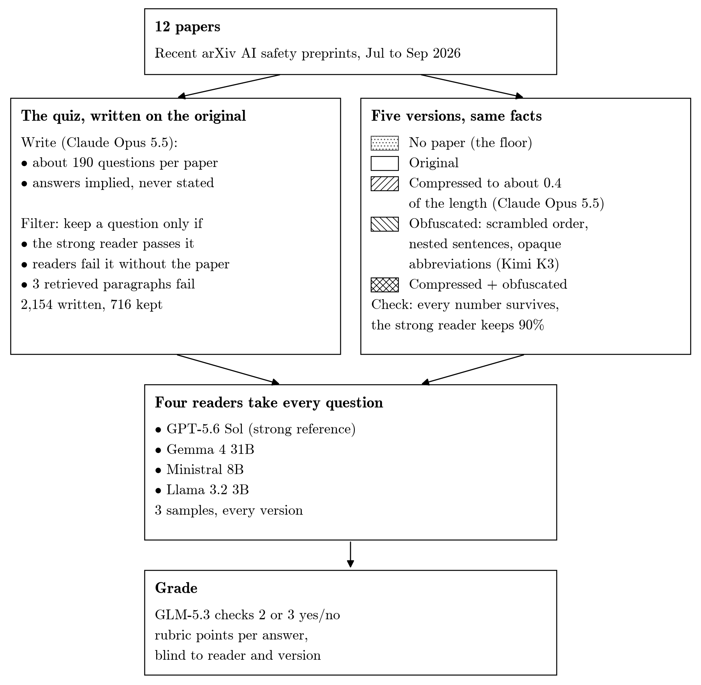
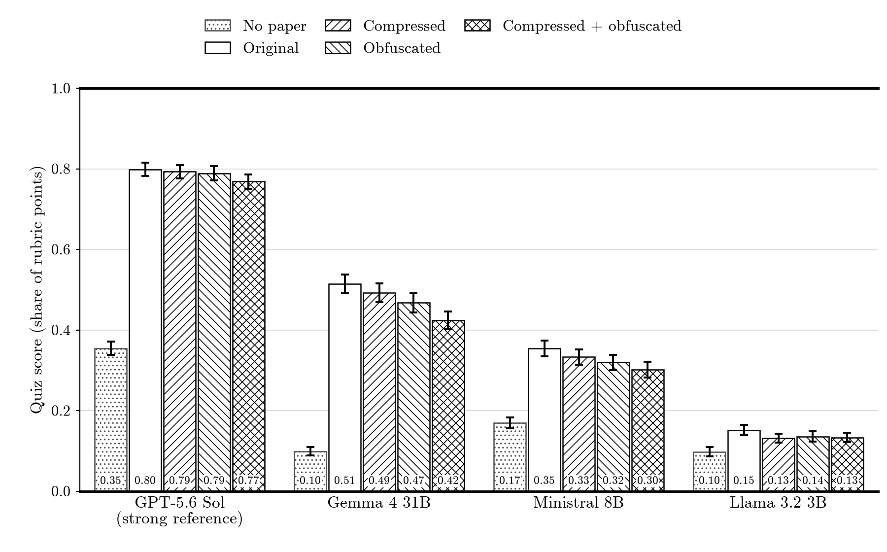
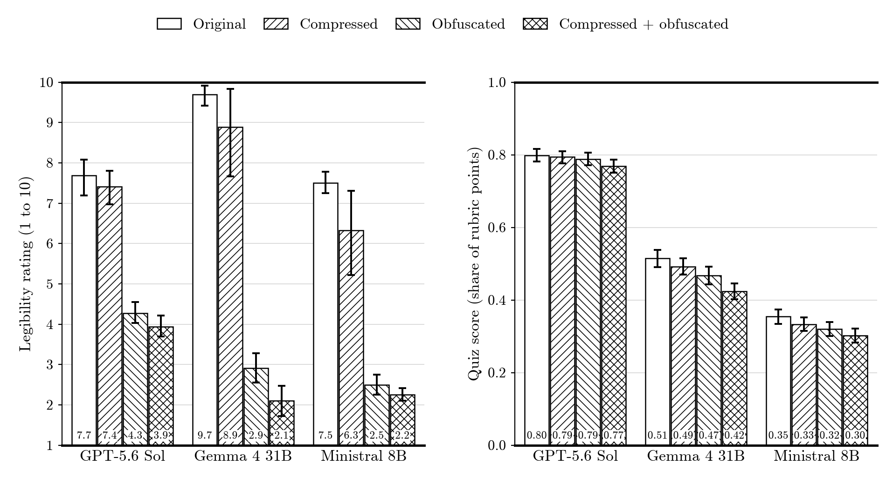
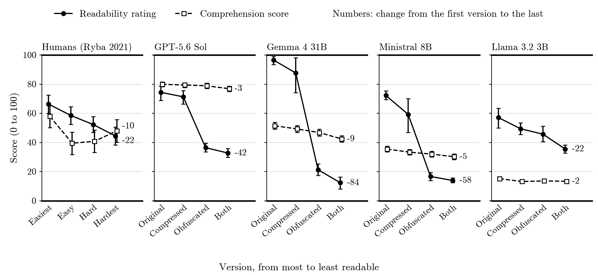
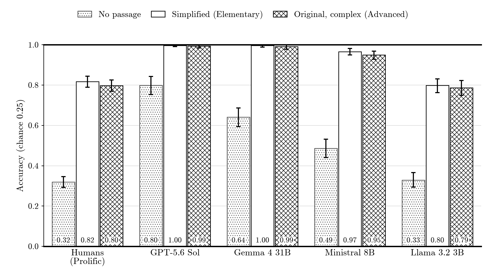
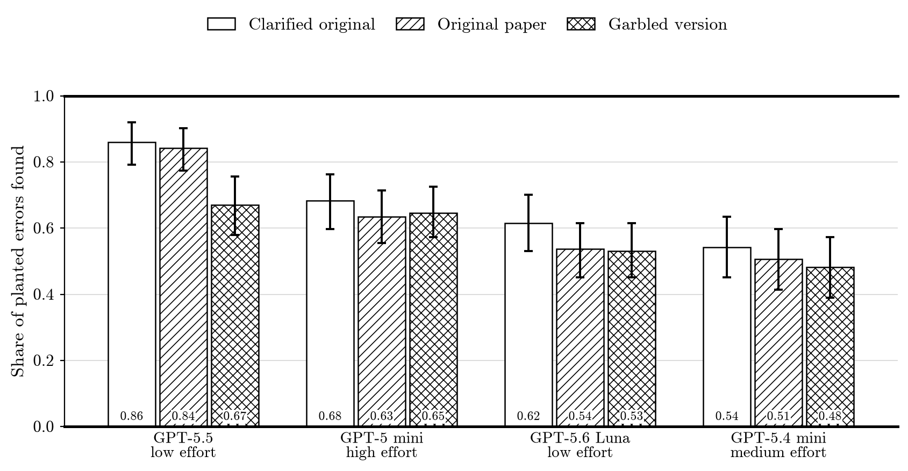
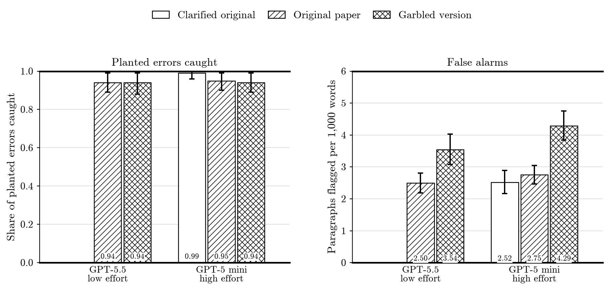

# Legibility of research papers to humans: an automated test, in parts

Averroes Labs is trying to build an automated test of whether a research paper is legible to people, one that a model
can run on any paper. This repository holds the posts written so far, in order, and the code and data behind them.
Each post can also be read on its own:

- [Part 1: Can a Quiz Test Whether a Paper Is Legible to Humans?](posts/part-1-quiz.md)
- [Part 2: Can a Reader That Catches Planted Errors Tell Whether a Paper Is Legible?](posts/part-2-planted-errors.md)

Below, the posts follow one another in full, then a guide to the repository.

---

## Part 1: Can a Quiz Test Whether a Paper Is Legible to Humans?

Jason Fantl, Averroes Labs · November 4, 2026

*Preliminary internal results, produced in three days. Please read them as initial signals, not definitive findings.*

**TL;DR.** We tried to build an automated test of whether a research paper is legible to humans. A strong model writes an open-book quiz on the paper, and weaker models take it. Rewriting papers to be hard to follow lowered the weaker models' quiz scores only slightly, much less than the gap between one model and another. Asked to rate legibility directly, the same models rated the rewrites as far harder to read, yet their ratings had little to do with how well they understood the text. A fluent paper with its key results quietly removed fooled most of the ratings, and a quiz written on that paper as well. In two published human studies, harder writing also hurt people's sense of readability more than their understanding, though less sharply than in our models. So the quiz's small effect may be partly realistic, and human data on our own papers is the next step.

### Why we want this

AI systems are starting to write a large share of AI safety research, and people can only oversee work they can follow. AI reasoning already drifts away from readable English, and optimizing outputs for correctness can make them harder for people to check. One fix is to have an LLM translate a hard paper into a readable one. Readers would then trust a translation nobody has audited, and each reader might get a different one. We would rather require the paper itself to be legible, and check this automatically at the scale at which AI will produce papers.

The idea is to turn a reading-comprehension quiz around. A normal quiz holds the text fixed and tests the reader. We hold the reader fixed and test the text. A paper counts as legible to a given reader if that reader, with the paper open, can answer questions that require understanding its methods, key results and conclusions.

**Premise and hypothesis.** We assume that rewriting a paper into scrambled, convoluted prose, with every fact kept, would slow a human reader down a lot, so a legibility test should detect it. If weaker LLM readers behave even roughly like people, their quiz scores should fall on the rewritten versions while the strong reader's score stays steady, which shows the information is still there. Comparing versions of the same paper separates how a paper is written from what it says.

### How we tested it



**Figure 1.** The experiment, read top to bottom. Each paper's quiz is written and filtered on the original. Every reader then takes it with no paper and with each version. The pattern next to each version is the one it has in the later figures.

**Papers.** 12 AI safety preprints from arXiv, posted July to September 2026 and drawn at random from interpretability, attacks, and alignment and oversight. They should postdate the readers' training data, and a no-paper condition measures how much the readers know anyway.

**Versions.** Each paper exists in four versions with the same facts. *Obfuscated* (written by Kimi K3) keeps the content and length but scrambles the order of ideas, uses long nested sentences and replaces named terms with opaque abbreviations. *Compressed* (written by Claude Opus 5.5) cuts the paper to about 0.4 of its length in terse shorthand, dropping background, motivation and repetition. *Compressed + obfuscated* does both. An *information check* guards against lost content. A script confirms that every number survives, and the strong reader must keep at least 90% of its original score on each version. A few versions fail the check. We flag them, and the pooled results barely change without them. A fifth condition, *no paper*, gives each reader's floor.

**The quiz.** The quiz is open book, with the whole paper in the reader's context, because the audit asks whether a reader can follow a paper. That makes looking things up the main way to pass without understanding, and in our first pilot most questions could be answered without the paper or from a few retrieved paragraphs. So the core rule, taken from reading-comprehension research, is that **answers must be implied by the paper but stated nowhere in it**. Claude Opus 5.5 first maps the paper's claims to the methods and results behind them. It then writes about 190 free-response questions per paper, covering failure modes and edge cases, why a result follows, counterfactual pairs, transfer to a new case, connections between distant parts of the paper, and whether a generalization is supported. Each question has a rubric of 2 or 3 yes/no points, first the conclusion and then the reason.

**Filtering.** Questions are filtered on the original paper only. A question is kept if the strong reader passes it with the paper, the readers fail it without the paper, and a mid-sized reader given only three keyword-retrieved paragraphs fails it, so lookup alone is not enough. The weaker readers' scores with the paper are never used to filter, because they are the measurement. Of 2,154 questions written, 716 (33%) were kept, between 11 and 95 per paper. One paper got only 11 because the writer's content filter refused it partway through.

**Readers and grading.** GPT-5.6 Sol is the strong reference, and Gemma 4 31B, Ministral 8B and Llama 3.2 3B are the weaker readers. All run through OpenRouter and answer every kept question in every condition, 3 samples each. GLM-5.3 grades each rubric point as met or not, without knowing the reader or the version, and quotes the words that earn each point. In our pilot a second grader model gave the identical score on 90% of answers. We have not yet checked the grading against humans. The 12-paper run cost about $250 in API calls.

### Result 1: the quiz detects the rewrite, but only slightly



**Figure 2.** Quiz score for each reader (groups of bars) in each condition (bar patterns, see the legend). The scale runs from 0 to 1, marked by the bold lines. Bars are means over 716 questions and 3 samples, and whiskers are 95% intervals. Compare bars within a group to see the effect of a rewrite, and across groups to see the effect of the reader.

Making a paper harder to read did lower the weaker readers' scores, and the harsher the rewrite, the larger the drop, while the strong reader held steady (Figure 2). That is the direction we hoped for, and the weaker readers lost more than the strong reader on most papers. But the drops are small.

They are small next to everything else that moves a score. Having the paper at all, and which model reads it, each matter far more than how the paper is written, so a quiz score mostly measures the reader. Papers also differ from each other more than versions of one paper do, which is why every comparison is between versions of the same paper. Llama barely beats its no-paper floor, so it has nothing to lose, and we leave it out of what follows.

For a tool that judges one paper at a time, this is the problem. Paper by paper, the versions sit within a few points of each other. Before seeing the results, we committed to counting a paper's drop only if it was at least 10 points and clearly above zero. Obfuscation never reached that on any paper, and the combined rewrite reached it on only a few. A rough estimate is that a single paper would need about one and a half times as many good questions as our best paper had to detect effects this small.

### Result 2: model ratings measure something else

A much simpler alternative to the quiz is to ask a model how legible a paper is. Each reader rated every version from 1 to 10 on how easy it would be for an ML researcher outside the subfield to understand. We name a human reader in the prompt, because asking about "a reader at your level" made each model rate by its own comfort. If the rating and the quiz measured the same thing, they would move together, and they do not.



**Figure 3.** Left: each model's rating, from 1 to 10, of how easy each version would be for a human ML researcher to understand (mean over 12 papers, 95% interval over papers). Right: the same model's quiz score on the same versions (95% interval over questions). If the ratings tracked understanding, the two panels would show the same pattern. Llama 3.2 3B is left out because its quiz scores sit near its no-paper floor.

The ratings and the quiz disagree (Figure 3). Every model rates the obfuscated versions as much harder to read, yet its quiz score barely changes, and compression alone hardly moves either. Models that understand very different amounts give similar ratings. Even within one model, the papers it rates hardest are not the ones it does worst on. Judging how readable a text looks and understanding it seem to be separate abilities. The ratings respond to the surface of the text, and the quiz to what the reader can work out.

Our best guess, which we have not tested, is that convoluted prose is hard for people because they must hold half-resolved references in memory, while a model has the whole paper in context at once. If so, the property we wanted to measure barely registers in these readers.

The ratings did spot our obfuscation more reliably than the quiz, and so did a standard readability formula, but only because this obfuscation is easy to see. A harder case is a paper that reads fluently but leaves out what the reader needs, which we test next.

#### A fluent paper with a hidden gap

Claude Opus 5.5 recorded each paper's crucial insight and the results that depend on it, then wrote two fluent versions.

- **Key insight implicit:** every fact and number stays, but the insight is never stated, results come without the reasoning behind them, and intuition, examples and summaries are cut, as a terse expert might write for other experts.
- **Key results removed:** the insight and the results that depend on it are cut, and the text is smoothed over so nothing looks missing. This tests completeness, and it is where a rating and a quiz should disagree most clearly.


**Figure 4.** The original and two fluent versions, one with the key insight left implicit (sparse lines) and one with the key results removed (dense lines). Left: legibility ratings, as in Figure 3. Middle: quiz scores, each on a quiz written for that text. The original and the implicit version, which keeps every fact, use the original quiz, and the results-removed version uses a new quiz written and filtered on it. Right: how many questions survived filtering per paper. Bars are means over papers with 95% intervals. One paper is left out on the right because the writer model's content filter cut its original quiz short.

Leaving the key insight implicit lowered the ratings a little and barely moved quiz scores. This was meant to be the real legibility test, but the writer kept most definitions, so the quiz has not yet faced a paper that is complete but genuinely hard to follow.

Removing the key results fooled most raters, who found the hollow paper as readable as the original. Only GPT-5.6 Sol noticed that the results sections no longer reported numbers. A quiz written on the hollow paper missed the gap too, because it can only ask about what that paper says, and readers can follow that. A quiz written on the full paper does catch the gap, but only by asking about results that are gone.

The hollow paper did leave one trace: fewer questions survive the filtering (Figure 4, right), because more of what is left to ask about is background a model already knows. Intact papers also vary widely in how many questions survive, so this is a weak signal. Catching an incomplete or wrong paper is closer to peer review than to testing whether a paper can be followed.

### Result 3: comparison with human readers

The quiz barely moved while the ratings fell sharply. To see whether people behave the same way, we compared our models with two existing human studies that rewrote texts with the content held fixed. We have no human data on our own papers.

**Science abstracts at four writing levels.** [Ryba et al. (2021)](https://www.frontiersin.org/articles/10.3389/fpsyg.2021.714321/full) had 170 students read three science abstracts, each rewritten at four writing levels, rate how easy each was to read, and answer two multiple-choice questions on it. The raw data is not public, so Figure 5 shows their published means next to our models.



**Figure 5.** One panel per reader, from people to the weakest model. Each panel shows the readability rating (solid line) and the comprehension score (dashed line), both on 0 to 100, across four versions from most to least readable. A falling line means that measure got worse as the text got harder, and the number at its end is the total change. For the models, "Both" is compressed + obfuscated. Humans: Ryba et al. (2021), published means with approximate 95% intervals. Models: our 12 papers, with the rating rescaled from 1 to 10 and the quiz score multiplied by 100.

People show the same pattern as our models, in a milder form (Figure 5). As the writing got harder, people's sense of how readable an abstract was fell faster than their understanding of it. For our models the gap is extreme, with ratings collapsing while understanding stays nearly flat. Part of that difference may come from our rewrite, which is far harsher than the one in the human study.

**News paragraphs, with the same questions for people and models.** [OneStopQA](https://github.com/berzak/onestop-qa) ([Berzak, Malmaud and Levy, 2020](https://aclanthology.org/2020.acl-main.507/)) has 324 multiple-choice questions on Guardian news paragraphs, each in its original and a teacher-simplified version, answered by Prolific participants (3 per question). We gave our four readers the same questions on both versions and with no passage. We added this check after the main study, and it cost about $2.



**Figure 6.** OneStopQA accuracy for people and our four readers with no passage, with the teacher-simplified version, and with the complex original of each news paragraph. 324 multiple-choice questions, where chance is 0.25; humans are 3 Prolific participants per question. Bars are means with 95% intervals over questions. Equal bars for the simplified and complex text mean the rewrite did not change accuracy.

On the news paragraphs, simplifying the text barely changed accuracy for anyone, people included (Figure 6). People did take longer on the complex paragraphs, so for them the harder text cost time more than correct answers. Two differences remain. Models and people struggle with different questions, and the strong models know many answers without the passage, probably because these older news articles are in their training data.

In both studies, and in [Ozuru et al. (2005)](https://escholarship.org/uc/item/0tw744hb), where making biology texts more cohesive improved accuracy only slightly, writing quality moved people's comprehension much less than their sense of how readable a text was. So part of the quiz's small effect may be realistic, and not only a sign that models read differently from people. The models' ratings, though, react far more strongly than people's, these studies used milder rewrites than ours, and none used research papers. Only human data on our own versions can settle how close the match is.

### Related work

We found no automated legibility test for papers that has been checked against human understanding, but several pieces come close.

**Legibility to a weaker model.** In [prover-verifier games](https://arxiv.org/abs/2407.13692) (Kirchner et al., 2024), a model learned to write grade-school math solutions that a much smaller model could check, and time-limited human checkers became more accurate on them too. It is the one result we know of where legibility to a model carried over to people. [Weak-to-strong legibility](https://arxiv.org/abs/2603.20508) (Roytburg et al., 2026) scores reasoning by how much it helps a weak model, but found no signal on knowledge-heavy questions once length was controlled, and did not test humans.

**Quizzes on papers.** [greCAPTCHA](https://arxiv.org/abs/2609.20481) (Payan et al., 2026) is closest to our design: GPT-5.6 Sol writes a quiz on a manuscript and a model grades the answers. It told authors from non-authors well (AUC 0.90), but it scores the reader, and we want to score the paper. [Comprehension Audits](https://arxiv.org/abs/2610.10064) (Bodkin et al., 2026) propose human oral audits of whether lab staff understand AI-written work.

**Simulated readers.** [KnowledgeGain](https://arxiv.org/abs/2605.31099) (Soós et al., 2026) built an LLM reader whose quiz answers matched humans on average. It got there by answering from a short summary instead of the full text and by tuning to human answers, and still correlated only 0.26 with humans topic by topic. Of 10 automatic metrics in [Guo et al. (2025)](https://arxiv.org/abs/2505.10409), only the quiz-based one tracked human comprehension, and weakly. Simulated students recover which math questions humans find hard ([Acquaye et al., 2026](https://arxiv.org/abs/2601.09953), r ≈ 0.8), with weaker models doing better than stronger ones, but prompting a strong model to act like a weaker student does not work ([Li et al., 2025](https://arxiv.org/abs/2512.18880)). Reading-comprehension models keep 95% of their accuracy with sentences shuffled ([Sugawara et al., 2020](https://arxiv.org/abs/1911.09241)), which fits how little obfuscation affected our readers.

**Model ratings.** LLM readability ratings agree reasonably with human readability ratings ([Cachola et al., 2025](https://arxiv.org/abs/2508.19221); [Trott and Rivière, 2024](https://arxiv.org/abs/2410.14028)). But in KnowledgeGain, a judge's clarity score correlated only 0.09 with what readers actually learned, and rewriting only a paper's framing raised AI-reviewer scores in 75% of attempts ([Yang et al., 2026](https://arxiv.org/abs/2606.13044)).

### What we take away

- **Writing the quiz works.** Requiring answers to be implied and never stated, and filtering out questions that can be answered without the paper or from a few retrieved paragraphs, gave enough usable questions for most papers. The filtering is wasteful, since most questions written get dropped, and the same pipeline works with any reader.
- **The reader is the weak link.** An LLM reader with the whole paper in context is barely affected by prose that every model rates as hard for a human, so its quiz score mostly measures its own ability. An off-the-shelf model cannot stand in for a human reader without evidence that it does.
- **Asking a model to rate legibility measures something else.** It catches visibly awkward text, but most models rated fluent text that had lost its key results as readable as the original, and the ratings depend heavily on how the question is framed.
- **A quiz can only test what the paper says.** Written on a paper with its key results missing, it asks about what is left, and readers pass. Catching missing or wrong content needs a different kind of check.
- **People show a milder version of the same gap.** In two human studies, harder writing hurt people's sense of readability more than their understanding, so a small quiz effect does not by itself show that the quiz fails. Human data on our own papers is the next step.

*Caveats: 12 papers, all AI safety preprints. One quiz writer, which also wrote the compressed versions. One obfuscation style. The strong reader both filters the questions and anchors the information check, so its stability is partly by construction. Reader models served through OpenRouter, not pinned weights. Only two rating prompts; another might capture prose and conceptual difficulty better. No human data on our own papers: the human comparisons use other texts, other questions and milder rewrites, so nothing here shows that any score tracks human understanding of research papers.*

---

## Part 2: Can a Reader That Catches Planted Errors Tell Whether a Paper Is Legible?

Jason Fantl, Averroes Labs · November 2026 · Part 2

*Preliminary internal results. This follows [Part 1](#part-1-can-a-quiz-test-whether-a-paper-is-legible-to-humans).*

**TL;DR.** In Part 1, rewriting papers to be hard to follow barely lowered a model's quiz score. Here we tried a more direct test of legibility, following a suggestion from Jan Kirchner. We planted an error in a paper, asked a model to find it, and planted the same error in a garbled version of the same paper. If writing quality matters to the reader, it should find fewer errors in the garbled one. With the whole paper in view, three of our four readers found about as many errors in garbled text as in the originals. The strongest, GPT-5.5, found clearly fewer, both on the four papers we designed the test with and on six peer-reviewed papers that played no part in the design. Asked about every paragraph in turn, GPT-5 mini and GPT-5.5 caught nearly every error in every version, but flagged more correct paragraphs in the garbled versions. So bad writing rarely stops a model from judging an error, but it can cost a strong reader in search and make a reader more suspicious of correct text. Of the changes we tried, only the choice of reader and the size of its memory moved a setting toward a calibrated test, so those are the levers to work with next.

### Why we tried catching errors

Part 1 asked whether a weak model with the paper open could answer questions that need understanding. Scrambled, convoluted rewrites lowered its scores by only about five points. A model holds the whole paper in context, so it can dig an answer out of bad prose that a person would give up on.

Jan Kirchner, whose [prover-verifier work](https://arxiv.org/abs/2407.13692) made model outputs easier for time-limited people to check, pointed out what a quiz misses. A reader that gives the right answer has not shown that it would notice a wrong one. On his view, a text is legible when the reader's answers are robustly correct, so a text written just as clearly but containing a mistake would not fool it.

His games trained a "sneaky" model to write such mistakes, which is tricky and possibly risky. We used his lighter alternative instead, planting errors from a small fixed set of templates. The hope was that catching an error needs the reader to hold a claim and its contradicting evidence together, which is exactly what hard writing gets in the way of.

### How we tested it

The test is as simple as we could make it. Plant one error in a paper and ask a weak model to review the paper for internal inconsistencies. Then plant the same error in a garbled version of the same paper and ask again, and repeat over many errors. If the reader finds fewer errors in the garbled version, its success depends on how the paper is written, which is what a legibility test needs. Nothing else is required, no quiz and no rewritten reference copy, only the paper, the errors and the reader.

**Papers.** Ten in all. The first four are the papers we started with, three of Part 1's arXiv preprints and the 2014 JMLR Dropout paper. We later added six papers accepted at peer-reviewed venues, drawn at random across lengths of about 4,000 to 15,000 words before anyone read them. Some experiments ran only on the first four.

**Garbled versions.** Each stacks every kind of difficulty we had. It compresses the paper to about two thirds of its length, swaps terms for opaque codes, moves evidence away from the claims it supports, and leaves connecting steps unstated. GPT-6.1 Sol checked it against the original until no fact or number was lost.

**Clarified versions.** As a known more-legible standard, Sol also rewrote each original as a structured explainer, with a summary first, a glossary, and each claim listed with its evidence. A separate check against the original confirmed nothing was lost or added. The clarified version only calibrates the test. The test itself runs on the submitted paper alone.

**Errors.** GPT-6.1 Sol planted errors from seven templates, such as a wrong number, a reversed comparison or a claim stretched beyond what was tested, one error per copy, and kept only the ones it could find itself in both versions. That left 82 errors across the ten papers.

**Readers.** We used OpenAI models only, the API we had. From strongest to weakest by how many errors they found, they were GPT-5.5 at low effort, GPT-5 mini at high effort, GPT-5.6 Luna at low effort and GPT-5.4 mini at medium effort, and every figure orders them that way. In the main test, each reader gets the whole paper and lists any internal inconsistencies, or none. Results 2 and 3 vary how the reader is asked and how much of the paper it can see. A cheap model graded whether each review named the planted error.

Everything here cost about $1,200 in API calls at OpenAI's list prices.

### Result 1: with the whole paper, only the strongest reader finds fewer errors in garbled text



**Figure 1.** Share of planted errors found by four readers (groups) reviewing the whole paper, pooled over all ten papers (82 errors), the four we designed the test with and six peer-reviewed papers that played no part in it. Plain bars are the clarified original, diagonal hatching the original, and crosshatching the garbled version. Whiskers are 95% intervals.

Each reader reviewed the whole paper and listed any internal inconsistencies. GPT-5 mini, GPT-5.6 Luna and GPT-5.4 mini found about as many errors in the garbled versions as in the originals, within 0.03 either way. GPT-5.5 was the exception. It found 0.84 of the errors in the originals and 0.67 in the garbled versions, a difference of 0.17 (interval 0.09 to 0.26). The gap held on both sets of papers, 0.20 on the first four and 0.13 on the six reviewed ones. No reader accused the unplanted passage of the planted error more than one time in twenty.

For three readers that made almost no difference, which is Part 1's result again from a different direction. GPT-5.5's gap is the first sign that a reader with the whole paper in view can pay for bad writing, and the first result in this project to hold on papers outside the set we designed with. It is still one reader of four on ten papers, and its catch rates on the two versions remain close enough that it cannot yet sort a single paper as legible or not.

### Result 2: asked about every paragraph, the reader catches nearly every error but flags more correct text when it is garbled



**Figure 2.** The reader has the whole paper and is asked about each paragraph in turn whether it is consistent with the rest. Left, the share of planted errors caught. Right, other paragraphs flagged per 1,000 words, including real inconsistencies already in the original papers. Hatching as in Figure 1. Whiskers are 95% intervals. GPT-5.5 was not run on the clarified originals, to save cost.

Result 2 removes the search step. The reader still has the whole paper, but we ask about every paragraph in turn, so it cannot miss an error by never looking at it. Because most paragraphs hold no error, this also measures how often the reader flags correct text.

GPT-5 mini caught nearly every planted error this way, in all three versions, so without the search garbling no longer hid errors. It did flag more correct paragraphs in the garbled versions, 4.3 per 1,000 words against 2.8 in the originals (a difference of 1.5, interval 1.0 to 2.1), and more on nine of the ten papers taken one at a time. GPT-5.5 behaved the same way, more mildly. It caught 0.94 of the errors in both versions and flagged 3.5 correct paragraphs per 1,000 words in the garbled versions against 2.5 in the originals (a difference of 1.0, interval 0.5 to 1.6), again more on nine of the ten papers. Some flags land on real contradictions in the original papers, such as a count given as 15,840 in the abstract and 18,480 later, and these raise every version alike. The extra flags on garbled text are a second place a legibility signal could show up, next to missed errors.

We also told all four readers which passage holds the error and asked only about that passage. Each judged the error about as well in garbled text as in the original, catching 0.82 to 0.98 of errors in the garbled versions and 0.90 to 0.99 in the originals over all ten papers. So what bad writing costs these readers lies in finding errors and in flagging correct text, not in judging them.

### Result 3: reading one section at a time, only GPT-5.5 found fewer errors, and not on new papers


**Figure 3.** Share of planted errors found by readers that read each paper once, one section at a time, with notes of at most 300 words. The first four groups read the first four papers, the only ones these readers saw this way. The last group, right of the dotted line, is GPT-5.5, the one reader that showed a gap there, with its settings frozen and run on the six reviewed papers. Hatching and whiskers as in Figure 1.

Result 3 makes the reader read more like a person. It goes through the paper once, one section at a time, rewrites notes of at most 300 words after each section, and cannot look back. A code defined pages earlier, or evidence far from its claim, should then cost it something.

For three of the four readers it did not. GPT-5.5 found 0.82 of the errors in the originals and 0.64 in the garbled versions, a difference of 0.18 (interval 0.02 to 0.34), but with its settings frozen the difference vanished on the six reviewed papers, at 0.66 against 0.68. The clarified versions helped every reader, so reading section by section made the readers sensitive to clearer writing, but not reliably to worse writing.

### Toward a calibrated test

The line between legible and illegible is drawn by people. A paper they can follow should pass, and one they cannot should fail. We cannot move that line, but we can tune the test to match it. Two things are tunable: the weak reader (which model, how much effort, how much of the paper it sees and remembers) and the planted errors (what kind of mistake, and how far each sits from the evidence that contradicts it).

To calibrate, we would run a setting on text whose legibility to people we already know, such as published papers, which people can follow, and garbled versions, which they cannot. A calibrated setting catches most errors in the first and few in the second. We have not done this tuning yet. Every setting in this post was fixed before we ran it, so Figure 4 only maps where those settings landed.


**Figure 4.** Each point is one reader setting. Its position shows the share of planted errors caught in the original papers (horizontal) and in their garbled versions (vertical). Circles read the whole paper, triangles were asked about every paragraph, and squares read one section at a time. On the dashed diagonal a setting cannot tell the two apart, and the green corner is the target.

Most settings sit near the diagonal. To calibrate, we need to know which changes move a setting off it and in which direction, so Figure 5 traces every change we have measured on the same map.


**Figure 5.** Each panel is the map of Figure 4, with the same axes, for one kind of change, measured on the first four papers, the only ones every setting was run on. Arrows run from the starting setting (open circle) to the changed one (filled circle). The last two panels split GPT-5.5's 44 errors by the difficulty each was built at and by how far its contradicting evidence sits, 11 to 19 errors per subset.

Only two changes moved a setting off the diagonal. The first is the choice of reader. GPT-5.5 is the one reader whose catch rate falls on garbled text, and it stays below the diagonal whether it reads the whole paper or one section at a time. The second is memory. Cutting GPT-5.5's notes from 1,200 words to 300 cost it a few errors in the originals and many more in the garbled versions, so its gap grew as the notes shrank. Everything else slid settings along the diagonal or up to the top corner. Reading one section at a time made the weaker readers miss more errors in both versions alike, and telling readers where the error is moved them all to the ceiling.

The errors themselves gave little to work with. Splitting GPT-5.5's errors by difficulty or by distance to the evidence moved it around a small region below the diagonal, and no subset came near the target. These subsets are small, so we read nothing more into them.

None of this is specific to planted errors. Part 1's quiz can be calibrated the same way. Its score is also a weak reader's success on text, measured on originals and on hard-to-read rewrites, so each quiz setting is a point on the same map. There the tunable parts are the reader and the questions, such as how much of the paper an answer needs and how far apart the facts it combines sit. Part 1's readers lost about five points on the rewrites, which puts them near the diagonal, where most settings here sit too. Any test that scores a reader on text people can follow and text they cannot can be placed on this map and tuned toward the target in the same way.

### What this means

A direct test of legibility needs a reader that pays something for bad writing. With the whole paper in view, three of our four readers pay almost nothing. GPT-5.5 pays in finding errors, on new papers as well as the ones we designed with, though the cost is still too small to sort a single paper. Asked about every paragraph, GPT-5 mini and GPT-5.5 pay in another way, by flagging more correct text when it is garbled.

Several parts of the test work, and all of them need nothing but the paper itself. Errors can be planted and checked automatically, readers rarely accuse clean papers of them, a cheap grader scores reviews reliably, and pointed questions separate finding an error from judging it.

The method may still work. Every reader found more errors in the clarified versions, so readers do respond to how text is written, and the two changes that moved a setting off the diagonal, a strong reader and a small memory, both make the reader pay for bad writing.

### Related work

Prover-verifier games ([Kirchner et al. 2024](https://arxiv.org/abs/2407.13692)) trained a helpful and a sneaky prover against a small verifier. Outputs trained this way became easier for time-limited people to check. We keep the small checker, but replace the trained sneaky prover with errors planted from fixed templates, as Jan Kirchner suggested.

Benchmarks of error detection in scientific papers ask whether a model can find real mistakes. They hold the paper fixed and test the reviewer, while we hold the reviewer fixed and vary the writing.

Other work has also found that writing which slows people barely touches models. OneStopQA rewrote the same articles at three reading levels with the same questions. People did worse on the hardest level, while a RoBERTa reader scored 85.6, 85.0 and 86.0 ([Berzak et al. 2020](https://arxiv.org/abs/2004.14797)). Simplifying text helps people but lowered the accuracy of GPT-4o-mini and Llama-3.1-70B by up to 20 points ([Anschütz et al. 2025](https://aclanthology.org/2025.gem-1.70)). GPT-4 kept 88% of its question-answering accuracy when every word's inner letters were scrambled ([Cao et al. 2023](https://arxiv.org/abs/2311.18805)), and RoBERTa kept its answers on sentence pairs with shuffled words that two human experts scored 58% and 38% on, against 33% by chance ([Sinha et al. 2021](https://aclanthology.org/2021.acl-long.569)). What does hurt models is different from what hurts people. Shuffling the premises of a proof, adding one plausible but irrelevant clause, or making the reader link facts that share no words all cost strong models many points ([Chen et al. 2024](https://arxiv.org/abs/2402.08939); [Mirzadeh et al. 2024](https://arxiv.org/abs/2410.05229); [Modarressi et al. 2025](https://arxiv.org/abs/2502.05167)). Weaker models are far more fragile to scrambling, and GPT-3.5 lost half its accuracy where GPT-4 lost a tenth (Cao et al. 2023). Part 1's quiz result and this post's Result 1 fit that pattern.

People have been tested in pieces of this design, never as a whole. Peer reviewers given manuscripts with planted flaws report about a quarter to a third of them ([Godlee et al. 1998](https://europepmc.org/article/MED/9676667); [Schroter et al. 2008](https://pmc.ncbi.nlm.nih.gov/articles/PMC2586872)), and a checklist naming what to look for raises detection at the cost of more false alarms ([Chauvin et al. 2019](https://pmc.ncbi.nlm.nih.gov/articles/PMC6864983)). Students miss contradictions planted in short texts more often when the two statements sit far apart or need an inference to connect ([Baker 1985](https://files.eric.ed.gov/fulltext/ED237577.pdf); [Epstein et al. 1984](https://link.springer.com/article/10.3758/BF03198295)), which is what our garbling does. We found no study that plants the same error in clear and garbled versions of a text and asks people to find it.

### Limitations

- **Small samples.** The first four papers have 44 errors and the six reviewed papers 38. That gives intervals of about ±0.1 on rates over all ten papers and ±0.15 on rates over four.
- **Many tries.** We tried several readers and ways of asking, and two combinations, both with GPT-5.5, showed a difference on the first four papers. In that many tries, some result is likely to look good by chance. The section-by-section difference did not hold on the reviewed papers and the whole-paper one did, but it is still one reader on ten papers. The false-alarm difference in Result 2 was not planned as a test before we saw it, and its intervals cover paragraphs, not differences between papers.
- **The garbled versions were not checked with people.** We assume they are hard for a person to follow, and Result 1 suggests they are not hard for most models. If they are easy for people too, the test was never really challenged.
- **Legibility to people is assumed, not measured.** We treat the original and peer-reviewed papers as legible because they were written and reviewed for people. We have not measured how people read them.
- **One provider.** Every reader, writer and grader was an OpenAI model, so their blind spots may be shared.
- **Our errors.** We chose the error templates. Two kinds, a result left out of a summary and a claim with no support, could not yet be tested properly, and naturally occurring errors may behave differently.
- **A strong model is the referee.** GPT-6.1 Sol built and checked the errors, the garbled versions and the clarified versions. Its own mistakes would pass into the results unnoticed.

The next step is to calibrate for real. We would try these levers on the first four papers, pick a setting by a rule fixed in advance, check it on the six reviewed papers, and only then run it once on nine papers held out from everything so far. The repository that accompanies this post holds the code, prompts, raw model outputs and every experiment's preregistered predictions, so each result here can be rerun. A detailed reference report written for AI agents, [`docs/part2-agent-report.md`](docs/part2-agent-report.md), gathers every number behind this post with its source, so an agent can answer questions about it without searching the repository.

---

## About this repository

This repository holds the code, prompts, model outputs and analysis behind the posts above, so anyone can check a number or rerun a step. It is a cleaned copy of our working repository. The work was run by an AI research agent (Claude) with Jason Fantl as PI, which is why the logs are written in the first person and some files mention internal notes (`STATE.md`, `INBOX.md`, `CLAUDE.md`) that are not included here.

### Where things are

| Path | Contents |
|---|---|
| `docs/report-v2.md` | The full technical report, with every number, interval and follow-up |
| `docs/preregistration-v2.md` | Predictions and analysis plans, each committed before its results were collected |
| `docs/plan-v2.md`, `docs/experiment-plan.md`, `docs/quiz-design.md`, `docs/goals.md` | Goal and design |
| `docs/decisions.md`, `docs/run-log.md` | Every design decision with its reason, and every run, failure and rerun |
| `docs/pilot-report.md`, `docs/preregistration.md` | The earlier 6-paper pilot that led to plan v2 |
| `docs/blog/` | Figures in this post (`scripts/blog_figures.py`) |
| `docs/figures/` | Report figures, light and dark (`scripts/quiz/make_figures.py`) |
| `scripts/quiz/` | The pipeline: `prompts.py` (all prompts), `versions.py` (rewrites), `write_v2.py`, `filter_v2.py`, `takes_v2.py`, `judge_v2.py`, `gap_v2.py`, `gap_requiz.py`, `gap_imp2.py`, analysis in `analyze_v2.py` and `ci_v2.py` |
| `scripts/onestop/run_onestop.py` | The OneStopQA comparison |
| `scripts/select_papers.py`, `scripts/paper_text.py` | Paper selection rule and arXiv HTML to text conversion |
| `data/selection/` | The sampling frame and the selection log |
| `data/papers/` | Paper texts and metadata; see `data/papers/ATTRIBUTION.md` |
| `data/runs/v2-<paper>/` | Per paper: rewritten versions, the quiz, filter results, every answer and grade, ratings, and `calls.jsonl` with every model call and its cost |
| `data/runs/v2rem-<paper>/` | Follow-up 2, the quiz written on the key-results-removed version |
| `data/onestop/` | OneStopQA human data (copied from the original release) and our model answers |
| `data/analysis/` | The analysis outputs every reported number comes from |
| `reports/`, `research_notes/` | Literature reviews done for the design and the related-work section |

### Rerunning

You need Python 3.12 and an [OpenRouter](https://openrouter.ai) key. Put the key in `.env` (copy `.env.example`), then `pip install -r requirements.txt`.

Every model call is cached in a `calls.jsonl` file keyed by its full request, so rerunning a script with the data here replays the cached replies at no cost and rebuilds every analysis file. Delete a run directory's `calls.jsonl` to make fresh calls. Fresh calls will not match exactly, since the models are served through OpenRouter and their weights and providers are not pinned.

```
python scripts/quiz/run_v2.py <paper> [<paper> ...]   # versions, quiz, filters and takes for the main study
python scripts/quiz/judge_v2.py rate                 # legibility ratings
python scripts/quiz/gap_v2.py run                    # hidden-gap versions, takes and ratings
python scripts/quiz/gap_requiz.py run                # Follow-up 2
python scripts/quiz/gap_imp2.py run                  # Follow-up 3
python scripts/onestop/run_onestop.py run            # OneStopQA
python scripts/quiz/analyze_v2.py                    # pooled analysis -> data/analysis/
python scripts/quiz/ci_v2.py                         # intervals for the figures
python scripts/blog_figures.py                       # figures in this post
```

Each script's docstring gives its options and outputs. The full study cost about $650 in API calls, mostly for writing and filtering quizzes.

### Licences

Code is under the MIT licence (`LICENSE`). Our text, quizzes, model outputs and analysis are under [CC BY-SA 4.0](https://creativecommons.org/licenses/by-sa/4.0/) (`LICENSE-DATA.md`). The papers belong to their authors and are shared under their own Creative Commons licences, listed in `data/papers/ATTRIBUTION.md`; the rewritten versions deliberately distort them and are not the authors' work. The OneStopQA data is © Berzak, Malmaud and Levy, CC BY-SA 4.0 (`data/onestop/human/`).
