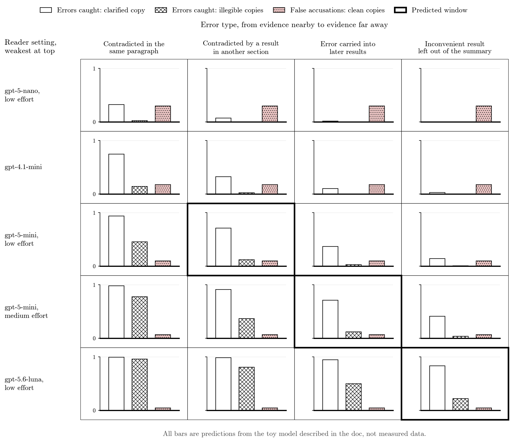

# Calibration grid for the error-catching audit

Written 2026-11-12, before any v4 data. The figure and the key are generated by [`scripts/calibration_table.py`](../scripts/calibration_table.py). Edit the script, not the generated section, and rerun it.

## What calibration is for

The audit plants errors in a submitted paper and in a clarified copy of it, and asks a weak reader to review both. If the reader catches errors in the clarified copy but misses them in the submitted paper, the writing is what stopped it. Calibration is the search for settings that make this comparison track legibility. Once found, the settings are frozen and used, unchanged, on new papers.

The settings we search over and then freeze:

- the reader model and its reading budget
- the error templates
- the clarification prompt
- the review and grading prompts

## Calibration data

On each development paper we build copies whose legibility we control.

- **Clarified copy:** a faithful rewrite that explains terms, assumptions and steps, written from the clean paper before any error is planted. It is our known-legible standard here, and in the frozen audit it is the reference the submitted paper is compared against. So its prompt is one of the settings being tuned.
- **Illegible copies, several kinds:** jargon without explanation, sections reordered, compressed, and all three combined, which is V1's obfuscation. Using several kinds keeps us from tuning to the signature of one obfuscator, such as V1's placeholder codes.
- **Held-out kind:** a fluent copy with the connecting steps left implicit. It is never used to choose settings, only to check them afterwards. It is the kind closest to real illegible writing, so it is the most important check.
- **Originals:** the Dropout paper serves as a clearly written original, which should score close to its clarified copy. Recent arXiv originals are reported but not used to choose settings, because we do not know their legibility.

The same errors are planted in every copy of a paper, so the difficulty of the subject and of each error cancels out between copies.

## The grid

**This figure is a prediction, not data.** Each cell is one reader setting, a row, with one type of error, a column. Bars show the share of planted errors caught in the clarified copy (plain), the share caught in the illegible copies (crosshatched), and the share of clean reviews that accuse the paper of the planted error when it is absent (dotted). Outlined cells meet the selection rule below. There is one grid per clarification prompt.

The predicted values come from a toy model in the script. A reader catches an error with a probability that rises with the reader's strength and falls with the error's difficulty, and illegibility adds a fixed amount of difficulty. Weaker readers are assumed to make more false accusations. The numbers are assumptions chosen to show the shape we expect: a floor where weak readers meet hard errors, a ceiling where strong readers meet easy errors, and a diagonal window between them where the clarified copy is caught and the illegible copies are not. V1 and the strongest reader in v3 sat on the ceiling. The row order is also a guess, and the experiment measures it.

The experiment fills this grid with measured rates. We start with a coarse pass, a few errors per type on three papers, to find roughly where the window is, and then spend samples on the cells near it.

## Key: what a cell's pattern means and where to move

Gates come first. A cell cannot be read until both pass.

<!-- key:start -->
| Clarified copy | Illegible copies | What it means | What to do |
|---|---|---|---|
| **Gate:** Clean copies get accused | Any cell | No catch rate can be read. A reader that flags everything also catches every planted error. | Let the prompt allow the reader to report no errors. Require each finding to name the claim and the evidence against it. Read a sample of accusations by hand. If a clean paper really has the flaw, set that error aside and record it. |
| **Gate:** Error fails a construction check | Any cell | The strong reader cannot find the error in some copy, or the pair check finds it planted unequally. | Repair or remove the error before any weak reader sees it. These checks never use weak-reader results, so removing errors here cannot bias the comparison. |
| Low | Low | Floor. The reader cannot check these errors even in clear text. | Move down the grid to a stronger reader or larger budget, or left to errors with nearer evidence. Use the pointed check to tell a reader that cannot find the error from one that cannot reason it through. |
| High | High | Ceiling. The reader sees through the illegibility, as in V1. | Move up to a weaker reader or smaller budget, or right to errors with more distant evidence. Run the local-window check, since an error caught from its paragraph alone does not test following the paper, and the edit-artifact check, since a planted passage can stand out against obfuscated text. |
| Low | High | The clarified copy makes errors harder to find. This is a clarification problem, never a reader problem. | Run the fidelity and pair checks, and the pointed check on the clarified copy. Fix the clarification prompt, for example by keeping evidence near claims or capping length, and rebuild. |
| High | Low | Desired. | Confirm the cell before trusting it. A clear original such as Dropout should score close to its clarified copy. False accusations should stay low. The held-out kind of illegibility should also score low. |
<!-- key:end -->

## Checks named in the key

Each check costs a few calls per error. The strong reader is gpt-6.1-sol, or gpt-5.6-sol if cost matters.

| Check | What we run | What it tells apart |
|---|---|---|
| Strong reader | The strong reader reviews the same copy with the same prompt | An invalid error, or one whose evidence is missing from this copy, from a reader that is simply too weak |
| Pair | The strong model compares the planted passage and the evidence needed to refute it across copies | Errors planted unequally, or with evidence present in one copy only |
| Fidelity | The strong model compares the clarified copy with the original for added or lost content | A clarification that adds facts or drops evidence. Run once per clarified copy, before errors are planted |
| Pointed | The weak reader is told which section and claim to examine | A reader that cannot find the error from one that cannot reason it through |
| Local window | The weak reader gets only the paragraph with the error and its neighbors | Errors that can be caught without following the paper |
| Edit artifact | A model is asked which passage looks edited or out of place, with no mention of errors | Planted passages that stand out by style |
| No paper | The weak reader is asked about the altered claim without the paper | Catches from memory, which matters for Dropout |

## Selection rule

Proposed here before any data, for Jason to approve or change. A setting is a reader, a budget, a set of error templates and a clarification prompt. Rates are per paper, over about 8 errors with 3 samples each, then averaged over development papers.

A setting qualifies if, on the development papers:

1. errors are caught in the clarified copy at least 70% of the time,
2. errors are caught in the illegible copies, pooled over the kinds used for tuning, at most 35% of the time,
3. clean copies are accused of a planted error at most 10% of the time, in every copy,
4. the Dropout original scores at least 80% of its clarified copy's catch rate.

Among qualifying settings we choose the one with the largest gap between clarified and illegible catch rates, and break near-ties in favor of the cheaper setting.

Jason's original design counts only errors the reader catches in a separate set of reads of the clarified copy. Under that design, condition 1 becomes the share of errors that survive selection, and the gap is measured among the survivors. The grid reads the same way. Selecting errors this way matches each error's difficulty to the reader automatically.

## After selection

1. **Held-out kind of illegibility.** At the chosen setting, the fluent copy with implicit steps should show a gap of at least half the development gap. If it does not, the setting has learned our obfuscators, and we return to the grid.
2. **Freeze.** Record the reader, budget, prompts, templates, checks and selection rule, with versions.
3. **Fresh papers.** Run the frozen audit, unchanged, on about five papers never used in calibration, each with clarified and illegible copies. The gap should hold.
4. **Humans.** On two or three of those papers, timed human readers do the same task on the clarified and illegible copies. This is the first evidence that the audit tracks legibility to people and not only to models.

## Limits

- Legibility by construction means easier or harder as we built it. V1's judges agreed strongly that the obfuscated copies were harder, but whether people find them harder by the same amount is the human check in step 4.
- Choosing among many settings on about a dozen papers will make the best setting look better than it is. Steps 1 and 3 exist to catch that.
- A paper that passes shows that the reader can check the kinds of errors we planted. A real error of another kind could still go unnoticed.
