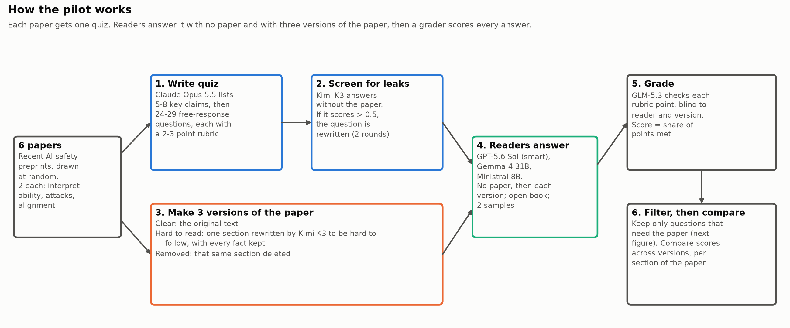
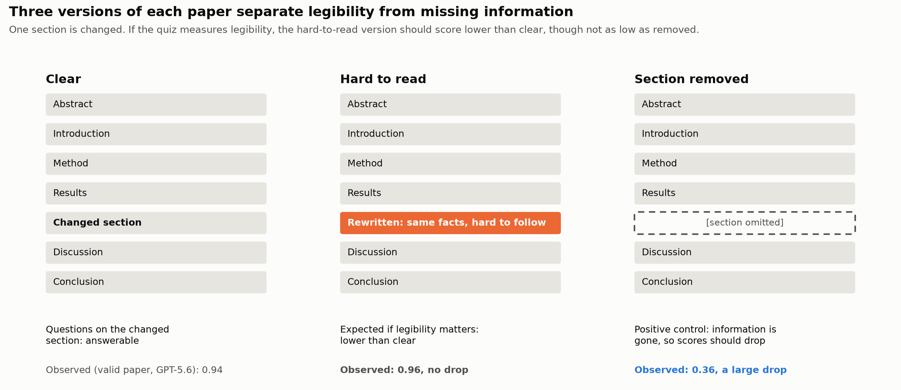
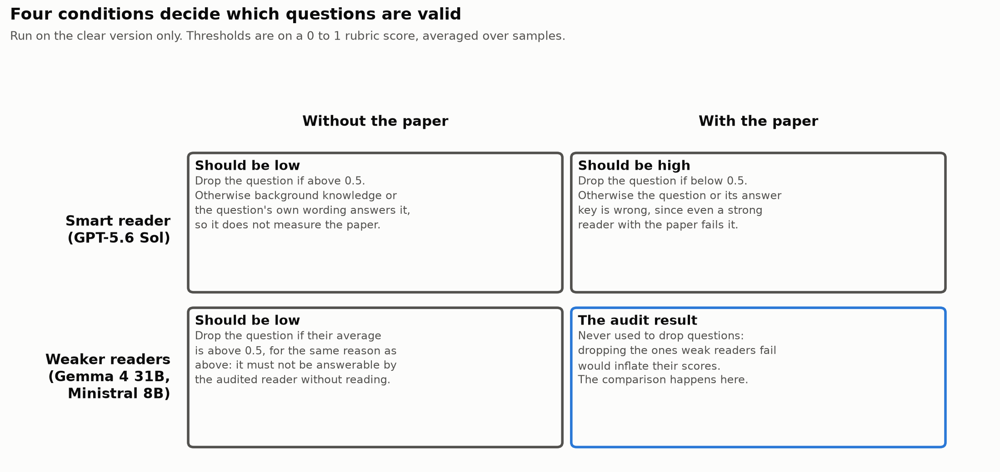
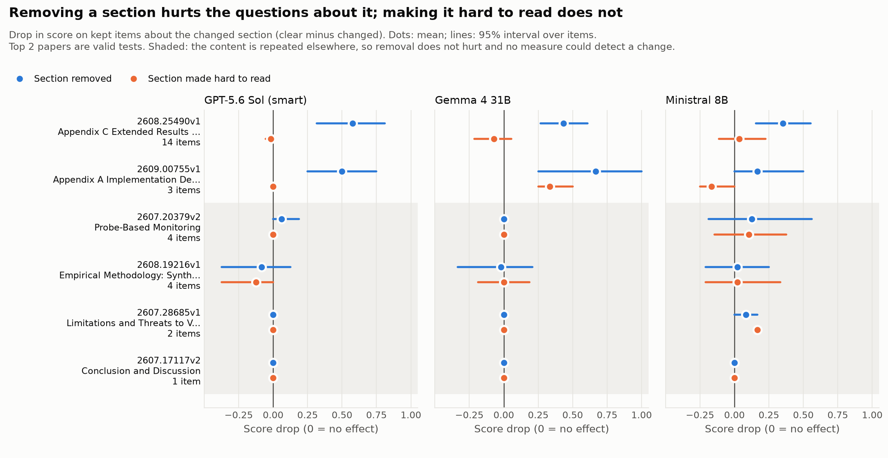
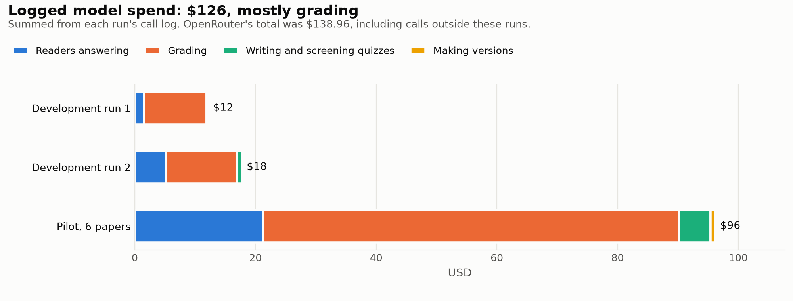
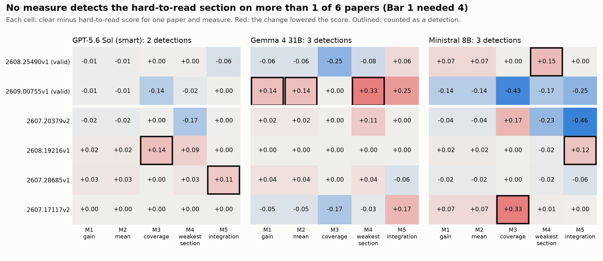
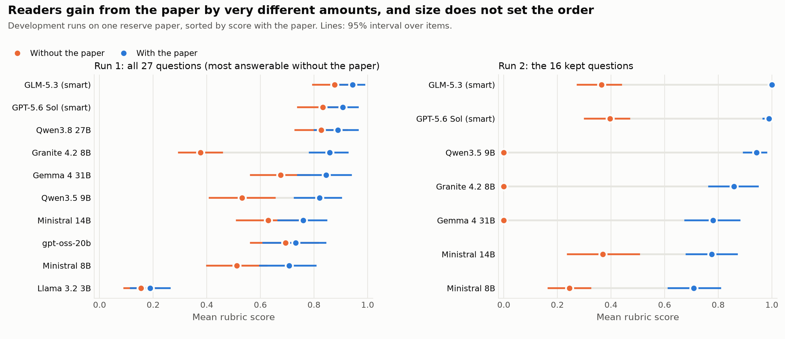
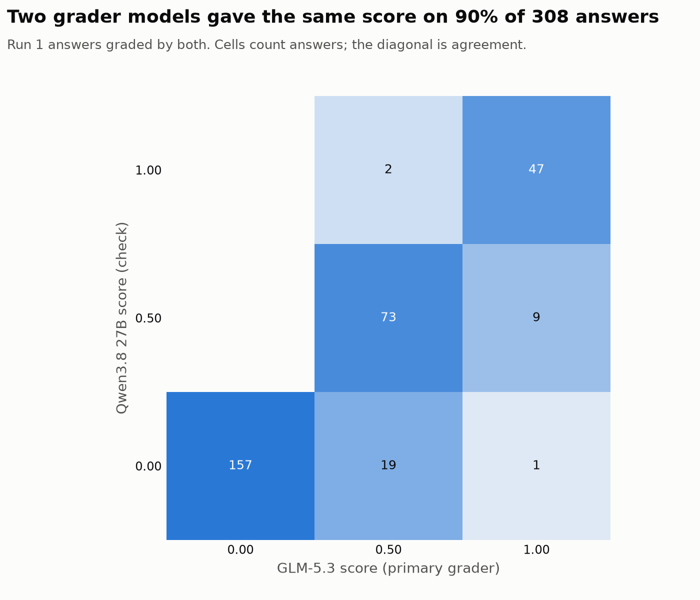
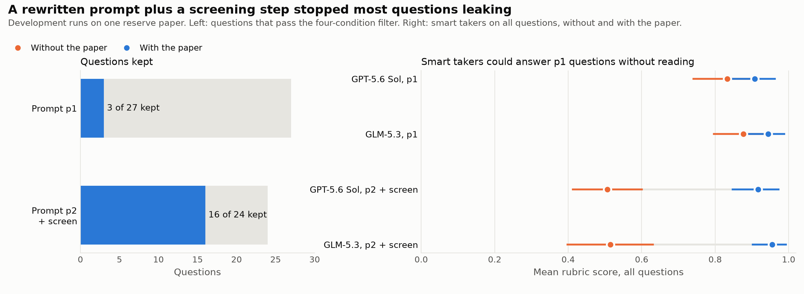
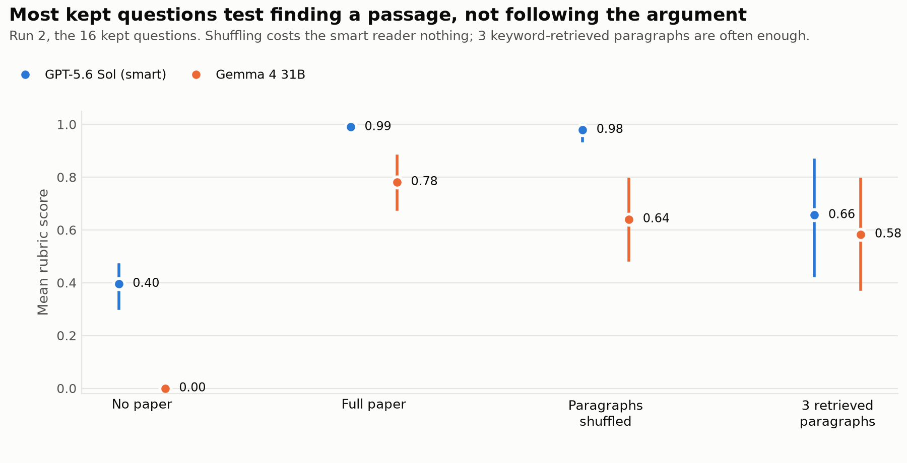

# Pilot report

Last updated 2026-11-03 11:10 UTC. **The scaled-down pilot is finished: 6 of 6 papers** ([`docs/preregistration.md`](preregistration.md)). The bars it is judged by are proposed and **not yet approved by Jason**. Anything marked exploratory was decided after seeing results.

## How the experiment works

**The question:** if part of a paper is hard to read, does a weaker model's quiz score show it? If so, a quiz could audit whether a paper is legible without a person reading it.

<picture>
  <source media="(prefers-color-scheme: dark)" srcset="figures/design-pipeline-dark.png">
  
</picture>

### 1. Papers

Six recent AI safety preprints from arXiv, two each on interpretability, attacks, and alignment and oversight. They were drawn at random by a rule committed before drawing, so nobody picked easy or hard papers.

- **Why recent (July to September 2026):** readers should not already know the paper, so their score has to come from reading it.
- **Why only 6:** the full design (12 papers, 3 quizzes each) would have cost about $1,400, mostly in grading, against a $150 overnight limit.
- **Development first:** the pipeline was tuned on a separate reserve paper, so tuning could not bias the 6 pilot papers.

### 2. Writing the quiz

Claude Opus 5.5 reads the paper and lists its 5 to 8 key claims, each tagged with the sections that support it. It then writes at least 3 questions per claim, plus a few that need several sections together: 24 to 29 questions per paper.

- **Open book:** readers have the paper while answering. The audit asks whether a reader can follow the paper, not whether it can remember it.
- **One inference beyond the text:** each answer must follow from the paper by one step of reasoning (change a condition, connect two sections, apply to a new case, or spot a wrong version). Finding one sentence is not enough, but no extra intelligence or outside knowledge is needed.
- **Free response, graded by rubric:** each question has 2 or 3 rubric points, such as the conclusion and the reason. Multiple choice was avoided because another study found it easy to answer by searching the text.
- **Claims and section tags:** these give scores per claim and per section, so a measure can notice one opaque section that an average would hide.

**Example** (MMJailBench paper, a "connect sections" question):

> *In the paper's table of per-model factor ranges, qwen2.5-vl-7b has a prompt-framing range of about 90 points, although its average ASR is only about 59%. How is this possible, given how the paper defines the range and its per-framing results?*
>
> Rubric: (1) explains that the range is the maximum minus the minimum across framings, not an average; (2) uses academic framing (about 91%) minus system framing (about 1%) to get about 90 points.
>
> All three readers scored 1.0 with the clear paper, 1.0 with this section made hard to read, and 0.5 with it removed. That pattern is the pilot's whole result in miniature.

### 3. Screening for leaks

Kimi K3 answers each question **without** the paper. Questions it answers too well (above 0.5) go back to the writer for up to 2 rewrites.

- **Why:** in the first development run, a smart model could answer 24 of 27 questions without the paper, because questions described the method or gave the numbers needed. For example, "The judge flags 100 of 1,000 responses as mismatches, and 270 succeed. Compute ASR and CASR" became "Suppose OCR mismatches were eliminated entirely while successes stayed the same. What would OCR's CASR become?"
- **Why Kimi K3:** it is neither the writer nor a reader, so the readers stay an independent check on whether screening worked.

### 4. Three versions of each paper

<picture>
  <source media="(prefers-color-scheme: dark)" srcset="figures/design-versions-dark.png">
  
</picture>

One section is changed, picked at random among sections that support a key claim (never the abstract or introduction).

- **Hard to read:** Kimi K3 rewrites the section with the same facts, numbers and definitions, but scrambled order, long nested sentences and new abbreviations. A script and a smart reader checked that no information was lost.
- **Removed:** the same section is deleted. This is the positive control: it proves the questions depend on that section. If removal does not hurt, the paper cannot test legibility at all.
- **Why both:** a drop for "hard to read" alone could mean the rewrite lost information. Comparing it with "removed" separates the two.

The random pick turned out to be a weakness: on 4 of 6 papers it landed on content the paper repeats elsewhere, so removing it did not hurt and those papers could not test anything.

### 5. Readers take the quiz

Three readers answer every question:

- **GPT-5.6 Sol, the smart reader:** checks that questions are answerable from the paper, and that the hard-to-read version still contains the information.
- **Gemma 4 31B and Ministral 8B, the weaker readers:** the readers being audited. Ministral 8B was the weakest model in development that still clearly gained from the paper.

Each reader takes the whole quiz in one sitting, four times: without the paper, then with each version. Each sitting runs twice, to measure noise. Readers get the paper's text with figure captions but not the figures.

### 6. Grading

GLM-5.3 checks each answer against its rubric points, without seeing the paper or knowing which reader or version produced it. The score is the share of points met, from 0 to 1. On 308 answers graded by both GLM-5.3 and Qwen3.8 27B, the two gave the same score 90% of the time.

### 7. Filtering questions, then comparing

<picture>
  <source media="(prefers-color-scheme: dark)" srcset="figures/design-filter-dark.png">
  
</picture>

The filter keeps 14 to 26 questions per paper. The kept questions are then scored five ways, comparing clear with hard to read:

| Measure | What it asks |
|---|---|
| M1 gain | How much does the reader gain from the paper on average? |
| M2 mean | How well does the reader score with the paper on average? |
| M3 coverage | What share of key claims does the reader get right? |
| M4 weakest section | How well does the reader do on its worst section? |
| M5 integration | How well does the reader do on questions that need several sections? |

A measure "detects" the hard-to-read section on a paper if the score drops by more than 0.10, or by more than twice the noise between the two sittings if that is larger. The preregistered bar asked for detection on at least 4 of 6 papers. It was set before the results and is still awaiting your sign-off.

## Bottom line

**Negative on the question the pilot asked. The quiz can tell whether information is in the paper, but none of the preregistered measures can tell clear prose from obfuscated prose. On this evidence the approach does not yet work as a legibility audit.**

- **Preregistered result: Bar 1 fails for both ladder readers.** Bar 1 needs a measure to detect the obfuscation on at least 4 of the 6 papers. For Ministral-8B the best measures (M3, M4, M5) detect it on 1 paper each. For Gemma-4-31B, M1, M2 and M4 detect it on 1 paper each, the same paper (2609.00755v1). There is no signal.
- **Writing quizzes is no longer the blocker.** All 6 quizzes pass the gate. The four-condition filter keeps 14 to 26 of 24 to 29 items per paper, covering 5 to 8 key claims. GPT-5.6-sol scores 0.88 to 0.98 on kept items with the paper.
- **Taking information away works as a positive control, where the paper states the information once.** On 2608.25490v1, removing the section cuts its 14 items for all three readers: GPT 0.94 to 0.36, Gemma 0.78 to 0.35, Ministral-8B 0.57 to 0.22. All intervals exclude 0.
- **Obfuscating the same section does not cut them.** The changes are +0.02, +0.07 and -0.04, and every interval contains 0. The readers, an 8B model among them, read through the rewrite. The rewrite reorders claims, uses long nested sentences and invents abbreviations, and it keeps every fact and number (checked by script and by eye on all 6 papers).
- **The test is thinner than 6 papers suggests: only 1 of 6 papers really tests it, plus a weak second.** The preregistered rule picks the obfuscated section at random among eligible ones. It landed on two appendices, a conclusion, a limitations section, a section restated elsewhere and a methods section whose results reappear later. Removing the section measurably hurts the tagged items on only 2 papers: 2608.25490v1 and, with 3 items, 2609.00755v1. On the other 4, the facts can be read in other sections, so no measure could have detected the obfuscation there. The bar was failed partly by the design, not only by the readers. This is a design weakness, not an execution error, so I have not re-run anything.
- **The detection threshold sits at the noise floor (exploratory).** On the 4 papers where the obfuscation cannot hurt, 4 of 60 reader-by-measure cells still register a "detection" (about 7%), including 2 for GPT-5.6-sol. The one ladder "signal" (Gemma on 2609.00755v1) looks like this kind of noise when read answer by answer.
- **What this means (inferred).** On the one paper where it can be tested, LLM readers are not hurt by prose that is hard to follow when all the definitions stay in. Either this obfuscation is too mild, or prose quality matters much less to LLM readers than to people. Without a human baseline the pilot cannot tell which. A useful legibility audit needs manipulations that do hurt a reader, such as dropped definitions, undefined notation or implicit steps, run on sections the quiz depends on. That is the recommended next experiment.

<picture>
  <source media="(prefers-color-scheme: dark)" srcset="figures/pilot-obfuscation-vs-removal-dark.png">
  
</picture>

Figures are generated from the run data by [`scripts/quiz/make_figures.py`](../scripts/quiz/make_figures.py).

## What was run

- **Pilot:** 6 core papers, 2 per stratum. One quiz per paper, written by `anthropic/claude-opus-5.5` (prompt p2) and screened for leakage by `moonshotai/kimi-k3`. Three versions of each paper: clear, one section obfuscated by Kimi K3, and that section removed. Readers: `openai/gpt-5.6-sol` (smart), `mistralai/ministral-8b-2512` and `google/gemma-4-31b-it` (ladder). Each read without the paper and with each version, 2 samples each. `z-ai/glm-5.3` graded. Runner: [`scripts/runs/pilot-all.sh`](../scripts/runs/pilot-all.sh); data in `data/runs/pilot-<paper>/`; settings in [`docs/decisions.md`](decisions.md).
- **Grading coverage:** 23 of about 4,000 answers stayed ungraded after retries (GLM ran out of tokens). They are excluded from all measures, and the counts by reader and condition are in [`data/runs/pilot-analysis.md`](../data/runs/pilot-analysis.md). I did not retry 2608.19216v1's 9 ungraded answers, because usage had reached the stop.
- **Spend:** OpenRouter usage was $138.96 at 11:02 UTC, against the $150 overnight limit. That covers everything: about $43 for the two development runs and about $96 for the pilot. The pilot's $138 self-stop tripped once, before the last paper's summary step. That step makes no API calls, so I ran it by hand (`docs/run-log.md`). Runpod: one CPU pod at $0.16/hr. Nothing is running now.

<picture>
  <source media="(prefers-color-scheme: dark)" srcset="figures/spend-dark.png">
  
</picture>

Development runs on reserve paper 2607.05615v2, before the pilot:

- **Paper:** reserve paper 2607.05615v2 ("A Coin Flip Per Token: Bernoulli Sparse Steering of LLMs", 5,600 words). I used a reserve so that prompt tuning stays off the 12 core papers.
- **Quiz:** written by `anthropic/claude-opus-5.5` (prompt version p1), with 8 key claims and 27 free-response items, each with a 2 to 3 point rubric.
- **Takers:** 8 ladder readers plus 2 smart takers from other families than the writer (`docs/models.md`). Each took the quiz without the paper and with it, 3 samples each. Exceptions: gpt-oss-20b has 2 samples and Qwen3.8-27B has 1 without the paper (`docs/run-log.md`).
- **Lookup baselines:** a scrambled-paragraph paper for 3 readers, and keyword-retrieved passages (3 paragraphs) for Gemma.
- **Format check:** one item per call for 2 readers.
- **Grading:** GLM-5.3 graded each answer against its rubric, blind to reader and condition. Qwen3.8-27B graded 311 answers as a check. 24 of 1,755 answers have no GLM grade, because the grader ran out of tokens.
- **Run 2:** writer prompt p2 plus a Kimi K3 screen, 24 items; 5 ladder readers and the 2 held-out smart takers, with and without the paper, 2 samples each; scrambled and retrieved baselines for Gemma and GPT-5.6; GLM-5.3 grading. Script: `scripts/runs/dev2.sh`.

Code: `scripts/quiz/`. Raw data and tables: `data/runs/dev-2607.05615v2/` (run 1) and `data/runs/dev2-2607.05615v2/` (run 2), with every call in `calls.jsonl` and the tables in `summary.md`.

## Pilot results (6 of 6 papers)

Generated by [`scripts/quiz/analyze_pilot.py`](../scripts/quiz/analyze_pilot.py). The full tables, with measures M1 to M5 per paper and reader, are in [`data/runs/pilot-analysis.md`](../data/runs/pilot-analysis.md). Uncertainty is a 95% bootstrap interval over items, with 2 samples per item.

<picture>
  <source media="(prefers-color-scheme: dark)" srcset="figures/pilot-measures-dark.png">
  
</picture>

**Preregistered bars (proposed, unapproved), measured:**

| Bar | Ministral-8B | Gemma-4-31B | Needed |
|---|---|---|---|
| Bar 1: papers where the measure detects obfuscation (best measure) | 1 of 6 (M3, M4, M5) | 1 of 6 (M1, M2, M4, all on 2609.00755v1) | 4 of 6 |
| Bar 3: in detecting cases, obfuscated closer to clear than removed is | 1 of 3 | 3 of 3 | descriptive |
| Bar 4: obfuscated section is the weakest section in the obfuscated version | 1 of 6 (chance 1.5) | 1 of 6 (chance 1.5) | descriptive |

GPT-5.6-sol: 0 of 6 on Bar 4.

Table behind the first figure: scores on the changed section's items, per paper and reader

**Exploratory: mean score on the kept items tagged to the obfuscated section.** I added this table after seeing the first 2 papers. Papers are sorted by whether the positive control works.

| Paper (obfuscated section) | Items | Reader | No paper | Clear | Obfuscated | Removed | Clear minus obfuscated | Clear minus removed |
|---|---|---|---|---|---|---|---|---|
| **Removal hurts: valid tests** | | | | | | | | |
| 2608.25490v1 (s10, appendix results) | 14 | GPT-5.6-sol | 0.23 | 0.94 | 0.96 | 0.36 | -0.02 [-0.05, 0.00] | 0.58 [0.32, 0.81] |
| | | Ministral-8B | 0.15 | 0.57 | 0.54 | 0.22 | 0.04 [-0.11, 0.23] | 0.35 [0.15, 0.55] |
| | | Gemma-4-31B | 0.00 | 0.78 | 0.85 | 0.35 | -0.07 [-0.21, 0.05] | 0.43 [0.27, 0.61] |
| 2609.00755v1 (s7, appendix implementation) | 3 | GPT-5.6-sol | 0.33 | 1.00 | 1.00 | 0.50 | 0.00 | 0.50 [0.25, 0.75] |
| | | Ministral-8B | 0.17 | 0.42 | 0.58 | 0.25 | -0.17 [-0.25, 0.00] | 0.17 [0.00, 0.50] |
| | | Gemma-4-31B | 0.17 | 0.75 | 0.42 | 0.08 | 0.33 [0.25, 0.50] | 0.67 [0.25, 1.00] |
| **Removal does not hurt: cannot test obfuscation** | | | | | | | | |
| 2607.20379v2 (s6, probe monitoring) | 4 | GPT-5.6-sol | 0.44 | 1.00 | 1.00 | 0.94 | 0.00 | 0.06 [0.00, 0.19] |
| | | Ministral-8B | 0.12 | 0.94 | 0.83 | 0.81 | 0.10 [-0.15, 0.38] | 0.12 [-0.19, 0.56] |
| | | Gemma-4-31B | 0.00 | 0.92 | 0.92 | 0.92 | 0.00 | 0.00 |
| 2608.19216v1 (s4, methods) | 4 | GPT-5.6-sol | 0.31 | 0.88 | 1.00 | 0.96 | -0.12 [-0.38, 0.00] | -0.08 [-0.38, 0.13] |
| | | Ministral-8B | 0.12 | 0.83 | 0.81 | 0.81 | 0.02 [-0.21, 0.33] | 0.02 [-0.21, 0.25] |
| | | Gemma-4-31B | 0.00 | 0.81 | 0.81 | 0.83 | 0.00 [-0.19, 0.19] | -0.02 [-0.33, 0.21] |
| 2607.28685v1 (s6, limitations) | 2 | GPT-5.6-sol | 0.33 | 0.83 | 0.83 | 0.83 | 0.00 | 0.00 |
| | | Ministral-8B | 0.00 | 0.67 | 0.50 | 0.58 | 0.17 | 0.08 [0.00, 0.17] |
| | | Gemma-4-31B | 0.00 | 0.92 | 0.92 | 0.92 | 0.00 | 0.00 |
| 2607.17117v2 (s6, conclusion) | 1 | all three | | 1.00 | 1.00 | 1.00 | 0.00 | 0.00 |

On 2608.25490v1, the one paper with a real test and enough items, obfuscation costs nothing while removal costs 0.35 to 0.58. On 2609.00755v1, Gemma's drop is explained in "Weird results". Some numbers differ slightly from the obfuscation metadata (for example 14 against 15 tagged items on 2608.25490v1, and 2 against 3 on 2607.28685v1), because the table counts only items kept by the four-condition filter.

## Development results (one paper; uncertainty below is over items only)

### First development run (prompt p1)

<picture>
  <source media="(prefers-color-scheme: dark)" srcset="figures/dev-reader-ladder-dark.png">
  
</picture>

Mean rubric score, all 27 items:

| Reader | No paper | With paper | Scrambled paper | Retrieved passages | One item per call |
| --- | --- | --- | --- | --- | --- |
| llama-3.2-3b | 0.15 | 0.19 | 0.22 | | 0.46 |
| granite-4.2-8b | 0.38 | 0.86 | | | |
| ministral-8b | 0.51 | 0.71 | | | |
| qwen3.5-9b | 0.53 | 0.82 | | | |
| ministral-14b | 0.63 | 0.76 | | | |
| gpt-oss-20b | 0.70 | 0.73 | | | |
| gemma-4-31b | 0.68 | 0.84 | 0.82 | 0.44 | 0.85 |
| qwen3.8-27b | 0.83 (1 sample) | 0.90 | | | |
| gpt-5.6-sol (smart) | 0.83 | 0.91 | 0.91 | | |
| glm-5.3 (smart) | 0.88 | 0.94 | | | |

<picture>
  <source media="(prefers-color-scheme: dark)" srcset="figures/dev-grader-agreement-dark.png">
  
</picture>

Measured findings:

- **Items are mostly answerable without the paper.** Under development thresholds (smart score without the paper above 0.5 drops the item), 24 of 27 items fail. The 3 kept items give per-reader 95% intervals as wide as [0, 1].
- **Scrambling the paper did not hurt.** Gemma scored 0.82 scrambled against 0.84 intact, and GPT-5.6 scored 0.91 on both. These items do not need the paper's argument in order, so the scrambled baseline does not separate them from lookup yet.
- **Retrieval did hurt.** Gemma fell to 0.44 with 3 retrieved paragraphs, from 0.84 with the whole paper.
- **Graders agree.** On 308 answers graded by both, GLM-5.3 and Qwen3.8-27B gave the identical score 90% of the time, with a mean absolute difference of 0.05. GLM was 0.05 more lenient on average. I read 14 GLM grades myself and agreed with all 14.

### Second development run: rewritten writer prompt plus screen

<picture>
  <source media="(prefers-color-scheme: dark)" srcset="figures/dev-leakage-dark.png">
  
</picture>

Same reserve paper, in `data/runs/dev2-2607.05615v2/`. Writer prompt p2 adds a rule that no question may be answerable from its own wording. A write-time screen then has Kimi K3 answer each item without the paper, and sends items scoring above 0.5 back to the writer, for up to 2 rewrite rounds. Kimi K3 is neither the writer nor one of the held-out smart takers (GPT-5.6-sol and GLM-5.3), so the held-out takers stay an independent check (`docs/decisions.md`).

Measured so far:

- **p2 alone did not fix leakage.** Kimi K3 answered 16 of 24 p2 items well without the paper.
- **After rewriting, 1 of 24 still leaks to Kimi.** Eight items passed at once, 12 after one rewrite and 3 after two, and 1 never passed. Ten of the 23 passing items sit exactly at the 0.5 threshold, on only 2 samples. Selecting on noisy scores like this will look better than it is, so the held-out takers, not Kimi, are the test. Their run is in progress.
- **Not prior knowledge.** Given only the title, Kimi K3, GPT-5.6-sol and GLM-5.3 each said they did not know the paper ([probe](../data/runs/probe/probe-2607.05615v2.md)). Gemma 4 31B claimed to know it and invented its models. So the high no-paper scores come from inference from the question and field knowledge. One probe per model on one paper.
- **Held-out result (final, 06:42 UTC; [summary](../data/runs/dev2-2607.05615v2/summary.md)).** Without the paper, the held-out smart takers now score 0.52 (GPT-5.6-sol) and 0.51 (GLM-5.3), against 0.83 and 0.88 under p1. With it, 0.92 and 0.95. The four-condition filter keeps **16 of 24 items** (p1: 3 of 27). Eight items fail, all because a smart taker answered them without the paper; 6 of the 16 kept items sit exactly at the 0.5 threshold.
- **On kept items** (95% bootstrap CI over the 16 items): smart takers 0.40 [0.30, 0.47] and 0.36 [0.28, 0.44] without the paper, 0.99 and 1.00 with it. Ladder readers with the paper: Qwen3.5-9B 0.94 [0.90, 0.98], Granite-4.2-8B 0.86 [0.76, 0.95], Gemma-4-31B 0.78 [0.68, 0.88], Ministral-14B 0.78 [0.68, 0.87], Ministral-8B 0.71 [0.61, 0.81]. Gemma, Granite and Qwen3.5-9B score exactly 0 without the paper because they answered "I don't know" to every item (checked); the Ministrals guess and score 0.24 and 0.37.
<picture>
  <source media="(prefers-color-scheme: dark)" srcset="figures/dev-lookup-baselines-dark.png">
  
</picture>

- **Lookup baselines, on kept items:**

  | Reader | Full paper | Scrambled paragraphs | 3 retrieved paragraphs |
  | --- | --- | --- | --- |
  | gpt-5.6-sol | 0.99 | 0.98 | 0.66 (10 of 16 items at 0.75 or more) |
  | gemma-4-31b | 0.78 | 0.64 | 0.58 |

  Scrambling paragraph order does not hurt the smart taker at all, and it answers 10 of 16 kept items fully from 3 keyword-retrieved paragraphs. So most kept items test whether the reader can find and use a local passage, often a table value, not whether it followed the paper's argument. Retrieval does hurt on 6 items (q2, q4, q5, q11, q23 and partly q17), which are the ones that need more than one passage.
- **Verdict on the fix:** p2 plus the screen fixes the leakage defect well enough to proceed: enough items survive to score a paper. It does not yet produce items that need the whole argument. For the next step (does a measure notice one obfuscated section?) local items are still usable, since obfuscating a section removes its local information. For "could the reader follow the whole paper", the retrieval-proof items are the ones that matter, and there are only 6 per quiz. Results will be reported with and without retrievable items, as `docs/measure-comparison-plan.md` already requires.
- **Cost:** about $11.60 for this run, about $9 of it GLM-5.3 grading (roughly $0.01 per answer, including re-asks after reasoning runaways). Kimi K3 screening was about $3. 4 of 840 answers have no grade (GLM ran out of tokens even at 24,000).

## Weird results

- **Pilot: Gemma drops on 2609.00755v1's obfuscated appendix, against my prediction, while Ministral-8B rises.** **Partly explained:** on q18 both obfuscated-version answers quote the right runtimes but compute "187 times" (true 179), from a table the rewrite did not change. The rest is one sample per item. Three items with 2 samples cannot separate this from noise.
- **Pilot: the obfuscated version sometimes scores higher than the clear one** (Gemma 0.85 against 0.78 on the 14 affected items of 2608.25490v1). **Explained as noise:** the interval [-0.21, 0.05] contains 0, and it fits readers that are untouched by the rewrite.
- **Pilot: removing a section does not hurt its items on 2607.20379v2.** **Explained:** the paper restates those results in the abstract, the conclusion and two appendices. "Remove one section" only removes information when the paper states it once.
- **Pilot: Ministral-8B M5 (integration items) on 2607.20379v2 is 0.54 clear against 1.00 obfuscated.** **Explained as noise:** only 2 integration items are kept (q27, q28), scored on 2 samples, and the obfuscated section cannot hurt them on this paper (removing it does not either). With all 6 papers in, differences this size on 1 to 4 items are common in both directions where the text the items need did not change.
- **Pilot: removing the methods section of 2608.19216v1 does not hurt its 4 tagged items, and GPT scores higher without it (0.96 against 0.88).** **Probably explained, not checked by reading:** every tagged item is also tagged to s5 (results), which restates the setup. The GPT difference has an interval of [-0.38, 0.13], so it is noise.
- **Pilot: "detections" for GPT-5.6-sol** (M5 on 2607.28685v1, M3 on 2608.19216v1), where the obfuscated section cannot hurt. **Explained:** the threshold max(0.10, 2 x between-sample SD) is at the noise floor with 2 samples and 1 to 7 items per measure. On the 4 papers where obfuscation cannot hurt, 4 of 60 reader-by-measure cells cross it.
- **Pilot: the obfuscated-section pick landed on sections whose content appears elsewhere on 4 of 6 papers.** **Explained:** a weakness in the preregistered pick rule (random among eligible sections). See the bottom line and next steps.

- **Llama 3.2 3B barely gains from the paper** (0.15 to 0.19), but scores 0.46 when asked one item per call. **Partly explained:** the 27-question sitting with a full paper is beyond it, and one sitting ran away to its 16,000-token limit. So the quiz format, not only the paper, limits the weakest reader. Open: which format the main pilot should use for weak readers.
- **The scrambled paper scored the same as the intact one.** In run 1 this was partly explained by leaky items. **Re-tested in run 2, still true for the smart taker** (0.98 against 0.99 on kept items), so it is not only leakage: the items need local passages, not paragraph order. Explained as a property of the items, not fixed. Gemma does drop (0.78 to 0.64).
- **Gemma-4-31B scores below smaller readers with the paper** in run 2 (0.78, against 0.94 for Qwen3.5-9B and 0.86 for Granite-4.2-8B on kept items; both samples agree within 0.04). **Open.** Errors I read were judgement slips on table comparisons (calling 0.237 against 0.232 "significantly better"). One paper and 16 items, so it may be jagged ability or style rather than a stable ranking.
- **gpt-oss-20b gains almost nothing** (0.70 to 0.73). **Open.** It rests on 2 samples per condition.
- **Reasoning runaways are common.** Kimi K3 without the paper, and GLM-5.3 when grading some answers, spend the whole token limit on hidden reasoning and return nothing. **Handled, not explained:** the pipeline now re-asks once with a larger limit instead of retrying unchanged. The second run lost about $1.50 to these before the fix (`docs/run-log.md`).
- **Pipeline defects found and fixed:** cut-off reasoning sittings, rate limits, under-logged spend on failed calls, and my own process-kill mistakes. Details and the original numbers are in `docs/run-log.md`.

## Limits

- **No human baseline.** Nothing here shows that scores track human understanding.
- **Pilot: in effect one valid test paper.** Only 2608.25490v1 (14 items) and, thinly, 2609.00755v1 (3 items) have a working positive control. The negative result covers one obfuscation style (Kimi K3 rewriting for hard-to-follow prose, definitions kept) on that one paper. It does not show that no obfuscation would be detected.
- Pilot: one quiz per paper, one writer (Claude Opus 5.5), one grader (GLM-5.3), 2 samples per item, and 3 readers. The bars are proposed and unapproved.
- Development runs: one paper, one quiz and one writer.
- OpenRouter models are not pinned weights, so they can change.
- Rubrics come from a model. I checked 14 grades myself, not the answer keys.
- The development thresholds are not preregistered bars.

## Recommended next steps

1. **Question writing: partly fixed** (second development run). Leakage is down enough to proceed. Items that need the whole argument are still rare. Try a writer rule or screen step that rejects items a smart model answers from 3 retrieved paragraphs.
2. **Cut grading cost before scaling up.** GLM grading cost about $0.006 per answer in run 1 and $0.01 in run 2. At that rate the planned design (about 245,000 answers) would be roughly $1,400. Options: Qwen3.8-27B as grader (about 5 times cheaper, 90% exact agreement), grading several answers per call, and fewer readers and samples. I will choose before the main pilot and record why in `docs/decisions.md`.
3. **Readers read through this obfuscation, so the recommended next experiment is a stronger and more varied set of illegibility manipulations, chosen before results come in: undefined notation, dropped definitions, contradictory or ambiguous referents, and steps of the argument made implicit. The current obfuscation keeps every definition, so a careful reader loses nothing. Pick the section whose removal costs the smart reader the most items, so the positive control holds by construction, instead of the current random eligible pick. This needs budget beyond the $150 overnight limit.
4. **Raise the samples or lower the noise before judging small effects.** With 2 samples, the detection threshold produces false detections in about 7% of cells. Use 4 or more samples, or require the drop on tagged items to be a sizeable fraction of the removal drop.
5. **Done:** the scaled-down pilot in [`docs/preregistration.md`](preregistration.md) used about $96 against an estimate of about $85, or about $0.023 per answer, writing and screening included.

**Decisions needed from Jason:**

- Sign-off, or changes, on the bars in `docs/preregistration.md`. The pilot fails them as proposed.
- Budget for the next experiment (step 3). Usage is $138.96 of the $150 overnight limit, so nothing more can run without a raise. A 6-paper rerun with 3 or 4 manipulations and the same readers would cost roughly $100 to $250, and less if grading moves to a cheaper model (step 2).
- Whether to go on with obfuscation-style manipulations at all, or to first get a small human baseline. Recruiting human readers needs your approval.
