# Plan v2 report

Last updated 2026-11-04 (pass 21). **Final for plan v2:** all 12 core papers, the required judge baseline ("Quiz vs. asking a model") and Jason's follow-up ("Fluent versions with a hidden gap") are in. The bars in [`preregistration-v2.md`](preregistration-v2.md) were committed before any core result, but **Jason has not approved them**, so the verdicts below are provisional.

## Bottom line

**New in pass 21, the follow-up result:** the quiz catches a fluent paper that is missing its key results, and most models asked to rate the paper do not. Claude Opus 5.5 rewrote each of the 12 core papers into a fluent version with the crucial insight and its dependent results removed. Quiz scores fell sharply: smart reader 0.80 → 0.41 (−0.40 [−0.42, −0.37]), Gemma −0.29, Ministral −0.11, each conclusive on 10 or 11 of 11 gated papers. Yet Gemma, Ministral and Llama rated this version as readable as the original, or more so. Only the smart reader's rating fell (−1.7 with the human-reader prompt), and its reasons say the results sections report no numbers. A second, "insight implicit" version (facts kept, reasoning left unstated) changed nothing: no reader lost score (pooled drops −0.005 to +0.02), and the version writer failed its length check on 5 of 12 papers. Of the four preregistered predictions, 1 (fluency) mostly held, 2 (removal lowers every reader) held, 3 (implicit separates weaker from strong readers) failed, and 4 (quiz catches what the judge misses) held for 3 of 4 judges. So the quiz is better than most judges at detecting *missing content*. It still shows no sign of detecting *harder-to-follow content*, which is what legibility means.

**Correction (2026-11-04, after the follow-up, Jason's point):** the result above gives the quiz an advantage it would not have in real use. That quiz was written on the original paper and then taken with the results-removed version, so it asked about results the version no longer contains. In real use the quiz is written from the paper being audited. A preregistered rerun did exactly that ("Follow-up 2" below): a quiz written and filtered on each results-removed version, then taken with that version, does **not** reveal the gap. Gemma scores 0.52 against 0.53 on the original quiz with the original paper, and Ministral 0.43 against 0.38. The only trace is that fewer questions survive the filters (41 against 64 per paper, fewer on 10 of 11 comparable papers). So the finding stands only as "most model ratings miss missing content", not as "the quiz catches it". The numbers above are kept as they were.

**Plan v2 main result:** **Whole-paper obfuscation measurably lowers the weaker readers' scores, but the effect is small, and it fails the preregistered bar.** On 12 core papers (716 questions, 3 samples each), obfuscation lowered Gemma-4-31B from 0.51 to 0.47 (−0.05 [−0.06, −0.03]) and Ministral-8B from 0.35 to 0.32 (−0.03 [−0.05, −0.02]). The smart reader barely moved (0.80 to 0.79, −0.01 [−0.02, +0.00]). Compared with the smart reader on the same questions, the weaker readers lost 0.036 (Gemma) and 0.024 (Ministral) more, on 10 and 9 of 12 papers respectively.

**Preregistered bar 3 fails for obfuscation:** on no paper does a weaker reader drop by 0.10 or more (the largest drop is 0.078, Gemma on 2609.00755v1). By the preregistered outcomes this is "a negative for this obfuscation, these readers and this quiz design". Compressed + obfuscated, a stronger manipulation, is clearer: Gemma drops 0.09 pooled and meets bars 1 and 2 on 4 of 10 papers, still short of the half needed.

**Simply asking a model does better at spotting this obfuscation** (exploratory, pass 20): the smart reader, Gemma and Ministral each rate the original above the obfuscated and compressed + obfuscated versions on 12 of 12 papers, against 9 to 11 of 12 for the quiz, at about 1% of the cost. But their reasons point at the visible placeholder codes, readability formulas catch it equally well, and judge ratings do not agree with the quiz on which papers or versions are hardest. So the pilot does not show the quiz is needed. That case rests on hidden difficulty a judge would miss, which this pilot did not test.

My reading (inferred, not measured): the quiz does detect lost legibility, and the direction and consistency across papers are encouraging. But at roughly 0.05 per paper, one paper's quiz cannot tell a legible paper from an illegible one. That would take about 4 times the questions a 0.10 effect needs (about 35), so roughly 140 kept questions per paper, or a reader or obfuscation that produces bigger gaps. The per-paper tool is not there yet.

## What was run

- **Papers:** all 12 core papers ([`data/selection/selection.json`](../data/selection/selection.json)). Reserve 2607.05615v2 was used for development only. 11 papers pass the preregistered gate (≥ 30 kept questions, smart reader ≥ 0.6 on the original); 2607.10112v1 (11 questions) does not.
- **Pipeline:** [`scripts/quiz/run_v2.py`](../scripts/quiz/run_v2.py). The writer is Claude Opus 5.5, with 5 batches (about 190 candidates per paper). Filters on the original (no paper, with paper, retrieval, pairs) keep 38 to 95 questions per paper, or 11 on the paper the content filter cut short ([`filter_v2.py`](../scripts/quiz/filter_v2.py)). Versions come from Kimi K3 (obfuscation) and Opus 5.5 (compression to 0.35x to 0.49x) ([`versions.py`](../scripts/quiz/versions.py)). Takes and grading are in [`takes_v2.py`](../scripts/quiz/takes_v2.py); the pooled analysis and bars are in [`analyze_v2.py`](../scripts/quiz/analyze_v2.py), with output in [`v2-pooled.json`](../data/analysis/v2-pooled.json).
- **Readers:** GPT-5.6-sol (smart), Gemma-4-31B, Ministral-8B and Llama-3.2-3B. The grader is GLM-5.3 at minimal reasoning, quoting the words that earn each point.
- **Judge baseline (pass 20):** 4 readers × 4 versions × 12 papers × 3 samples = 576 ratings ([`judge_v2.py`](../scripts/quiz/judge_v2.py)), $3.25, plus readability formulas (textstat).
- **Hidden-gap follow-up (pass 21):** 2 Opus 5.5 versions × 12 papers, takes on the existing kept quizzes (4 readers × 2 versions × 3 samples), and both judge prompts on the new versions ([`gap_v2.py`](../scripts/quiz/gap_v2.py)). It cost $74.68 of account usage ($435.92 → $510.60), including about 9 minutes when two copies of the run were going at once ([`run-log.md`](run-log.md), pass 21). That is above the plan's estimate of about $50. The single clean run logged $28.55 of new calls on top of the cached versions, so most of the excess is the Opus versions written twice. Plan v2 has now used about $371 of its $500 (stop line $639).
- **Spend:** account usage was $432.49 after the judge baseline, so plan v2 used about $293 of its $500 (the stop line was $639). The core run directories log $250 of successful calls. By stage, obfuscation cost $56, writing $43, reader calls in takes $58 (five conditions), filters $39 and GLM-5.3 grading $39; failed calls, the dev paper and the grader check make up the rest.
- **Time:** the core run took 4.6 hours of wall-clock time (22:59 to 03:35 UTC), including reruns for defects. The slowest stages were versions (median 14 min, up to 100 min, mostly Kimi obfuscation) and takes (median 28 min, up to 54 min). Filters took under a minute on cached reruns.

## Results

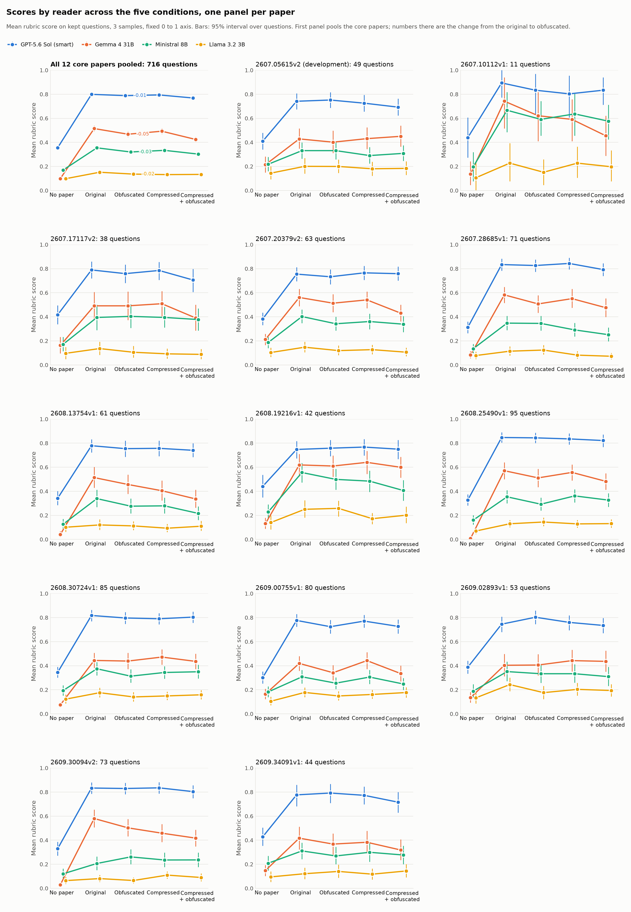

Absolute scores on a fixed 0 to 1 axis. The first panel pools the core papers and labels each reader's change from original to obfuscated.

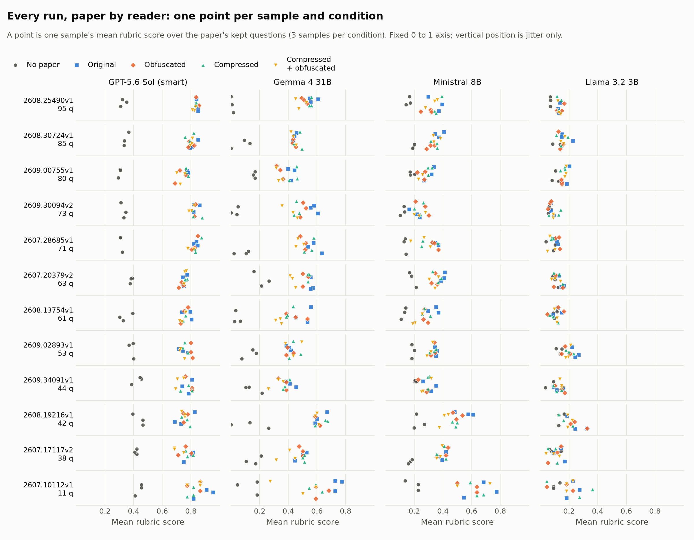

Every run as a point: one sample's mean over a paper's kept questions, for each condition, paper and reader (figure 13, [`make_figures.py`](../scripts/quiz/make_figures.py) `fig_v2_runs_grid`). The no-paper cluster (grey) sits well below the rest for every reader except Llama. **The original (blue) and compressed + obfuscated (yellow) clusters mostly overlap within a cell**, with sample-to-sample spread about as large as the gap. They separate clearly only for Gemma on a few papers (2608.13754v1, 2607.20379v2, 2609.30094v2). This is the same small effect as the pooled table, seen per run.

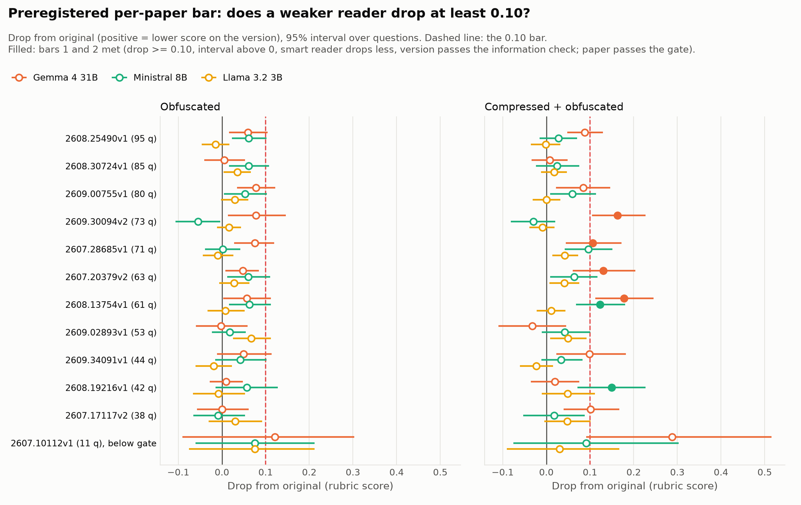

**Preregistered bars** (all from [`v2-pooled.json`](../data/analysis/v2-pooled.json), key `bars`):

- **Bar 1 (per-paper detection, drop ≥ 0.10 with its interval above 0):** obfuscated, 0 of 33 paper × weaker-reader results on gated papers. Compressed + obfuscated, 7 of 33.
- **Bar 2 (smart reader drops less, version passes the information check):** holds for most of the bar-1 cases; see the filled markers.
- **Bar 3 (bars 1 and 2 on at least half the gated papers, for some weaker reader):** **fails** for obfuscated (Gemma 0, Ministral 0, Llama 0 of 11) and for compressed + obfuscated (Gemma 4, Ministral 2, Llama 0 of 10).
- **Bar 4 (brevity is not penalised as illegibility, descriptive):** across gated papers, compression costs Gemma 0.018 against 0.042 for obfuscation, and Ministral 0.023 against 0.032. Compression costs at least as much as obfuscation on 2 of 11 papers for Gemma, 5 for Ministral and 6 for Llama. For Gemma the quiz responds more to the confusing rewrite than to brevity. For Ministral it barely separates the two, and for Llama not at all.
- **Bar 5 (reliability, descriptive):** a paper's 95% interval on a drop is about ±0.05 (median width 0.09 to 0.10 for Gemma and Ministral with 38 to 95 questions). For obfuscation, 6 of 11 gated papers are conclusive (interval excludes 0) for Gemma and for Ministral. Given the per-question spread, a paper needs about **35 questions to detect a 0.10 drop, and about 16 for 0.15** (80% power, 95% interval; this formula was chosen in pass 19, after the results). The observed drop of about 0.05 would need about 140.

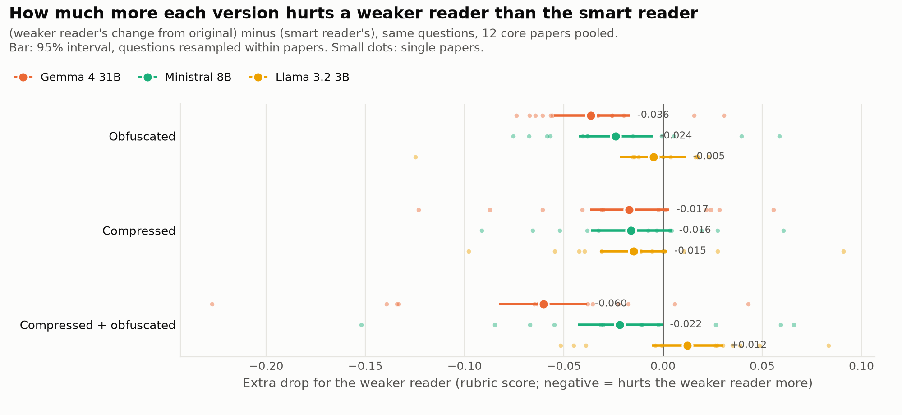

**Weaker reader's change minus the smart reader's,** on the same questions, pooled over 12 papers (questions resampled within papers):

- Obfuscated: Gemma −0.036 [−0.055, −0.017], Ministral −0.024 [−0.042, −0.005], Llama −0.005 [−0.022, +0.011].
- Compressed + obfuscated: Gemma −0.060 [−0.083, −0.038], Ministral −0.022 [−0.043, −0.000].
- Compressed: −0.015 to −0.017 for all three, with intervals that include 0.

The preregistered mixed model (score ~ version + (1 | question) + (1 | paper), per reader) gives the same fixed effects as the paired means, as expected with every question in every condition. Excluding versions that fail a paper's information check (2607.10112v1 compressed; 2607.17117v2 compressed + obfuscated) changes no pooled estimate by more than 0.005.

### Quiz vs. asking a model (exploratory)

Jason asked whether a model could simply rate how legible a paper is, making the quiz unnecessary. Each of the 4 readers rated each of the 4 versions of all 12 core papers, one version per call, 3 samples: "How easy is this paper for a reader at your level to understand, from 1 to 10?", with anchors at 1, 5 and 10 and a reason of at most 50 words (prompt `JUDGE_V2` in [`prompts.py`](../scripts/quiz/prompts.py); 576 calls, 0 failed, $3.25). Prompt and comparison were committed before any rating ([`decisions.md`](decisions.md), pass 20). This was added after the preregistration, so it is exploratory. Code: [`judge_v2.py`](../scripts/quiz/judge_v2.py); data: `judge-v2.jsonl` in each run directory, summary in [`v2-judge.json`](../data/analysis/v2-judge.json) and [`v2-judge-tables.md`](../data/analysis/v2-judge-tables.md).

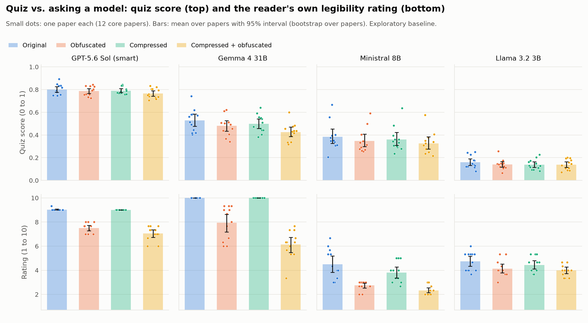

Figure 14. Top: quiz score; bottom: the same reader's rating of the same version. Bars here are means over papers (each paper weighted equally), so they differ slightly from the pooled table below, which weights by question.

**At spotting the obfuscated versions, the judge does better than the quiz.** Share of the 12 papers where the original comes out above the version:

| Reader | Judge: obfuscated / compressed / comp. + obf. | Quiz: obfuscated / compressed / comp. + obf. | Mean rating: orig / obf / comp / comp. + obf. |
| --- | --- | --- | --- |
| GPT-5.6-sol (smart) | **1.00** / 0.54 / **1.00** | 0.75 / 0.58 / 0.83 | 9.0 / 7.5 / 9.0 / 7.1 |
| Gemma-4-31B | **1.00** / 0.50 / **1.00** | 0.88 / 0.58 / 0.92 | 10.0 / 7.9 / 10.0 / 6.1 |
| Ministral-8B | **1.00** / 0.83 / **1.00** | 0.83 / 0.79 / 0.92 | 4.5 / 2.8 / 3.8 / 2.3 |
| Llama-3.2-3B | 0.75 / 0.62 / 0.83 | 0.67 / 0.88 / 0.75 | 4.8 / 4.1 / 4.4 / 4.0 |

Ties count half. Single runs agree too: across the 9 pairs of one original sample against one obfuscated sample per paper, Gemma's rating puts the original higher 85% of the time and its quiz run 82%; for Ministral 91% against 75%. The readability formulas also flag obfuscation on every paper (Flesch-Kincaid grade higher for obfuscated on 12 of 12, compressed + obfuscated on 11 of 12), at no cost.

**But the judge sees the surface, and does not agree with the quiz on anything finer.**

- The reasons name what they see: "highly unconventional alphanumeric placeholders (e.g., Q7Z, X8U, M2X)" (Gemma, 2609.00755v1). Our obfuscation is visibly marked, so any judge, or a readability formula, catches it. That shows the judge detects visible difficulty, not that it measures understanding.
- **On which papers are hardest, judge and quiz do not agree.** Spearman over papers between a reader's rating of the original and its quiz score on it: −0.14 (Ministral, p = 0.67) and −0.10 (Llama, p = 0.77). The two larger models cannot rank papers at all: Gemma rated every original 10 on all 36 samples, and the smart reader rated 35 of 36 a 9 (its nominal +0.22 rests on the one 10).
- **Per paper, a bigger rating drop does not go with a bigger quiz drop** ([figure 14b](figures/v2-judge-drops-light.png)). Of 11 defined correlations, none reaches p < 0.05; the two largest are negative (Ministral, compressed −0.58, p = 0.05, and compressed + obfuscated −0.54, p = 0.07), about what chance produces in 11 tests.
- **Ratings are not comparable across readers.** Gemma rates 10 where its quiz score is 0.53; Ministral rates 4.5 with 0.38; Llama rates 4.8 with 0.16. The two larger models do not penalise compression: their compressed ratings equal their original ratings on every sample but one, even where the quiz shows a drop.

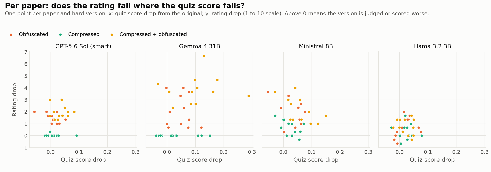

**What this means (inferred):** this pilot cannot show the quiz is needed. Against the only manipulation we have, which announces itself in the text, a $3 judge is a more reliable detector than a $250 quiz. Where the two differ, nothing here says which is right, because there are no human ratings. The case for the quiz is the case an audit has to meet: a judge rates how a text looks, so a fluent paper that hides gaps or skips steps could rate well and still not be understood. Testing that needs versions whose difficulty is not visible on the surface (see next steps). The judge is not useless: it is a cheap screen for visibly hard text.

#### Asking about a human reader instead (Jason, 2026-11-04)

Jason pointed out that the prompt should ask how readable the paper is *to a human*, not "to a reader at your level". Re-run with prompt `JUDGE_HUMAN_V2`, which names the reader: an ML PhD who does not work in the paper's subfield, reading carefully with only the paper and general ML knowledge. Same readers, versions, papers and 3 samples; 576 ratings, 0 failed, $3.43. Run from the laptop session with `judge_v2.py rate --prompt human`; data in `judge-human-v2.jsonl` per run directory and [`v2-judge-human-tables.md`](../data/analysis/v2-judge-human-tables.md). Exploratory.

<picture>
  <source media="(prefers-color-scheme: dark)" srcset="figures/v2-judge-human-dark.png">
  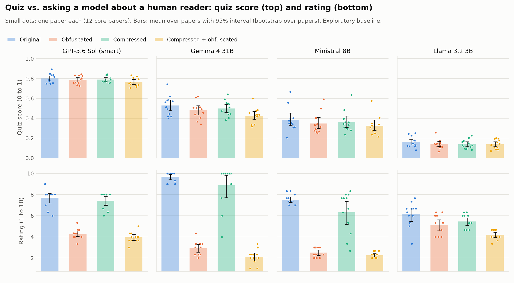
</picture>

| Reader | Rating: orig / obf / comp / comp. + obf. (human prompt) | Same, original prompt | Original-paper ratings across papers (human prompt) | Spearman, original rating vs. quiz score |
| --- | --- | --- | --- | --- |
| GPT-5.6-sol | 7.7 / 4.3 / 7.4 / 3.9 | 9.0 / 7.5 / 9.0 / 7.1 | 6.0 to 9.0 | +0.11 (p = 0.74) |
| Gemma-4-31B | 9.7 / 2.9 / 8.9 / 2.1 | 10.0 / 7.9 / 10.0 / 6.1 | 9.0 to 10.0 | −0.02 (p = 0.95) |
| Ministral-8B | 7.5 / 2.5 / 6.3 / 2.3 | 4.5 / 2.8 / 3.8 / 2.3 | 7.0 to 8.3 | −0.08 (p = 0.80) |
| Llama-3.2-3B | 6.1 / 5.1 / 5.4 / 4.2 | 4.8 / 4.1 / 4.4 / 4.0 | 3.3 to 7.7 | +0.28 (p = 0.39) |

- **The obfuscation gap becomes very large:** GPT-5.6, Gemma and Ministral now rate obfuscated versions 3.4 to 6.8 points below the original, against 1.5 to 2.1 with the original prompt. All three still rank the original above obfuscated and compressed + obfuscated on 12 of 12 papers.
- **Ratings are more comparable across readers:** Ministral's rating of the originals rose from 4.5 to 7.5, near the others. The original prompt measured how hard the model itself found the paper.
- **Ratings now vary somewhat across papers** (GPT-5.6 from 6 to 9), but **still do not agree with the quiz on which papers are hardest:** every correlation is near 0. Per paper, rating drops still do not track quiz drops (no correlation reaches p < 0.05; table in the linked file).
- **Compression is still barely penalised** by the larger models (Gemma 9.7 to 8.9).

**Reading (inferred):** naming a human reader makes the judge a sharper detector of visibly awkward text, and more consistent across models, but it does not change the earlier conclusion. The judge and the quiz still measure different things, and only human data can say which matches people.

### Fluent versions with a hidden gap (follow-up, Jason 2026-11-04)

The plan v2 rewrites were visibly awkward, so a judge caught them. Jason asked for the case that matters for a quiz: a paper that reads fluently but leaves the reader without what they need. Claude Opus 5.5 first recorded each paper's crucial insight, its dependent results, key definitions and reasoning steps (`versions/gap-meta.json`). It then wrote two versions of about the original's length with the same headings ([`gap_v2.py`](../scripts/quiz/gap_v2.py), prompts `GAP_*` in [`prompts.py`](../scripts/quiz/prompts.py)):

- **Insight removed (`rem`):** the insight and the results that depend on it are removed and smoothed over. All 12 passed the checks (0.86x to 1.11x length).
- **Insight implicit (`imp`):** every fact and number kept, but the insight, definitions and connecting reasoning left unstated, as for experts. **Only 7 of 12 passed.** On the other 5, all 3 tries came out shorter than the 0.8x floor (0.58x to 0.80x), so, as preregistered, those papers have no `imp` result.

The existing kept quizzes were reused unchanged, with the same sittings, samples and grader. Predictions were committed before any run ([`preregistration-v2.md`](preregistration-v2.md), last section). Data: `takes-gap.jsonl`, `judge-gap.jsonl` and `judge-human-gap.jsonl` per run directory; summary in [`v2-gap.json`](../data/analysis/v2-gap.json) and [`v2-gap-tables.md`](../data/analysis/v2-gap-tables.md).

<picture>
  <source media="(prefers-color-scheme: dark)" srcset="figures/v2-gap-dark.png">
  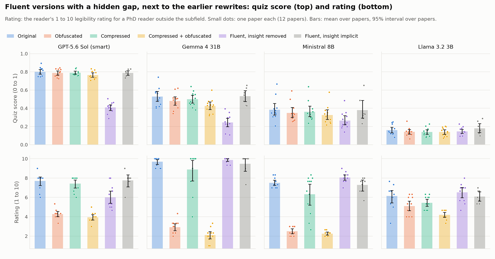
</picture>

Figure 15: all six versions side by side. The purple bars are the key result. For Gemma and Ministral, the quiz score falls but the rating stays level or rises.

**Quiz drop from the original** (11 gated papers for `rem`, 6 for `imp`; 95% bootstrap over questions within papers):

| Reader | orig − rem | papers with interval above 0 | orig − imp | papers with interval above 0 |
| --- | --- | --- | --- | --- |
| GPT-5.6-sol (smart) | **+0.40** [+0.37, +0.42] | 11 of 11 | +0.005 [−0.01, +0.02] | 0 of 6 |
| Gemma-4-31B | **+0.29** [+0.26, +0.32] | 11 of 11 | −0.005 [−0.03, +0.02] | 0 of 6 |
| Ministral-8B | **+0.11** [+0.09, +0.13] | 10 of 11 | +0.02 [+0.00, +0.04] | 1 of 6 |
| Llama-3.2-3B | +0.01 [+0.00, +0.03] | 2 of 11 | +0.003 [−0.01, +0.02] | 0 of 6 |

**Judge rating, version minus original** (mean over papers and samples; how many papers stay within 1 point):

| Reader | rem, human-reader prompt | rem, "your level" prompt | imp, human-reader prompt | imp, "your level" prompt |
| --- | --- | --- | --- | --- |
| GPT-5.6-sol | **−1.69** (5 of 12) | −0.53 (10 of 12) | +0.07 (7 of 7) | +0.07 (7 of 7) |
| Gemma-4-31B | +0.17 (12 of 12) | 0.00 (12 of 12) | −0.22 (6 of 7) | 0.00 (7 of 7) |
| Ministral-8B | +0.56 (11 of 12) | +0.36 (10 of 12) | −0.21 (6 of 7) | −0.36 (6 of 7) |
| Llama-3.2-3B | +0.39 (9 of 12) | −0.33 (9 of 12) | −0.04 (5 of 7) | −0.18 (5 of 7) |

**The preregistered predictions:**

1. **Fluency (both versions rated within 1 point of the original): holds for 15 of 16 reader × prompt × version cells.** The exception is the smart reader with the human-reader prompt on `rem` (−1.69).
2. **Removal lowers every reader's quiz score: holds.** The smart reader drops most (−0.40), as expected for missing content rather than hard-to-follow text. Llama's drop is tiny (+0.014 [+0.003, +0.025]), and it sits at its floor as predicted.
3. **Implicit version separates weaker readers from the smart one: fails.** The smart reader passes the information check on 6 of 6 gated papers. But weaker minus smart drop is −0.010 [−0.036, +0.017] for Gemma and +0.016 [−0.009, +0.040] for Ministral: nobody's score moves.
4. **The quiz catches what the judge misses: holds for 3 of 4 judges.** For Gemma, Ministral and Llama, the rating of `rem` is within about half a point of the original under either prompt, while the quiz drops conclusively for Gemma and Ministral. Gemma's case is the clearest: its quiz score falls from 0.53 to 0.24 while it rates the version 9.9, against 9.7 for the original. The smart reader's judge does notice with the human-reader prompt, and its reasons say why: "the results section reports almost no actual quantitative results" (2608.19216v1), "most empirical sections describe protocols without reporting actual quantitative outcomes" (2607.20379v2).

**What this means (inferred):** this is the first result where the quiz does something a cheap judge does not. A mid-sized model asked to rate the paper is fooled by fluent text that has lost its results, but the same model taking the quiz is not. The limits are large, though. `rem` is a completeness test, not a legibility test: a careful reader notices that the numbers are gone, so the strongest judge partly catches it, and so might a simple "does the results section contain numbers" check. On the legibility case proper, `imp`, the quiz detects nothing. The likeliest explanation (inferred, not tested) is that the manipulation is too mild. In the first paper read, Opus mostly tightened prose and kept the definitions, and the length floor stopped it from cutting explanation on 5 papers. So the pilot cannot say whether the quiz would catch a paper that is fluent, complete and hard to follow.

### Follow-up 2: a quiz written on the hidden-gap version (Jason, 2026-11-04)

Predictions were committed before any call ([`preregistration-v2.md`](preregistration-v2.md), "Follow-up 2", commit 6f67606). Code [`scripts/quiz/gap_requiz.py`](../scripts/quiz/gap_requiz.py); each paper's `rem` version becomes a paper of its own (`data/papers/<paper>-rem/`), and the unchanged plan v2 pipeline writes, filters and takes a quiz on it (`data/runs/v2rem-<paper>/`; conditions: that version, and no paper). Results in [`data/analysis/v2-gap-requiz.json`](../data/analysis/v2-gap-requiz.json) and `data/analysis/v2-ci.json` (`quiz_requiz`). Cost about $112 (account usage $512.96 to $625.24). All 12 papers ran with no failed calls.

**Scores** (mean over 12 papers; difference with a 95% bootstrap interval over papers):

| Reader | Original quiz, original paper | Quiz written on `rem`, taken with `rem` | Difference | Papers lower |
|---|---|---|---|---|
| GPT-5.6 Sol | 0.80 | 0.77 | −0.03 [−0.07, −0.00] | 9 of 12 |
| Gemma 4 31B | 0.53 | 0.52 | −0.01 [−0.06, +0.03] | 5 of 12 |
| Ministral 8B | 0.38 | 0.43 | +0.04 [−0.03, +0.11] | 4 of 12 |
| Llama 3.2 3B | 0.16 | 0.17 | +0.01 [−0.03, +0.04] | 7 of 12 |

**Yield:** kept questions fell on 10 of the 11 comparable papers, from 64 to 41 on average (2607.10112v1 excluded: its original quiz was cut short by the writer's content filter, 11 kept). Almost all of the loss is at the no-paper filter (for example 2609.30094v2: 53% dropped there on the original quiz, 80% on the `rem` quiz). The "too hard" filter (strong reader fails with the paper) removes 0 to 7% on both quizzes.

**Predictions:** 1 (fewer kept questions on most papers) held, 10 of 11. 2 (Gemma and Ministral within 0.05 of the original quiz, no consistent sign) held. 3 (the strong reader about as high) held, with a small drop (−0.03) that the filter partly builds in.

**What this means (inferred):** a quiz written from a fluent paper missing its key results asks about what the paper still says, and readers follow that, so the quiz does not reveal the gap. The yield drop is a within-paper signal; intact papers already range from 38 to 95 kept questions, so a low count alone cannot flag a hollow paper. Detecting incomplete or wrong content is a different task from testing legibility.

### Follow-up 3: a stronger "insight implicit" version (Jason, 2026-11-04)

Predictions were committed before any call ([`preregistration-v2.md`](preregistration-v2.md), "Follow-up 3", commit 8792a93). The first `imp` was probably too mild, and its 0.8x length floor excluded 5 of 12 papers. `imp2` (prompt p10, [`scripts/quiz/gap_imp2.py`](../scripts/quiz/gap_imp2.py)) drops the floor, forbids defining the key terms in the insight note and explaining why results follow, and cuts intuition, examples, signposting and summaries. All 12 versions passed on the first try (every number and heading kept), at 0.56x to 0.84x the original length. Readers took the existing original quiz (`takes-imp2.jsonl`); the four readers rated `imp2` with the human-reader prompt (`judge-human-imp2.jsonl`); GLM-5.3 checked which key terms each text defines (`versions/imp2-defined.json`). Results in [`data/analysis/v2-imp2.json`](../data/analysis/v2-imp2.json). Cost about $24 (account usage $625.24 to $649.26); 20 failed answers on one paper were rerun from cache before analysis.

| Reader | Quiz drop orig − imp2 (pooled, 11 gated papers) | Minus the strong reader's drop | Rating change (human prompt) |
|---|---|---|---|
| GPT-5.6 Sol | +0.006 [−0.005, +0.018] | — | −0.47 |
| Gemma 4 31B | +0.012 [−0.002, +0.027] | +0.006 [−0.012, +0.023] | −0.83 |
| Ministral 8B | +0.028 [+0.013, +0.043] | +0.022 [+0.004, +0.040] | −1.28 |
| Llama 3.2 3B | +0.002 [−0.008, +0.013] | −0.004 [−0.020, +0.012] | −0.53 |

**Predictions:** 1 (information check) held, 11 of 11 gated papers. 2 (at least two thirds of the defined key terms undefined) **failed**: only 16% became undefined; the writer kept most definitions, often in a formula or passing clause, which the prompt allowed. 3 (Sol's and Gemma's ratings fall by at least 1 point) **failed**: −0.47 and −0.83. 4 (weaker readers lose more than the strong reader) held for Ministral (+0.022, interval above 0) and not for Gemma.

**What this means (inferred):** a version with explanation, intuition and summaries cut, but most definitions kept, costs the quiz readers at most about 3 points and lowers ratings by about half a point to 1.3 points. The manipulation is still milder than intended, so the pilot still cannot say whether the quiz catches a paper that is complete but genuinely hard to follow. Blog figure 4 now shows `imp2` in place of `imp`; `imp`'s results above stay as reported.

### All core papers pooled (12 papers, 716 questions, 3 samples)

| Reader | No paper | Original | Obfuscated (Δ) | Compressed (Δ) | Compressed + obfuscated (Δ) |
|---|---|---|---|---|---|
| GPT-5.6-sol (smart) | 0.35 [0.34, 0.37] | 0.80 [0.78, 0.82] | 0.79 (−0.01 [−0.02, +0.00]) | 0.79 (−0.00 [−0.02, +0.01]) | 0.77 (**−0.03 [−0.04, −0.02]**) |
| Gemma-4-31B | 0.10 [0.09, 0.11] | 0.51 [0.49, 0.54] | 0.47 (**−0.05 [−0.06, −0.03]**) | 0.49 (**−0.02 [−0.04, −0.01]**) | 0.42 (**−0.09 [−0.11, −0.07]**) |
| Ministral-8B | 0.17 [0.16, 0.18] | 0.35 [0.34, 0.37] | 0.32 (**−0.03 [−0.05, −0.02]**) | 0.33 (**−0.02 [−0.04, −0.01]**) | 0.30 (**−0.05 [−0.07, −0.04]**) |
| Llama-3.2-3B | 0.10 [0.09, 0.11] | 0.15 [0.14, 0.16] | 0.14 (**−0.02 [−0.03, −0.00]**) | 0.13 (**−0.02 [−0.03, −0.01]**) | 0.13 (**−0.02 [−0.03, −0.01]**) |

Score [95% interval]; Δ is the change from the original, paired by question; bold where its interval excludes 0. Intervals resample questions within each paper, so papers keep their weight. All versions included, whether or not they pass a paper's information check. From [`analyze_v2.py`](../scripts/quiz/analyze_v2.py).

### 2608.25490v1 (95 questions)

| Reader | No paper | Original | Obfuscated (Δ) | Compressed (Δ) | Compressed + obfuscated (Δ) |
|---|---|---|---|---|---|
| GPT-5.6-sol (smart) | 0.33 [0.28, 0.37] | 0.85 [0.80, 0.89] | 0.84 (−0.00 [−0.03, +0.02]) | 0.84 (−0.01 [−0.04, +0.02]) | 0.82 (−0.03 [−0.06, +0.01]) |
| Gemma-4-31B | 0.01 [0.00, 0.01] | 0.57 [0.50, 0.64] | 0.51 (**−0.06 [−0.10, −0.02]**) | 0.56 (−0.01 [−0.06, +0.03]) | 0.48 (**−0.09 [−0.13, −0.05]**) |
| Ministral-8B | 0.16 [0.12, 0.20] | 0.35 [0.30, 0.41] | 0.29 (**−0.06 [−0.10, −0.02]**) | 0.36 (+0.01 [−0.04, +0.05]) | 0.33 (−0.03 [−0.07, +0.02]) |
| Llama-3.2-3B | 0.07 [0.04, 0.10] | 0.13 [0.10, 0.16] | 0.14 (+0.01 [−0.02, +0.05]) | 0.13 (−0.00 [−0.03, +0.03]) | 0.13 (+0.00 [−0.03, +0.04]) |

Information check (smart reader's score / original): obf 1.00, comp 0.99, compobf 0.97. Lengths (bytes): comp 0.37x, compobf 0.39x. Failed grades 0, unanswered 28. Data: [`takes-summary.json`](../data/runs/v2-2608.25490v1/takes-summary.json).

### 2608.30724v1 (85 questions)

| Reader | No paper | Original | Obfuscated (Δ) | Compressed (Δ) | Compressed + obfuscated (Δ) |
|---|---|---|---|---|---|
| GPT-5.6-sol (smart) | 0.34 [0.30, 0.39] | 0.82 [0.77, 0.86] | 0.80 (−0.02 [−0.06, +0.01]) | 0.79 (−0.03 [−0.06, +0.01]) | 0.80 (−0.01 [−0.06, +0.03]) |
| Gemma-4-31B | 0.07 [0.05, 0.10] | 0.44 [0.38, 0.51] | 0.44 (−0.01 [−0.05, +0.04]) | 0.47 (+0.03 [−0.02, +0.08]) | 0.44 (−0.01 [−0.05, +0.03]) |
| Ministral-8B | 0.19 [0.15, 0.24] | 0.37 [0.32, 0.43] | 0.31 (**−0.06 [−0.11, −0.02]**) | 0.34 (−0.03 [−0.08, +0.01]) | 0.35 (−0.02 [−0.08, +0.02]) |
| Llama-3.2-3B | 0.12 [0.09, 0.16] | 0.18 [0.14, 0.22] | 0.14 (**−0.04 [−0.07, −0.00]**) | 0.15 (**−0.03 [−0.05, −0.00]**) | 0.16 (−0.02 [−0.05, +0.01]) |

Information check (smart reader's score / original): obf 0.97, comp 0.97, compobf 0.98. Lengths (bytes): comp 0.49x, compobf 0.52x. Failed grades 0, unanswered 5. Data: [`takes-summary.json`](../data/runs/v2-2608.30724v1/takes-summary.json).

### 2609.00755v1 (80 questions)

| Reader | No paper | Original | Obfuscated (Δ) | Compressed (Δ) | Compressed + obfuscated (Δ) |
|---|---|---|---|---|---|
| GPT-5.6-sol (smart) | 0.30 [0.25, 0.35] | 0.78 [0.72, 0.83] | 0.72 (**−0.05 [−0.09, −0.01]**) | 0.77 (−0.01 [−0.05, +0.04]) | 0.73 (−0.05 [−0.10, +0.00]) |
| Gemma-4-31B | 0.16 [0.12, 0.21] | 0.42 [0.36, 0.48] | 0.34 (**−0.08 [−0.12, −0.03]**) | 0.44 (+0.02 [−0.03, +0.07]) | 0.33 (**−0.08 [−0.15, −0.02]**) |
| Ministral-8B | 0.18 [0.14, 0.23] | 0.31 [0.25, 0.36] | 0.25 (**−0.05 [−0.10, −0.00]**) | 0.31 (−0.00 [−0.05, +0.04]) | 0.25 (**−0.06 [−0.11, −0.01]**) |
| Llama-3.2-3B | 0.10 [0.07, 0.14] | 0.18 [0.14, 0.22] | 0.15 (−0.03 [−0.06, +0.00]) | 0.16 (−0.02 [−0.05, +0.01]) | 0.18 (−0.00 [−0.03, +0.03]) |

Information check (smart reader's score / original): obf 0.93, comp 0.99, compobf 0.94. Lengths (bytes): comp 0.37x, compobf 0.40x. Failed grades 0, unanswered 1. Data: [`takes-summary.json`](../data/runs/v2-2609.00755v1/takes-summary.json).

### 2609.30094v2 (73 questions)

| Reader | No paper | Original | Obfuscated (Δ) | Compressed (Δ) | Compressed + obfuscated (Δ) |
|---|---|---|---|---|---|
| GPT-5.6-sol (smart) | 0.33 [0.27, 0.39] | 0.83 [0.79, 0.88] | 0.83 (−0.00 [−0.03, +0.03]) | 0.83 (+0.00 [−0.03, +0.03]) | 0.80 (−0.03 [−0.07, +0.00]) |
| Gemma-4-31B | 0.03 [0.01, 0.05] | 0.58 [0.51, 0.65] | 0.50 (**−0.08 [−0.15, −0.01]**) | 0.46 (**−0.12 [−0.18, −0.07]**) | 0.42 (**−0.16 [−0.23, −0.10]**) |
| Ministral-8B | 0.12 [0.08, 0.16] | 0.21 [0.15, 0.26] | 0.26 (**+0.05 [+0.00, +0.11]**) | 0.24 (+0.03 [−0.02, +0.08]) | 0.24 (+0.03 [−0.02, +0.08]) |
| Llama-3.2-3B | 0.06 [0.04, 0.09] | 0.08 [0.05, 0.11] | 0.06 (−0.02 [−0.04, +0.01]) | 0.11 (+0.03 [−0.00, +0.06]) | 0.09 (+0.01 [−0.02, +0.04]) |

Information check (smart reader's score / original): obf 1.00, comp 1.00, compobf 0.96. Lengths (bytes): comp 0.41x, compobf 0.43x. Failed grades 0, unanswered 97. Data: [`takes-summary.json`](../data/runs/v2-2609.30094v2/takes-summary.json).

### 2607.28685v1 (71 questions)

| Reader | No paper | Original | Obfuscated (Δ) | Compressed (Δ) | Compressed + obfuscated (Δ) |
|---|---|---|---|---|---|
| GPT-5.6-sol (smart) | 0.31 [0.26, 0.36] | 0.83 [0.78, 0.88] | 0.83 (−0.01 [−0.05, +0.03]) | 0.84 (+0.01 [−0.03, +0.05]) | 0.79 (**−0.04 [−0.08, −0.00]**) |
| Gemma-4-31B | 0.08 [0.05, 0.11] | 0.58 [0.51, 0.65] | 0.51 (**−0.08 [−0.12, −0.03]**) | 0.55 (−0.03 [−0.09, +0.03]) | 0.48 (**−0.11 [−0.17, −0.04]**) |
| Ministral-8B | 0.13 [0.10, 0.17] | 0.35 [0.29, 0.41] | 0.35 (−0.00 [−0.04, +0.04]) | 0.29 (**−0.06 [−0.11, −0.01]**) | 0.25 (**−0.10 [−0.15, −0.04]**) |
| Llama-3.2-3B | 0.08 [0.05, 0.11] | 0.11 [0.08, 0.15] | 0.12 (+0.01 [−0.03, +0.04]) | 0.08 (**−0.03 [−0.06, −0.00]**) | 0.07 (**−0.04 [−0.07, −0.01]**) |

Information check (smart reader's score / original): obf 0.99, comp 1.01, compobf 0.95. Lengths (bytes): comp 0.40x, compobf 0.40x. Failed grades 0, unanswered 6. Data: [`takes-summary.json`](../data/runs/v2-2607.28685v1/takes-summary.json).

### 2607.20379v2 (63 questions)

| Reader | No paper | Original | Obfuscated (Δ) | Compressed (Δ) | Compressed + obfuscated (Δ) |
|---|---|---|---|---|---|
| GPT-5.6-sol (smart) | 0.38 [0.33, 0.43] | 0.75 [0.69, 0.81] | 0.73 (−0.02 [−0.07, +0.02]) | 0.77 (+0.01 [−0.04, +0.07]) | 0.76 (+0.00 [−0.05, +0.06]) |
| Gemma-4-31B | 0.21 [0.17, 0.26] | 0.56 [0.49, 0.63] | 0.51 (**−0.05 [−0.08, −0.01]**) | 0.54 (−0.02 [−0.07, +0.03]) | 0.43 (**−0.13 [−0.20, −0.06]**) |
| Ministral-8B | 0.19 [0.14, 0.23] | 0.40 [0.35, 0.46] | 0.34 (**−0.06 [−0.11, −0.01]**) | 0.36 (−0.04 [−0.10, +0.02]) | 0.34 (**−0.06 [−0.12, −0.01]**) |
| Llama-3.2-3B | 0.10 [0.07, 0.14] | 0.15 [0.10, 0.19] | 0.12 (−0.03 [−0.06, +0.01]) | 0.13 (−0.02 [−0.06, +0.02]) | 0.11 (**−0.04 [−0.07, −0.01]**) |

Information check (smart reader's score / original): obf 0.97, comp 1.01, compobf 1.00. Lengths (bytes): comp 0.46x, compobf 0.48x. Failed grades 0, unanswered 3. Data: [`takes-summary.json`](../data/runs/v2-2607.20379v2/takes-summary.json).

### 2608.13754v1 (61 questions)

| Reader | No paper | Original | Obfuscated (Δ) | Compressed (Δ) | Compressed + obfuscated (Δ) |
|---|---|---|---|---|---|
| GPT-5.6-sol (smart) | 0.34 [0.28, 0.40] | 0.78 [0.72, 0.83] | 0.75 (−0.02 [−0.07, +0.02]) | 0.76 (−0.02 [−0.07, +0.02]) | 0.74 (−0.04 [−0.08, −0.00]) |
| Gemma-4-31B | 0.04 [0.02, 0.07] | 0.51 [0.43, 0.60] | 0.46 (**−0.06 [−0.11, −0.00]**) | 0.40 (**−0.11 [−0.15, −0.07]**) | 0.34 (**−0.18 [−0.25, −0.11]**) |
| Ministral-8B | 0.13 [0.08, 0.17] | 0.34 [0.27, 0.41] | 0.28 (**−0.06 [−0.11, −0.02]**) | 0.28 (**−0.06 [−0.11, −0.01]**) | 0.22 (**−0.12 [−0.18, −0.07]**) |
| Llama-3.2-3B | 0.10 [0.06, 0.14] | 0.12 [0.08, 0.17] | 0.11 (−0.01 [−0.05, +0.03]) | 0.09 (−0.03 [−0.06, +0.01]) | 0.11 (−0.01 [−0.04, +0.02]) |

Information check (smart reader's score / original): obf 0.97, comp 0.97, compobf 0.95. Lengths (bytes): comp 0.43x, compobf 0.46x. Failed grades 0, unanswered 3. Data: [`takes-summary.json`](../data/runs/v2-2608.13754v1/takes-summary.json).

### 2609.02893v1 (53 questions)

| Reader | No paper | Original | Obfuscated (Δ) | Compressed (Δ) | Compressed + obfuscated (Δ) |
|---|---|---|---|---|---|
| GPT-5.6-sol (smart) | 0.39 [0.33, 0.44] | 0.75 [0.68, 0.81] | 0.80 (**+0.06 [+0.02, +0.10]**) | 0.76 (+0.01 [−0.03, +0.06]) | 0.73 (−0.01 [−0.05, +0.03]) |
| Gemma-4-31B | 0.13 [0.09, 0.18] | 0.40 [0.31, 0.50] | 0.41 (+0.00 [−0.06, +0.06]) | 0.44 (+0.04 [−0.02, +0.10]) | 0.44 (+0.03 [−0.05, +0.11]) |
| Ministral-8B | 0.19 [0.14, 0.25] | 0.35 [0.27, 0.43] | 0.33 (−0.02 [−0.05, +0.02]) | 0.33 (−0.02 [−0.07, +0.03]) | 0.31 (−0.04 [−0.10, +0.01]) |
| Llama-3.2-3B | 0.13 [0.09, 0.18] | 0.24 [0.19, 0.30] | 0.18 (**−0.07 [−0.11, −0.03]**) | 0.20 (**−0.04 [−0.07, −0.01]**) | 0.19 (**−0.05 [−0.09, −0.01]**) |

Information check (smart reader's score / original): obf 1.08, comp 1.02, compobf 0.99. Lengths (bytes): comp 0.37x, compobf 0.40x. Failed grades 0, unanswered 3. Data: [`takes-summary.json`](../data/runs/v2-2609.02893v1/takes-summary.json).

### 2609.34091v1 (44 questions)

| Reader | No paper | Original | Obfuscated (Δ) | Compressed (Δ) | Compressed + obfuscated (Δ) |
|---|---|---|---|---|---|
| GPT-5.6-sol (smart) | 0.43 [0.35, 0.50] | 0.78 [0.68, 0.86] | 0.79 (+0.02 [−0.04, +0.06]) | 0.77 (−0.00 [−0.06, +0.06]) | 0.72 (**−0.06 [−0.11, −0.01]**) |
| Gemma-4-31B | 0.15 [0.10, 0.19] | 0.42 [0.32, 0.51] | 0.37 (−0.05 [−0.11, +0.01]) | 0.38 (−0.03 [−0.11, +0.04]) | 0.32 (**−0.10 [−0.18, −0.02]**) |
| Ministral-8B | 0.21 [0.15, 0.27] | 0.31 [0.24, 0.38] | 0.27 (−0.04 [−0.10, +0.02]) | 0.30 (−0.01 [−0.06, +0.03]) | 0.28 (−0.03 [−0.08, +0.01]) |
| Llama-3.2-3B | 0.09 [0.05, 0.14] | 0.12 [0.08, 0.17] | 0.14 (+0.02 [−0.02, +0.06]) | 0.12 (−0.00 [−0.05, +0.04]) | 0.14 (+0.02 [−0.02, +0.06]) |

Information check (smart reader's score / original): obf 1.02, comp 1.00, compobf 0.92. Lengths (bytes): comp 0.38x, compobf 0.40x. Failed grades 0, unanswered 1. Data: [`takes-summary.json`](../data/runs/v2-2609.34091v1/takes-summary.json).

### 2608.19216v1 (42 questions)

| Reader | No paper | Original | Obfuscated (Δ) | Compressed (Δ) | Compressed + obfuscated (Δ) |
|---|---|---|---|---|---|
| GPT-5.6-sol (smart) | 0.44 [0.35, 0.54] | 0.75 [0.67, 0.82] | 0.76 (+0.01 [−0.03, +0.05]) | 0.77 (+0.02 [−0.03, +0.07]) | 0.75 (+0.00 [−0.05, +0.04]) |
| Gemma-4-31B | 0.13 [0.09, 0.18] | 0.62 [0.52, 0.71] | 0.61 (−0.01 [−0.05, +0.03]) | 0.64 (+0.02 [−0.04, +0.08]) | 0.60 (−0.02 [−0.08, +0.04]) |
| Ministral-8B | 0.23 [0.17, 0.29] | 0.56 [0.47, 0.63] | 0.50 (−0.06 [−0.13, +0.01]) | 0.48 (−0.07 [−0.16, +0.01]) | 0.41 (**−0.15 [−0.23, −0.07]**) |
| Llama-3.2-3B | 0.14 [0.08, 0.20] | 0.25 [0.18, 0.32] | 0.26 (+0.01 [−0.05, +0.07]) | 0.17 (**−0.08 [−0.15, −0.01]**) | 0.20 (−0.05 [−0.11, +0.01]) |

Information check (smart reader's score / original): obf 1.01, comp 1.03, compobf 1.00. Lengths (bytes): comp 0.41x, compobf 0.43x. Failed grades 0, unanswered 2. Data: [`takes-summary.json`](../data/runs/v2-2608.19216v1/takes-summary.json).

### 2607.17117v2 (38 questions)

| Reader | No paper | Original | Obfuscated (Δ) | Compressed (Δ) | Compressed + obfuscated (Δ) |
|---|---|---|---|---|---|
| GPT-5.6-sol (smart) | 0.42 [0.34, 0.50] | 0.79 [0.72, 0.86] | 0.76 (−0.03 [−0.10, +0.03]) | 0.79 (−0.00 [−0.07, +0.06]) | 0.71 (−0.08 [−0.18, +0.00]) |
| Gemma-4-31B | 0.16 [0.10, 0.23] | 0.49 [0.37, 0.61] | 0.49 (−0.00 [−0.06, +0.06]) | 0.51 (+0.02 [−0.04, +0.08]) | 0.39 (**−0.10 [−0.17, −0.04]**) |
| Ministral-8B | 0.17 [0.11, 0.23] | 0.39 [0.29, 0.50] | 0.40 (+0.01 [−0.05, +0.07]) | 0.39 (−0.00 [−0.06, +0.06]) | 0.38 (−0.02 [−0.09, +0.05]) |
| Llama-3.2-3B | 0.10 [0.05, 0.15] | 0.14 [0.08, 0.19] | 0.11 (−0.03 [−0.09, +0.03]) | 0.09 (−0.04 [−0.09, +0.00]) | 0.09 (−0.05 [−0.10, +0.00]) |

Information check (smart reader's score / original): obf 0.96, comp 0.99, compobf 0.89 (fails, below 0.9). Lengths (bytes): comp 0.35x, compobf 0.38x. Failed grades 0, unanswered 3. Data: [`takes-summary.json`](../data/runs/v2-2607.17117v2/takes-summary.json).

### 2607.10112v1 (11 questions)

| Reader | No paper | Original | Obfuscated (Δ) | Compressed (Δ) | Compressed + obfuscated (Δ) |
|---|---|---|---|---|---|
| GPT-5.6-sol (smart) | 0.44 [0.27, 0.61] | 0.89 [0.77, 1.00] | 0.83 (−0.06 [−0.17, +0.02]) | 0.80 (−0.09 [−0.21, +0.00]) | 0.83 (−0.06 [−0.15, +0.02]) |
| Gemma-4-31B | 0.14 [0.05, 0.24] | 0.74 [0.52, 0.94] | 0.62 (−0.12 [−0.30, +0.09]) | 0.59 (−0.15 [−0.33, +0.03]) | 0.45 (**−0.29 [−0.52, −0.09]**) |
| Ministral-8B | 0.20 [0.08, 0.32] | 0.67 [0.48, 0.82] | 0.59 (−0.08 [−0.21, +0.06]) | 0.64 (−0.03 [−0.12, +0.06]) | 0.58 (−0.09 [−0.30, +0.08]) |
| Llama-3.2-3B | 0.11 [0.00, 0.23] | 0.23 [0.08, 0.39] | 0.15 (−0.08 [−0.21, +0.08]) | 0.23 (−0.00 [−0.06, +0.06]) | 0.20 (−0.03 [−0.17, +0.09]) |

Information check (smart reader's score / original): obf 0.93, comp 0.90 (fails, below 0.9), compobf 0.93. Lengths (bytes): comp 0.45x, compobf 0.48x. Failed grades 0, unanswered 0. Data: [`takes-summary.json`](../data/runs/v2-2607.10112v1/takes-summary.json).

### Development paper 2607.05615v2 (49 questions, tuning only)

Data: [`data/runs/v2dev-2607.05615v2/takes-summary.json`](../data/runs/v2dev-2607.05615v2/takes-summary.json).

| Reader | No paper | Original | Obfuscated | Compressed | Compressed + obfuscated |
|---|---|---|---|---|---|
| GPT-5.6-sol | 0.41 | 0.74 | 0.75 | 0.73 | 0.69 |
| Gemma-4-31B | 0.21 | 0.43 | 0.40 | 0.43 | 0.45 |
| Ministral-8B | 0.22 | 0.33 | 0.33 | 0.29 | 0.31 |
| Llama-3.2-3B | 0.14 | 0.20 | 0.20 | 0.18 | 0.18 |

Intervals are about ±0.07 per cell (table in [`run-log.md`](run-log.md), pass 16). The information check passed for every version (smart reader at 0.93 to 1.01 of its original score), so the versions kept the content.

### Versions: length, information check, position

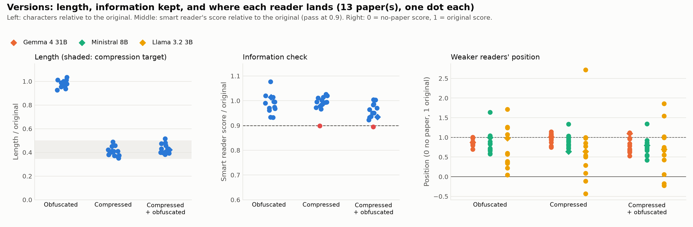

Compressed versions hit the 0.35 to 0.5 target, and the information check passes for all three versions. Positions are unstable when a reader gains little from the paper: Llama's gap from no paper to original is only 0.06, so a 0.01 change moves its position by about 0.15. Data: `versions/meta.json` and `takes-summary.json` in each run directory.

### Question funnel and types

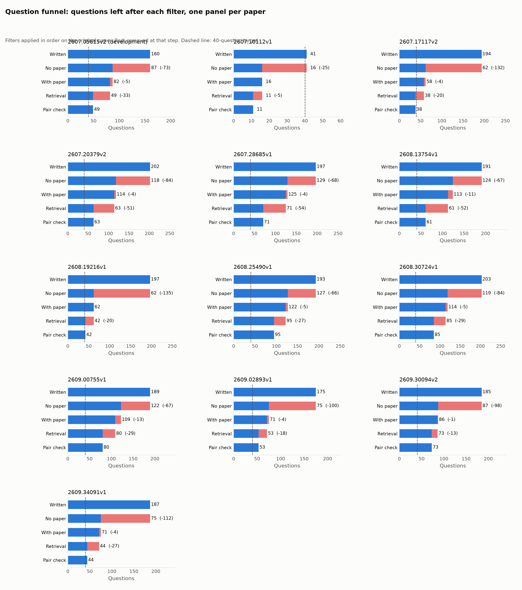

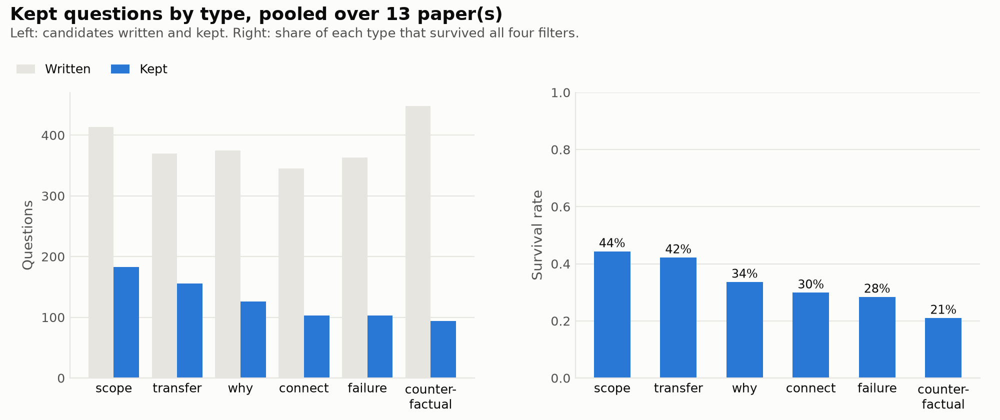

On every paper, the no-paper filter and retrieval remove the most. Ten of 12 core papers keep at least 40 questions (42 to 95); 2607.17117v2 keeps 38 (above the gate of 30) and 2607.10112v1 keeps 11 from its single writer batch. Data: `kept-v2.json` in each run directory.

### Score by question type (exploratory, decided after the dev result)

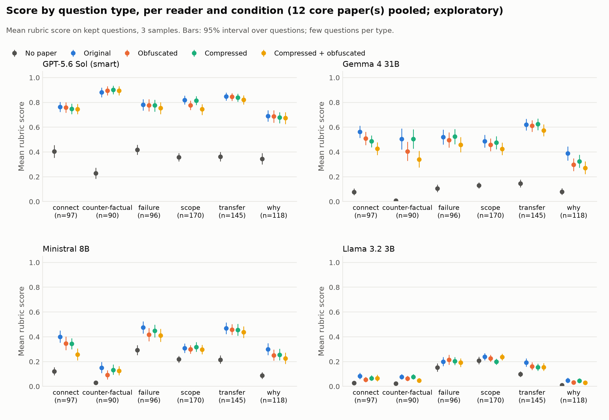

Pooled over 12 papers, obfuscation costs Gemma most on "why" questions (0.39 → 0.30, n = 118) and "counterfactual" questions (0.50 → 0.41, n = 90), and least on "transfer" (0.62 → 0.61) and "failure" (0.52 → 0.50). Ministral shows the same order but smaller ("why" 0.30 → 0.25; "transfer" 0.47 → 0.46). The smart reader is flat on every type except "scope" (0.82 → 0.78). If this holds up, a quiz made only of "why", "counterfactual" and "connect" questions would roughly double the effect per question. That is a lead for the next design, not a finding: the split was chosen after seeing the dev result.

## Weird results

- **Explained (follow-up):** the "insight implicit" writer missed the 0.8x length floor on 5 of 12 papers, in all 3 tries (0.58x to 0.80x). The prompt asks it to drop intuition, signposting and examples, which shortens the text, and to fill the space with detail already in the paper, which it mostly did not do. Those papers are excluded as preregistered, not rerun with a looser floor.
- **Explained (follow-up):** the smart reader still scores 0.41 on "insight removed". Many kept questions are about the method, setup or scope, which the version keeps, and the smart reader scores 0.37 on average (mean over papers) with no paper at all.
- **Fixed (follow-up, own error):** two copies of the follow-up run went at once for about 9 minutes, duplicating calls and possibly overwriting each other's files. Both were killed, and one rerun rebuilt every file from a single consistent set of logged calls. Part of the $74.68 is duplicate spend ([`run-log.md`](run-log.md), pass 21).
- **Fixed (pass 19): 2607.28685v1's obfuscated version had lost a quarter of its longest section.** The obfuscator's retry for section s4 hit the token limit and returned 0.20 of the section, and the code always used the retry. The whole version was 0.74x the original's length with 35 numbers lost (every other paper: 0.94x to 1.03x, 0 lost). The fix uses the try that is not truncated and loses the fewest numbers. The paper was rerun before its takes finished, so no result came from the bad version ([`run-log.md`](run-log.md), pass 19).
- **Fixed (pass 19):** 89 takes rows on 2609.02893v1 (Llama, one sample) failed on rate limits while 5 papers ran at once. They were rerun on the same versions: 0 failed. Separately, 2608.30724v1 stalled silently at `combine` again in a process started before the pass-18 fix, and was rerun on current code.
- **Fixed (pass 18), 5 papers in batch 2 failed or stalled on pipeline defects, all before any takes.** (1) The number check misread LaTeX `2{,}000`, blanked any parenthesis with four digits as a citation (hiding `1060.00`), and missed square-bracket citations, which failed compression on 3 papers when nothing was really lost. (2) `combine` stopped a paper's thread silently (`SystemExit`) when one filter call had failed. (3) A GLM-5.3 grade with unescaped quotes in its note never parsed. All three are fixed and the papers rerun from cache ([`run-log.md`](run-log.md), pass 18).
- **Explained, not fixed:** Opus 5.5's content filter refused writer batch 2 on 2607.10112v1 (a multilingual LLM-safety benchmark) on all 4 tries, so that paper has 11 kept questions instead of about 60, and its intervals are wide. Its compressed version also just fails the information check (0.90x; bar 0.9). It is kept and flagged, not replaced.
- **Explained:** Gemma scores 0.01 without the paper on 2608.25490v1 (0.21 on the dev paper). It answered "I don't know" to most questions (166 of 285 answers under 5 words), because they name specific models and results from the paper. This is allowed behaviour, not a failure.
- **Fixed:** compression failed on 2 of the first 3 core papers. On one, the number check misread rewritten table cells (`- $0.02$` → `−0.02`), so nothing was really lost; on the other, every try lost 1 to 4 real numbers. The check was fixed and a repair step added, before any takes on those papers ([`run-log.md`](run-log.md), pass 17).
- **Fixed (own figure code):** the first pooled figure reported Ministral's original score as 0.40 instead of 0.35, because the figure code skipped the counterfactual-pair scoring rule the summaries use. Figures now call the same scoring function as the summaries ([`takes_v2.question_scores`](../scripts/quiz/takes_v2.py)); nothing with the wrong numbers was committed.
- **Open, now weaker:** obfuscation does not lower scores on the dev paper, and on 3 of 12 core papers it does not lower Gemma's score at all (2607.17117v2, 2608.19216v1, 2609.02893v1; drops −0.002 to +0.009), though it lowers Gemma's and Ministral's on most. Why the dev paper differs is not known, though the rewrite is plainly hard to read (results before setup, 100-word sentences, opaque codes for every named term). Untested explanations: weaker readers' points come from matching terms and numbers that survive obfuscation, or they are near their floor. Exploratory: on the dev paper, scope questions (27% of kept) gave the weaker readers no gain from the paper, which dilutes any drop.
- **Explained:** the smart reader scores 0.41 without the paper on questions kept for scoring at most 0.5 without it: regression to the mean on new samples.
- **Fixed:** 4 of 2,940 grades failed to parse (LaTeX backslashes in quotes); fixed and re-graded, 0 failed.
- **Explained (judge baseline):** Gemma rates every original and every compressed version 10 of 10, on all 36 samples each, while its quiz score on them is about 0.5; the smart reader gives 9 on 71 of 72. Their ratings saturate, so they cannot rank clear papers. Ministral rates itself lower (4.5) than Llama does (4.8) despite scoring more than twice as high on the quiz. Self-ratings are not on a common scale across models.
- **Open:** on 2609.02893v1 the smart reader scores higher on the obfuscated version than on the original (0.80 against 0.75, +0.06 [+0.02, +0.10]). That is within what 12 papers × 3 versions of noise could produce once, but it is not explained.
- **Explained:** 97 of 4,380 answers on 2609.30094v2 are "unanswered", 96 of them Gemma without the paper saying it does not know, as on 2608.25490v1.

## Limits

- The judge baseline was first tested against one visibly marked obfuscation. The follow-up adds a fluent version with content removed, which most judges miss; the quiz catches it only when written on the full paper, not when written on that version (Follow-up 2). But that is missing content, not difficulty, and a careful judge (GPT-5.6 with the human-reader prompt) partly catches it. The fluent hard-to-follow version (`imp`) was probably too mild to test anything.

- There is no human baseline, so nothing here shows that scores track human understanding. The result is only that weaker models lose a little more than a strong model on a rewritten paper.
- The bars are proposed, not approved, so the verdicts above are provisional.
- One obfuscator (Kimi K3) and one style of obfuscation. A weaker effect may reflect this rewrite rather than the quiz.
- The same model (Opus 5.5) wrote the quiz and compressed the papers, so compression may keep exactly what the quiz asks.
- The information check (smart reader at 0.9 of its original score) is loose: the smart reader also drops 0.03 on compressed + obfuscated, so part of that condition's effect may be lost content.
- Llama-3.2-3B gains only 0.05 from reading the paper and tells us nothing. 2607.10112v1 has only 11 questions, because the content filter refused the writer.
- Per-type results and the questions-needed formula were chosen after seeing the data.

## Next steps

Decisions for Jason:

1. **The bars.** Approve them, or decide whether the 0.10 per-paper bar was the right target. The data say it is not reachable with this obfuscation and these readers.
2. **Whether to scale.** The signal is consistent but small. I would not run more papers with this design. Instead I recommend a cheap follow-up on 3 to 4 core papers (about $30 to $60, within the remaining $210):
   - (a) a quiz restricted to "why", "counterfactual" and "connect" questions, to test the per-type lead;
   - (b) a graded obfuscation strength (mild, current, strong), to see whether drops scale with how hard the text is to read;
   - (c) replacing Llama-3.2-3B with a mid-sized reader between Ministral and Gemma;
   - (d) **Done in pass 21** (see "Fluent versions with a hidden gap"). The quiz caught removed content that 3 of 4 judges missed, but the fluent hard-to-follow version moved nothing. **Recommended next (about $25 to $40):** a stronger `imp` on the 7 papers where it passed. Define every key term only after its first use or not at all, remove the paper's explanation of each result, and drop the length floor to 0.6x, checking that no fact is lost. Separately, a "swapped condition" version (one key condition or number changed, fluently) would test whether the quiz catches content that is wrong rather than missing. Both should come with a predicted drop committed first.
3. **Human baseline.** Any claim about legibility for people needs human readers on a few papers. Recruiting them needs your approval.

Smaller items: the right-conclusion-wrong-reason rates are in each `takes-summary.json` but not yet plotted.
