# Report v4: details

Per-experiment detail behind [the v4 report](report-v4.md): every preregistered table, the full list of weird results, and the code and data behind each number. Sections are in the order the experiments were run. Until pass 38 this text was the body of `report-v4.md`; it was moved here unchanged except where marked, so that the report itself stays short.

## What was run (full)

- **Experiment 0, clean reviews:** 5 reader settings (gpt-5-nano low effort, gpt-4.1-mini, gpt-5-mini low and medium effort, gpt-5.6-luna low effort) reviewed 3 papers (2609.30094v2, 2608.13754v1, 2609.02893v1). Each paper was read in 3 copies: the original, `obf` (V1's jargon and placeholder codes) and `compobf` (compressed plus jargon). There were 3 samples per cell, 135 reviews in all. The prompt asks for internal inconsistencies only, as JSON, and allows an empty list. Code: [`scripts/v4/exp0_clean_reviews.py`](../scripts/v4/exp0_clean_reviews.py). Data: [`data/v4/exp0-clean/`](../data/v4/exp0-clean/).
- **Contradiction inventory (step 0b):** gpt-6.1-sol (medium effort, 1 sample) read each of the 9 copies along with the experiment 0 accusations against it. It judged each accusation real or false, and listed every real internal contradiction with exact quotes. All quotes were found in the texts. Code: [`scripts/v4/inventory.py`](../scripts/v4/inventory.py). Data: [`data/v4/inventory/`](../data/v4/inventory/). Cost $1.27.
- **Experiment 1, clarified copies:** gpt-6.1-sol (medium effort, 1 sample) rewrote each original with the prompt `CLARIFY_USER` (define terms, state assumptions and implicit steps, put evidence next to claims; keep every section, number, table and caveat; add nothing; keep existing inconsistencies). Three checks per copy: a mechanical check that every number in the original appears in the copy, a gpt-6.1-sol fidelity check (added, lost, changed or silently fixed content), and the step 0b inventory prompt with no accusations. To test the fidelity check, I planted 3 infidelities that change no numbers (a deleted limitation, a reversed conclusion, an invented causal claim) in one copy and reran it. Code: [`scripts/v4/exp1_clarify.py`](../scripts/v4/exp1_clarify.py). Data: [`data/v4/exp1-clarify/`](../data/v4/exp1-clarify/) (`<paper>.clarified.md`, `checks.jsonl`, `fidelity-sensitivity.json`). Cost $1.75.
- **Experiment 2, planted errors:** gpt-6.1-sol only, 1 sample per call. *Design* (high effort): from the clarified copy and `compobf`, with the inventory passages to avoid, 12 errors per paper as exact text edits. *Plant* (medium): the same errors written into the original, `obf` and `compobf` in each copy's own style, without adding or removing detail, plus that copy's refuting evidence. Edits are applied mechanically. *Strong reader* (medium): reviews each planted copy (one error per copy) with experiment 0's review prompt, and a low-effort call grades whether the review caught the planted error. *Pair check* (medium): the four copies' passages before and after planting, side by side. A one-paper slice was run three times, each time to fix a named construction defect ([`run-log.md`](run-log.md)). Code: [`scripts/v4/exp2_errors.py`](../scripts/v4/exp2_errors.py). Data: [`data/v4/exp2-errors/errors.jsonl`](../data/v4/exp2-errors/errors.jsonl), with planted copies rebuilt by `planted_text()`. Cost $17.33 including slices.
- **Experiment 3, coarse grid:** the 5 reader settings of experiment 0 reviewed each surviving error's planted copy (19 errors x 4 copies x 2 samples = 760 reviews), with experiment 0's review prompt unchanged. gpt-5-mini (low) graded each review against its planted error with experiment 2's grading prompt, unchanged. False-accusation baseline: every clean review (experiment 0's 3 samples per reader on `orig`, `obf`, `compobf`, plus 2 new samples per reader on each clarified copy) graded against each surviving error of its paper. gpt-6.1-sol (low) regraded 50 random reviews to check the grader. Exploratory: 3 more errors that failed experiment 2 only because the strong reader missed them in a non-clarified copy (120 reviews). Preregistered in [`plan-v4.md`](plan-v4.md) before the run. Intervals are bootstrap 95% over errors. Code: [`scripts/v4/exp3_grid.py`](../scripts/v4/exp3_grid.py). Data: [`data/v4/exp3-grid/`](../data/v4/exp3-grid/) (`reviews.jsonl`, `clean-grades.jsonl`, raw `calls.jsonl`). Cost about $24.5 in the ledger, of which about $16 is luna, charged at the high fallback rate.
- **Experiments 3r (repair and rerun), 4 (stronger readers), 5 (pointed check), 6 (`scatter`) and 7 (several errors per copy):** each is described at the top of its Results section, with code and data links. Cost $2.86 for the repair, $17.63, $30.50, $5.98, $10.07 and $8.27.
- **Models:** readers gpt-5-nano, gpt-4.1-mini, gpt-5-mini and gpt-5.6-luna at the efforts named; gpt-6.1-sol for construction, checks and regrading; gpt-5-mini low as grader. All through [`scripts/v4/llm.py`](../scripts/v4/llm.py), which logs every call.
- **Experiment 8, limited-view reader:** described in its Results section. Variant A cost $90 in the ledger (luna-low $55.5 at the fallback rate, mini-high $34.5), including its slice and the parse-fix re-run. Variant B (mini-high) cost $30.5, A with mini-med $14.4 and variant C (mini-high) $47.2.
- **Spend: $91.96 at OpenAI list prices** for all of v4 through experiment 8, **$130.91** after experiment 9's clean versions ($12.62) and error construction ($26.33), and **$155.46** after experiment 9's first reader ($24.55), **$167.90** after its second reader ($12.1, pass 31), **$171.23** after its third reader ($3.33, pass 32), **$187.08** after its fourth ($15.85, pass 32), and **$266.80** after its fifth (gpt-5.5, $79.7, pass 33) ([`data/v4/spend.jsonl`](../data/v4/spend.jsonl.gz); `python scripts/v4/llm.py` prints the current total). Until 2026-11-13 the ledger priced calls at inflated rates and showed $305.59. Every cost quoted elsewhere in this report (per experiment, per review) is at those old rates, about 3 times too high overall, and about 30 times for gpt-5.6-luna. The correction is in [`decisions.md`](decisions.md) (2026-11-13, ledger repriced). The budget was $500 for experiments 0 to 8. Jason raised the v4 cap to $2,000 on 2026-11-13.

## Results

Sections are in the order the experiments were run; each one was preregistered in [`plan-v4.md`](plan-v4.md) before its data, except where marked exploratory. Rates are the share of planted errors caught; intervals are bootstrap 95% over errors.

### Experiment 3: the measured grid

The figure has the same layout as the [predicted grid](figures/calibration-grid.png). Compared with the prediction: the floor rows (nano, gpt-4.1-mini) match, but the strong rows never reach the predicted ceiling, and the illegible-copy penalty is much smaller than predicted.

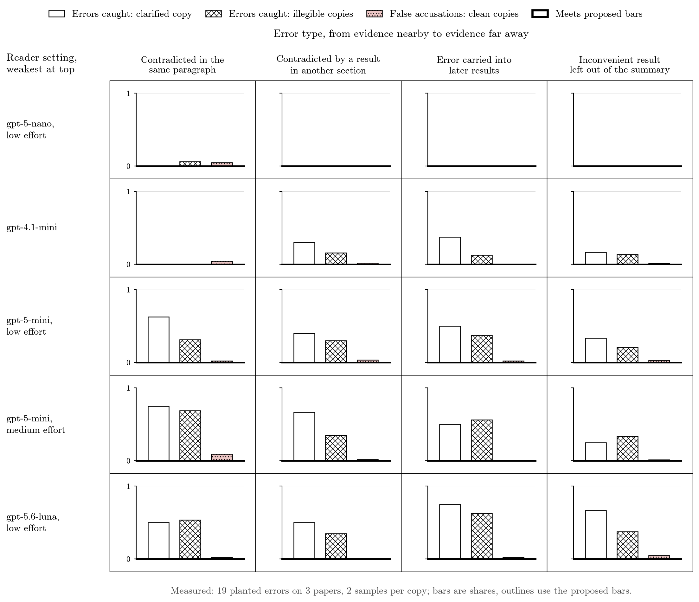

- **The best readers catch about half the errors in the clarified copy, not the 70% the proposed bar asks for.** gpt-5.6-luna (low) catches 0.60 [0.37, 0.81], gpt-5-mini (medium) 0.51 [0.30, 0.71]. No cell sits on the ceiling, so V1's problem (readers see through illegibility) does not recur here. The problem now is a low clarified-copy rate.
- **The gap between clarified and illegible copies is about 0.15 for two readers, with wide intervals.** Pooled over types: gpt-5-mini low 0.45 vs 0.29 (gap 0.16 [0.01, 0.32]), luna low 0.60 vs 0.45 (gap 0.15 [−0.07, 0.35]), gpt-5-mini medium 0.51 vs 0.46 (gap 0.05 [−0.07, 0.19]). Most of the gap comes from `compobf` (compressed plus jargon); `obf` alone costs little.
- **The clarified copy is no easier than the original** for the three stronger readers (luna 0.60 vs 0.58, gpt-5-mini medium 0.51 vs 0.55). gpt-5-mini low is the exception (0.45 vs 0.29).
- **False accusations of planted errors are rare in clean copies:** 0 to 9% per cell, under the 10% proposed bar everywhere. The gate passes.
- gpt-5-nano is on the floor (1 catch in 152 reviews); gpt-4.1-mini nearly so (about 0.2 in the clarified copy).
- The gpt-5-mini grader agreed with gpt-6.1-sol on 50 of 50 sampled reviews, so the grades are usable.
- **Repairing V1's rewrite defects did not change this picture** (experiment 3r, Jason's note). After 42 patches, catch rates on the repaired illegible copies are within about 0.1 of V1's, slightly lower if anything (all intervals include 0), so the defects did not inflate the gap. The gap is the same or a little larger on repaired copies (luna 0.21, gpt-5-mini low 0.25, on 17 common errors).
- Inference, measured since in experiment 5: with one error per long paper, readers fail mostly at finding the error rather than at judging it. The plan at that point was to raise the clarified-copy rate (stronger reader settings, experiment 4) and test with more errors whether the gap holds (experiment 7).

Per cell, with 4 to 6 errors each:

| reader | type | errors | clarified | illegible (obf+compobf) | original | false accusation |
|---|---|---|---|---|---|---|
| nano-low | same_paragraph | 4 | 0.00 [0.00, 0.00] | 0.06 [0.00, 0.19] | 0.00 [0.00, 0.00] | 0.05 [0.00, 0.15] |
| nano-low | other_section | 5 | 0.00 [0.00, 0.00] | 0.00 [0.00, 0.00] | 0.20 [0.00, 0.40] | 0.00 [0.00, 0.00] |
| nano-low | carried | 4 | 0.00 [0.00, 0.00] | 0.00 [0.00, 0.00] | 0.00 [0.00, 0.00] | 0.00 [0.00, 0.00] |
| nano-low | omitted | 6 | 0.00 [0.00, 0.00] | 0.00 [0.00, 0.00] | 0.00 [0.00, 0.00] | 0.00 [0.00, 0.00] |
| 4.1-mini | same_paragraph | 4 | 0.00 [0.00, 0.00] | 0.00 [0.00, 0.00] | 0.00 [0.00, 0.00] | 0.05 [0.00, 0.14] |
| 4.1-mini | other_section | 5 | 0.30 [0.00, 0.70] | 0.16 [0.00, 0.35] | 0.30 [0.00, 0.70] | 0.02 [0.00, 0.05] |
| 4.1-mini | carried | 4 | 0.38 [0.00, 0.75] | 0.12 [0.00, 0.38] | 0.38 [0.00, 0.75] | 0.00 [0.00, 0.00] |
| 4.1-mini | omitted | 6 | 0.17 [0.00, 0.50] | 0.14 [0.00, 0.32] | 0.17 [0.00, 0.33] | 0.02 [0.00, 0.05] |
| mini-low | same_paragraph | 4 | 0.62 [0.25, 1.00] | 0.31 [0.12, 0.50] | 0.50 [0.12, 0.88] | 0.02 [0.00, 0.07] |
| mini-low | other_section | 5 | 0.40 [0.00, 0.80] | 0.30 [0.05, 0.65] | 0.20 [0.00, 0.60] | 0.04 [0.00, 0.11] |
| mini-low | carried | 4 | 0.50 [0.00, 1.00] | 0.38 [0.00, 0.75] | 0.38 [0.00, 0.75] | 0.02 [0.00, 0.07] |
| mini-low | omitted | 6 | 0.33 [0.00, 0.67] | 0.21 [0.04, 0.46] | 0.17 [0.00, 0.50] | 0.03 [0.00, 0.09] |
| mini-med | same_paragraph | 4 | 0.75 [0.50, 1.00] | 0.69 [0.25, 1.00] | 0.75 [0.50, 1.00] | 0.09 [0.00, 0.18] |
| mini-med | other_section | 5 | 0.67 [0.22, 1.00] | 0.35 [0.05, 0.70] | 0.60 [0.30, 0.90] | 0.02 [0.00, 0.05] |
| mini-med | carried | 4 | 0.50 [0.00, 1.00] | 0.56 [0.25, 0.88] | 0.62 [0.25, 1.00] | 0.00 [0.00, 0.00] |
| mini-med | omitted | 6 | 0.25 [0.00, 0.58] | 0.33 [0.08, 0.62] | 0.33 [0.08, 0.67] | 0.02 [0.00, 0.05] |
| luna-low | same_paragraph | 4 | 0.50 [0.00, 1.00] | 0.53 [0.25, 0.86] | 0.50 [0.00, 1.00] | 0.02 [0.00, 0.07] |
| luna-low | other_section | 5 | 0.50 [0.10, 0.90] | 0.35 [0.15, 0.55] | 0.30 [0.00, 0.70] | 0.00 [0.00, 0.00] |
| luna-low | carried | 4 | 0.75 [0.25, 1.00] | 0.62 [0.50, 0.88] | 0.88 [0.62, 1.00] | 0.02 [0.00, 0.07] |
| luna-low | omitted | 5 | 0.67 [0.22, 1.00] | 0.38 [0.08, 0.67] | 0.67 [0.33, 1.00] | 0.05 [0.00, 0.11] |

Pooled over types (bootstrap 95% over the 19 errors):

| reader | clarified | original | obf | compobf | clarified minus illegible |
|---|---|---|---|---|---|
| gpt-5-nano low | 0.00 | 0.06 | 0.03 | 0.00 | −0.01 [−0.04, 0.00] |
| gpt-4.1-mini | 0.21 [0.05, 0.39] | 0.21 | 0.08 | 0.14 | 0.10 [−0.03, 0.24] |
| gpt-5-mini low | 0.45 [0.24, 0.66] | 0.29 | 0.37 | 0.21 | 0.16 [0.01, 0.32] |
| gpt-5-mini medium | 0.51 [0.30, 0.71] | 0.55 | 0.53 | 0.39 | 0.05 [−0.07, 0.19] |
| gpt-5.6-luna low | 0.60 [0.37, 0.81] | 0.58 | 0.51 | 0.39 | 0.15 [−0.07, 0.35] |

Exploratory (the 3 errors the strong reader missed in a non-clarified copy): weak readers showed the desired pattern on them. gpt-5-mini medium caught them in 4 of 6 clarified reviews and 0 of 18 others; luna caught them in 4 of 6 clarified, 3 of 12 illegible and 0 of 6 original reviews. With 3 errors this is suggestive only, but it bears on the strong-reader gate question for Jason.

### Repairing V1's illegible copies (Jason's note)

V1's texts are untouched; repaired copies are in [`data/v4/repaired/`](../data/v4/repaired/) ([`scripts/v4/repair.py`](../scripts/v4/repair.py)). gpt-6.1-sol (medium) compared each copy with the original, listed every contradiction or factual difference the copy has and the original does not (starting from the step 0b inventory), and wrote a minimal patch in the copy's style. The check was rerun on the patched text until it listed nothing. Every patch, with its diff and reason, is in [`patches.jsonl`](../data/v4/repaired/patches.jsonl). Cost $2.86.

| paper | `obf` patches | `compobf` patches | rounds until clean |
|---|---|---|---|
| 2609.30094v2 | 2 | 5 | 2 / 2 |
| 2608.13754v1 | 1 | 12 | 2 / 3 |
| 2609.02893v1 | 16 (10 are one repeated code-name misuse) | 6 | 3 / 3 |

- **All 6 illegible copies now pass the check.** 42 patches in total. They are mostly code names used for the wrong term (for example "N5P", the code for *OOD score*, written where the original means *out of distribution*). There are also several major meaning changes: `compobf` of 2608.13754v1 said "mechanisms agree" where the original says "mechanisms differ a great deal", and `compobf` of 2609.02893v1 swapped two target-trained AUROCs (0.936 and 0.950). I checked that swap against the original by hand, and the patch is correct.
- **The rewrites had far more defects than the step 0b inventory found** (42 patches, against 13 contradictions the inventory listed for these 6 copies, about half of which the originals share). The inventory looked only for contradictions inside a copy. This check compares the copy with the original, so it also finds changed meaning that is consistent within the copy.
- **Two of the 19 surviving planted errors touch a repaired passage.** 2609.30094v2 omitted-1 was planted in `compobf` in a sentence that itself misattributed the drift result (probe-level written as dialogue-level). After the repair, that edit no longer applies. For 2609.02893v1 carried-3 in `obf`, a patch touches its evidence. So experiment 3's grid on V1 copies did include planted passages containing rewrite defects, despite the avoid list.
- **Clarified copies: 2 of 3 pass this check, and 1 would fail.** On 2608.13754v1, the clarified copy says the specification space holds "all levels that a competent analyst could defend", where the original says "the levels of each that a competent analyst could defend, each with a citation". Sol called this major. I judge it minor: it widens a protocol requirement and drops the citation condition. No planted error uses this passage. It is recorded and not patched, because Jason's note keeps the clarified copies as they are.

#### Experiment 3 rerun on the repaired copies (experiment 3r)

Preregistered in [`plan-v4.md`](plan-v4.md) before any data; script [`scripts/v4/exp3r_repaired.py`](../scripts/v4/exp3r_repaired.py), output [`data/v4/exp3r-repaired/`](../data/v4/exp3r-repaired/). V1's planted edits were reused wherever they still applied word for word in the repaired copy (43 of 44 error-copy pairs), so the planted passage is identical and only the repairs differ; 2609.30094v2 omitted-1 was re-planted in `compobf`. The strong-reader and pair checks were rerun, then the same five readers (2 samples) reviewed the repaired planted copies, and 90 new clean reviews (3 per reader and copy) gave the false-accusation baseline. Cost $17.63.

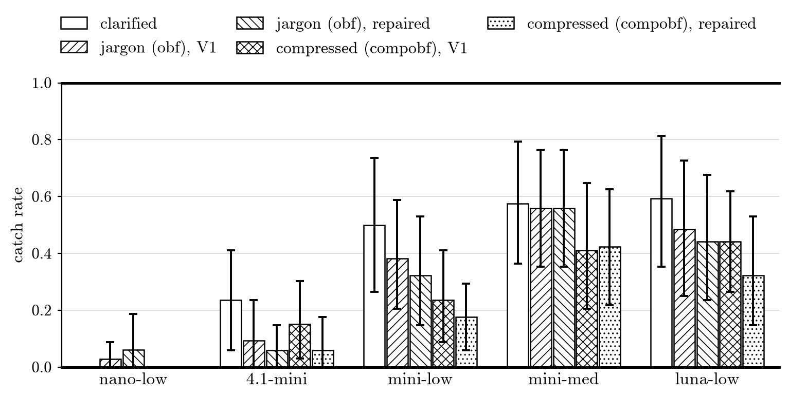

- **The repairs did not raise catch rates. If anything they lowered them slightly.** On the 17 errors in both preregistered sets, repaired minus V1 for the illegible copies pooled: luna low −0.08 [−0.18, 0.02], gpt-5-mini low −0.06 [−0.15, 0.03], gpt-4.1-mini −0.06 [−0.15, 0.01], gpt-5-mini medium +0.01 [−0.15, 0.16], nano +0.02. Every interval includes 0. The defects therefore did not depress catches in V1's copies, contrary to the worry behind the repair. At this sample size the distortion is no larger than about 0.15 in either direction.
- **So the clarified-minus-illegible gap is the same or slightly larger on repaired copies:** luna 0.21 (V1 0.13), gpt-5-mini low 0.25 (0.19), gpt-5-mini medium 0.08 (0.09), on the 17 common errors. No cell meets the proposed bars on either grid.
- **False accusations stay low:** 1 to 8% on repaired copies, against 2 to 4% on V1 copies (differences within ±0.05, intervals include 0).
- **Construction checks:** 17 of 19 preregistered errors pass again. carried-1 (2608.13754v1) and omitted-3 (2609.02893v1) now fail the pair check although their planted edits are identical to V1's (weird result 11). The gpt-5-mini grader agreed with gpt-6.1-sol on 30 of 30 regraded reviews; 7 of 530 reviews were unparsed and are excluded.

| reader | clarified | obf V1 | obf repaired | compobf V1 | compobf repaired | illegible: repaired - V1 | clarified - illegible, V1 | clarified - illegible, repaired | false acc. V1 | false acc. repaired |
|---|---|---|---|---|---|---|---|---|---|---|
| nano-low | 0.00 [0.00, 0.00] | 0.03 [0.00, 0.09] | 0.06 [0.00, 0.19] | 0.00 [0.00, 0.00] | 0.00 [0.00, 0.00] | 0.02 [0.00, 0.05] | -0.01 | -0.03 | 0.02 | 0.01 |
| 4.1-mini | 0.24 [0.06, 0.41] | 0.09 [0.00, 0.24] | 0.06 [0.00, 0.15] | 0.15 [0.03, 0.30] | 0.06 [0.00, 0.18] | -0.06 [-0.15, 0.01] | 0.11 | 0.18 | 0.04 | 0.08 |
| mini-low | 0.50 [0.26, 0.74] | 0.38 [0.21, 0.59] | 0.32 [0.15, 0.53] | 0.24 [0.09, 0.41] | 0.18 [0.06, 0.29] | -0.06 [-0.15, 0.03] | 0.19 | 0.25 | 0.04 | 0.02 |
| mini-med | 0.58 [0.36, 0.79] | 0.56 [0.35, 0.76] | 0.56 [0.35, 0.76] | 0.41 [0.21, 0.65] | 0.42 [0.22, 0.62] | 0.01 [-0.15, 0.16] | 0.09 | 0.08 | 0.04 | 0.05 |
| luna-low | 0.59 [0.35, 0.81] | 0.48 [0.25, 0.73] | 0.44 [0.24, 0.68] | 0.44 [0.26, 0.62] | 0.32 [0.15, 0.53] | -0.08 [-0.18, 0.02] | 0.13 | 0.21 | 0.03 | 0.01 |

Rates over the 17 common errors, 2 samples per copy (clean: 3), 95% bootstrap over errors; the clarified rates are experiment 3's, reused. Reproduce with `python scripts/v4/exp3r_repaired.py --figure`.

### Experiment 4: stronger reader settings

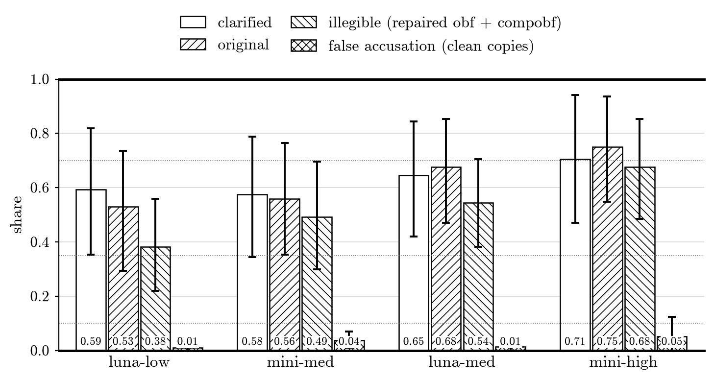

Preregistered in [`plan-v4.md`](plan-v4.md) before any data. Two stronger settings, gpt-5.6-luna medium (`luna-med`) and gpt-5-mini high (`mini-high`), reviewed the 17 errors in both preregistered sets in all four copies (clarified, original, repaired `obf`, repaired `compobf`), 2 samples each, 272 planted-copy reviews, plus 48 clean reviews for false accusations. Prompts, grader and analysis as experiment 3. The `luna-low` and `mini-med` rows are reused from experiments 3 and 3r on the same errors and copies. Code: [`scripts/v4/exp4_stronger.py`](../scripts/v4/exp4_stronger.py). Data: [`data/v4/exp4-stronger/`](../data/v4/exp4-stronger/). Cost $30.50 in the ledger.

| setting | clarified | original | illegible (repaired obf + compobf) | clarified − illegible | false accusation |
|---|---|---|---|---|---|
| luna-low (exp 3/3r) | 0.59 [0.35, 0.82] | 0.53 [0.29, 0.74] | 0.38 [0.22, 0.56] | 0.21 [0.01, 0.41] | 0.01 [0.00, 0.03] |
| mini-med (exp 3/3r) | 0.58 [0.34, 0.79] | 0.56 [0.35, 0.76] | 0.49 [0.30, 0.70] | 0.08 [−0.10, 0.26] | 0.04 [0.01, 0.07] |
| luna-med | 0.65 [0.42, 0.84] | 0.68 [0.47, 0.85] | 0.54 [0.38, 0.71] | 0.10 [−0.12, 0.31] | 0.01 [0.00, 0.04] |
| mini-high | 0.71 [0.47, 0.94] | 0.75 [0.55, 0.94] | 0.68 [0.49, 0.85] | 0.03 [−0.07, 0.13] | 0.05 [0.00, 0.12] |

17 errors, 2 samples per copy, pooled over error types; 95% bootstrap over errors (gap paired). Reproduce with `python scripts/v4/exp4_stronger.py --figure`.

- **Measured:** more reasoning effort raises the catch rate on every copy, and raises it as much or more on the illegible copies. Within each model, the gap shrinks as effort rises: luna 0.21 (low) to 0.10 (medium), gpt-5-mini 0.08 (medium) to 0.03 (high). Only mini-high reaches the 0.70 clarified bar, and its illegible rate (0.68) is far above the 0.35 bar.
- **The clarified copy is still no easier than the original** for any of the four settings (original is higher for both new settings).
- False accusations stay under the 0.10 bar (mini-high 0.05, upper bound 0.12). The grader agreed with gpt-6.1-sol on 30 of 30 regraded reviews. 5 of 320 reviews were unparsed or cut off by the output allowance (luna-med 3, mini-high 2) and are excluded.
- **Inference:** the illegible copies slow readers down but do not hide the planted errors from a reader that searches harder. That matches V1's finding that readers see through the rewrites. This is the "stronger readers see through the illegibility" branch of the preregistered reading.

### Experiment 5: pointed check (finding or judging?)

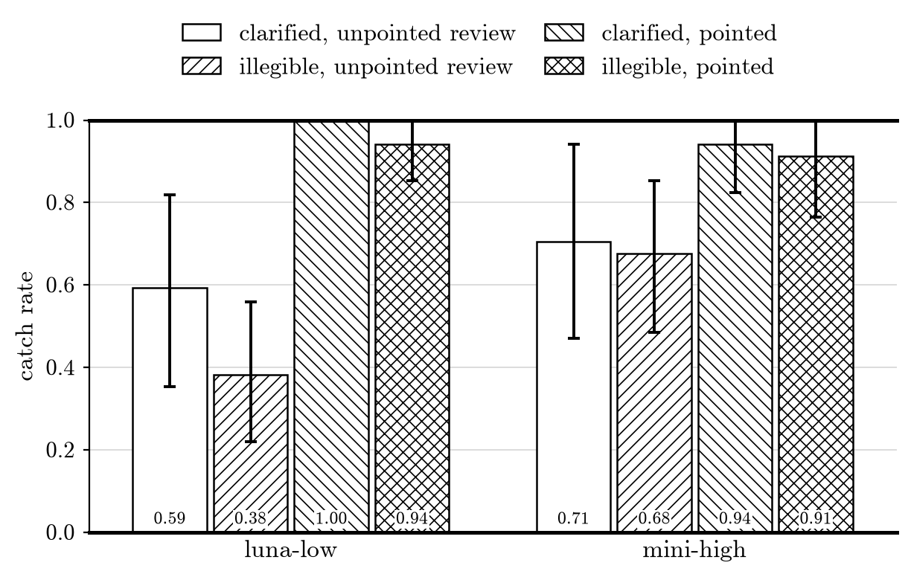

Preregistered in [`plan-v4.md`](plan-v4.md) before any data. luna-low and mini-high each got the whole copy plus one quoted passage, the planted text, and were asked: "Check whether this passage is consistent with the rest of the paper" (same system prompt as the review). The run covered 17 errors in clarified, repaired `obf` and repaired `compobf`, 1 sample each. The control asked the same question on the unplanted clarified copy, quoting the passage before planting. A "not consistent" reply was graded by experiment 3's grader as a one-item review. Code: [`scripts/v4/exp5_pointed.py`](../scripts/v4/exp5_pointed.py). Data: [`data/v4/exp5-pointed/replies.jsonl`](../data/v4/exp5-pointed/replies.jsonl). Cost $5.98 in the ledger.

| setting | pointed clarified | pointed illegible | pointed gap | unpointed gap (exp 3/3r/4) |
|---|---|---|---|---|
| luna-low | 1.00 [1.00, 1.00] | 0.94 [0.85, 1.00] | 0.06 [0.00, 0.15] | 0.21 [0.01, 0.41] |
| mini-high | 0.94 [0.82, 1.00] | 0.91 [0.76, 1.00] | 0.03 [−0.09, 0.18] | 0.03 [−0.07, 0.13] |

| setting | clarified: pointed catch on errors missed / found unpointed | illegible: missed / found | control: says inconsistent / graded as the planted reason |
|---|---|---|---|
| luna-low | 7/7 / 9/9 | 22/24 / 10/10 | 1/17 / 1/17 |
| mini-high | 4/5 / 12/12 | 10/12 / 21/22 | 0/17 / 0/17 |

"Missed" means the reader missed that error in that copy in most of its unpointed samples (ties count as missed). Bootstrap 95% over errors, 2000 resamples, seed 0. 0 of 136 replies failed or were unparsed. gpt-6.1-sol regraded 21 replies and agreed on 21. Reproduce with `python scripts/v4/exp5_pointed.py --figure`.

- **Measured:** pointed, both readers catch 91 to 100% of planted errors in every copy, including 43 of 48 error-copy pairs they had missed unpointed. They rarely call the unplanted passage inconsistent (1 of 34). Against the preregistered reading, clarified pointed rates are at least 0.85 and control accusations at most 0.15, so **clarified-copy misses are a search problem**. The pointed gap is near 0 while luna-low's unpointed gap is 0.21, so **illegibility acts on finding, not judging.**
- All 6 pointed misses are on 2 errors, both of the "omitted from summary" type (2608.13754v1 omitted-1, 2609.30094v2 omitted-1). The readers check the numbers in the quoted sentence, find them correct, and do not notice the dropped caveat. An omission is not visible from the passage alone, so this is expected for that type.
- **Inference:** a reader that searched exhaustively would erase the illegibility effect in these copies. The audit's signal is how much harder the copy makes it to find the contradicting content. So harder illegible copies should target search, by moving evidence away from claims or splitting it across sections, more than wording. Larger budgets or a search-focused prompt (for example, checking each claim in turn) would raise clarified rates, but by the same logic they would raise illegible rates too.

### Experiment 6: search-hard illegible copy `scatter`

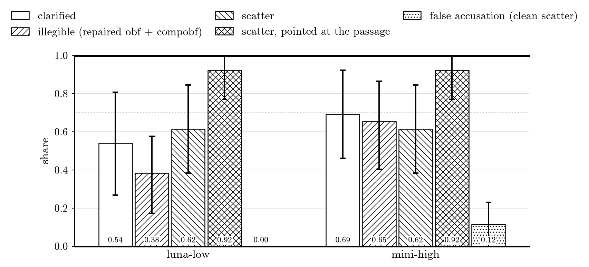

Preregistered in [`plan-v4.md`](plan-v4.md) before any data. gpt-6.1-sol (medium) rewrote each original into `scatter` (prompt `SCATTER_USER`). The rewrite keeps every fact in plain wording. Each number is reported once, in tables or an appendix, definitions and caveats get their own sections, and cross-references are removed. Lengths are 0.92 to 0.99 times the original. Checks: experiment 1's number check, and `repair.py`'s consistency check against the original (a missing fact counts as a defect), rerun until clean. It made 1 patch on 2608.13754v1, 8 on 2609.02893v1 and 0 on 2609.30094v2, and all three copies are clean. The 17 errors of experiment 4 were planted into `scatter` (experiment 2's plant prompt) and passed through the strong reader and a pair check against the clarified copy. 13 survived. Then luna-low and mini-high reviewed them (2 samples each), with clean reviews (2 samples) and the pointed check (1 sample). Code: [`scripts/v4/exp6_scatter.py`](../scripts/v4/exp6_scatter.py). Data: [`data/v4/exp6-scatter/`](../data/v4/exp6-scatter/) (copies `<paper>.scatter.md`, unpatched `<paper>.scatter.raw.md`, `copies.jsonl`, `errors.jsonl`, `reviews.jsonl`, `clean-grades.jsonl`, `pointed.jsonl`). Cost $10.07 in the ledger.

| reader | clarified | illegible (repaired obf + compobf) | scatter | clarified − scatter | clarified − illegible | pointed, scatter | false accusation, scatter |
|---|---|---|---|---|---|---|---|
| luna-low | 0.54 [0.27, 0.81] | 0.38 [0.17, 0.58] | 0.62 [0.38, 0.85] | −0.07 [−0.35, 0.20] | 0.16 [−0.08, 0.40] | 0.92 [0.77, 1.00] | 0.00 |
| mini-high | 0.69 [0.46, 0.92] | 0.65 [0.40, 0.87] | 0.62 [0.38, 0.85] | 0.08 [−0.15, 0.31] | 0.04 [−0.04, 0.13] | 0.92 [0.77, 1.00] | 0.12 [0.00, 0.23] |

The table covers the 13 errors in the experiment 6 set. Clarified and illegible rates are reused from experiments 3/3r (luna-low) and 4 (mini-high), restricted to those errors. Intervals are bootstrap 95% over errors (2000 resamples, seed 0). 0 of 64 reviews and 0 of 26 pointed replies failed. gpt-6.1-sol regraded 20 reviews and agreed on 18. Both disagreements are mini-high reviews of 2609.02893v1 other_section-2 that the gpt-5-mini grader counted as caught and Sol did not. Reproduce with `python scripts/v4/exp6_scatter.py --figure`.

- **Measured:** neither reader catches fewer errors in `scatter` than in the clarified copy, and pointed rates stay at 0.92. Against the preregistered reading, mini-high (clarified 0.69, just under 0.7) has a gap of 0.08 whose interval includes 0. So **this layout illegibility is not measurable with these readers and one planted error per paper.**
- **Errors lost in construction:** 4 of 17 failed. One was not caught by the strong reader in `scatter` (2608.13754v1 omitted-1). Three failed the two-copy pair check, and two of those three complaints were about the *clarified* planting, which had passed the four-copy pair check in experiments 2 and 3r (weird result 11, again). As preregistered, all 4 are excluded. Readers were not run on them.
- Both pointed misses are on 2609.30094v2 omitted-1, an "omitted from summary" error, as in experiment 5.
- **Inference:** these readers hold the whole paper in context, so moving evidence costs them little. Codes and compression cost luna-low more, perhaps because they break the lexical match between a claim and its evidence. A layout-based audit would need much longer documents or readers with limited context. Neither is the setting of this pilot.
- **Confound, small:** luna-low's clarified and illegible reviews (experiments 3/3r) had a 16,000-token output limit, its `scatter` reviews 32,000 (as preregistered). The longest luna review in experiments 3/3r used 1,868 output tokens, so the limit was never reached and this does not matter in practice.

### Experiment 7: several planted errors per copy

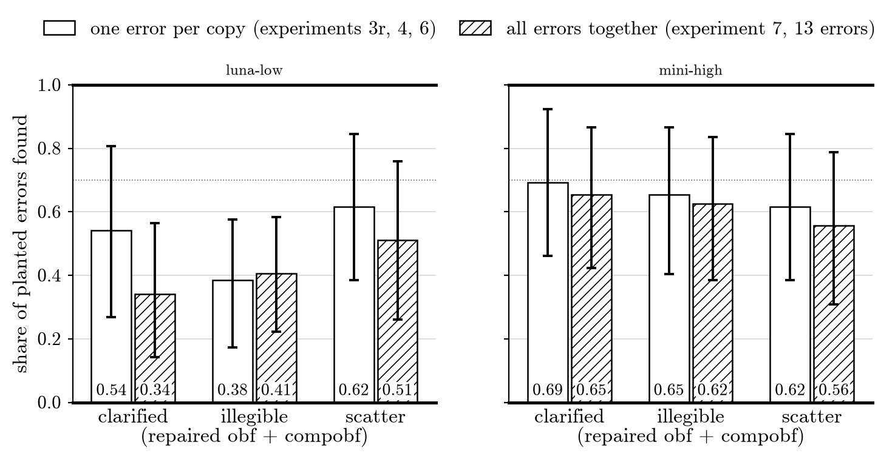

Preregistered in [`plan-v4.md`](plan-v4.md) before any data. For each paper, all errors of the experiment 6 set were planted together into one clarified, one repaired `obf`, one repaired `compobf` and one `scatter` copy, reusing each copy's existing edits. A mechanical check confirmed that every edit still applies and that no evidence quote is lost, so all 13 errors combine (3, 5 and 5 per paper). luna-low and mini-high reviewed each copy 4 times (96 reviews), and each review was graded against each planted error. Code: [`scripts/v4/exp7_multi.py`](../scripts/v4/exp7_multi.py). Data: [`data/v4/exp7-multi/`](../data/v4/exp7-multi/) (`plan.jsonl`, `reviews.jsonl`, `calls.jsonl`). Cost $8.27 in the ledger.

| reader | clarified | illegible (repaired obf + compobf) | scatter | clarified − illegible | clarified − scatter | errors reported per review (clarified / illegible / scatter) |
|---|---|---|---|---|---|---|
| luna-low | 0.34 [0.14, 0.57] | 0.41 [0.22, 0.58] | 0.51 [0.26, 0.76] | −0.07 [−0.23, 0.08] | −0.17 [−0.39, 0.04] | 2.1 / 2.3 / 2.8 |
| mini-high | 0.65 [0.42, 0.87] | 0.62 [0.38, 0.84] | 0.56 [0.31, 0.79] | 0.03 [−0.15, 0.21] | 0.10 [−0.08, 0.29] | 3.9 / 3.8 / 3.6 |

Shares are the planted errors found per review, pooled. Intervals are a paired bootstrap over the 13 errors (2000 resamples, seed 0). Errors in the same review are not independent, so these intervals are somewhat too narrow. 3 of 96 reviews were unparsed: luna-low wrote malformed JSON (an invalid `\(` escape, and stray text after the list). They are excluded, as in earlier experiments. gpt-6.1-sol regraded 20 (review, error) pairs and agreed on 19. Reproduce with `python scripts/v4/exp7_multi.py --figure`.

- **Measured:** no gap whose interval excludes 0, and neither reader reaches 0.7 on clarified. Compared with one error per copy (open bars in the figure, exploratory), mini-high's shares drop by 0.03 to 0.06 in every copy alike. luna-low drops by 0.20 on clarified and by about 0.1 on `scatter`, and does not drop on the illegible copies.
- **Measured:** luna-low reports few errors per review, and fewest on clarified (2.1). On clarified 2609.02893v1 it reports exactly one error in all 4 reviews (4 of 20 planted errors found), and 3 of those 4 reviews report the same easy same-paragraph error.
- **Inference:** at low effort, luna stops after the first error or two it finds. In the clarified copy the first find comes quickly, so it stops sooner. This is the opposite of what the audit needs: a more readable copy gives a reader that satisfices fewer planted errors found. mini-high, at about 4 reports per review in every copy, shows no stopping effect.

### Experiment 8: a reader with a limited view

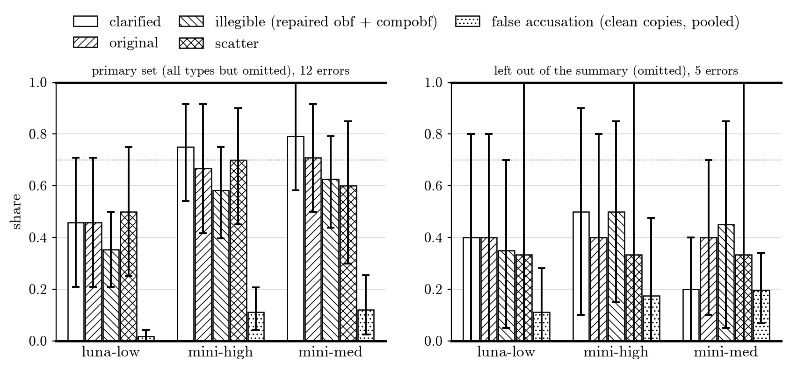

On Jason's instruction (2026-11-12), the reader reads each copy once, in order, one section at a time. Copies are split at level-1 and level-2 headings, and sections over 800 words are split at paragraph breaks, giving 9 to 14 chunks per copy. The reader carries only its own notes, at most 300 words, and rewrites them after each chunk. At each step it sees only the current chunk and its notes, and reports any inconsistency it finds then. Its findings across all steps form its review, graded by experiment 3's grader, unchanged. It cannot search or look back, so search effort can no longer hide illegibility. Preregistered in [`plan-v4.md`](plan-v4.md) ("Experiment 8 preregistration") before any data, with three variants: A (notes ≤ 300 words), B (notes ≤ 150), C (paragraph chunks ≤ 250 words, notes ≤ 300). Copies and errors as experiment 4 (17 errors in clarified, original, repaired `obf` and repaired `compobf`), plus the 13 set-6 errors in `scatter`. 2 samples per copy, plus 2 clean passes per copy for false accusations. **Primary set: the 12 errors that are not "left out of the summary" (`omitted`)**, as Jason asked. Code: [`scripts/v4/exp8_limited.py`](../scripts/v4/exp8_limited.py). Data: [`data/v4/exp8-limited/`](../data/v4/exp8-limited/) (`reviews-A.jsonl`, `clean-grades-A.jsonl`, raw `calls.jsonl`, chunking in `chunks.jsonl`). Variant A cost $90 in the ledger, including the slice and the parse-fix re-run.

**Variant A, primary set (12 errors; 10 in `scatter`)**

| reader | clarified | original | illegible (repaired obf + compobf) | scatter | clarified − illegible | clarified − scatter | false accusations (pooled; worst copy) | verdict |
|---|---|---|---|---|---|---|---|---|
| luna-low | 0.46 [0.21, 0.71] | 0.46 [0.21, 0.71] | 0.35 [0.21, 0.50] | 0.50 [0.25, 0.75] | 0.10 [−0.12, 0.31] | −0.10 [−0.50, 0.25] | 0.02; 0.04 | no / no |
| mini-high | 0.75 [0.54, 0.92] | 0.67 [0.42, 0.92] | 0.58 [0.40, 0.75] | 0.70 [0.45, 0.90] | **0.17 [0.04, 0.29]** | 0.00 [−0.20, 0.25] | 0.11; 0.21 (`compobf`) | no / no |
| mini-med | 0.79 [0.58, 1.00] | 0.71 [0.50, 0.92] | 0.62 [0.44, 0.79] | 0.60 [0.30, 0.85] | 0.17 [−0.04, 0.38] | 0.15 [−0.20, 0.45] | 0.12; 0.20 (clarified 0.17, `scatter` 0.20) | no / no |
| *mini-high, whole paper (exp 4, same 12 errors; exploratory comparison)* | *0.83* | | *0.79* | | *0.04 [−0.04, 0.15]* | | | |

Bootstrap 95% over errors (paired for gaps, 2000 resamples, seed 0). Verdict by the preregistered key (illegible test / `scatter` test). Meets: clarified ≥ 0.70, illegible ≤ 0.35, false accusations ≤ 0.10 in every copy. Comes close: clarified ≥ 0.60, gap ≥ 0.20 with its interval excluding 0, pooled false accusations ≤ 0.15. `omitted` set (5 errors): luna-low clarified 0.40, illegible 0.35; mini-high 0.50 and 0.50, gaps 0.05 and 0.00 with intervals about ±0.4. mini-med: clarified 0.20, illegible 0.45, gap −0.25 [−0.70, 0.20]. All 17: mini-high gap 0.12 [−0.06, 0.26], mini-med 0.04 [−0.18, 0.26]. 0 of 4,912 steps failed after a parser fix (Weird results 18), and 0 of 2,456 for mini-med. gpt-6.1-sol agreed with the grader on 19 of 20 regraded reviews (18 of 20 for mini-med). mini-med was run last, as preregistered step 4, and cost $14.4. Reproduce with `python scripts/v4/exp8_limited.py --figure --variant A`.

- **Measured:** neither reader meets or comes close on either test, so variant A's verdict is "no". mini-high comes nearest. Its clarified rate passes the bar (0.75), and its gap of 0.17 is the first gap for a reader at the clarified bar whose interval excludes 0. But the gap is under the 0.20 "close" bar, its illegible rate (0.58) is far above 0.35, and it falsely accuses in 21% of `compobf` clean passes. luna-low catches little in any copy.
- **Measured (exploratory comparison with experiment 4):** limiting the view lowers mini-high's catch rate more on the illegible copies (0.79 to 0.58) than on clarified (0.83 to 0.75), so the gap grows from 0.04 to 0.17. That is the direction the audit needs: once search is costly, illegibility starts to cost the reader something. It is not enough yet.
- **gpt-5-mini medium (preregistered step 4)** looks like mini-high: clarified 0.79, illegible 0.62, gap 0.17 with an interval that includes 0, and false accusations of 0.17 to 0.20 on clarified and `scatter`, over the 0.10 bar. Verdict "no". It is the only reader with a positive `scatter` gap (0.15 [−0.20, 0.45]), at noise level. It cost half as much per pass as mini-high ($0.10 against $0.22).
- **`scatter` still costs nothing** (clarified minus `scatter` 0.00 for mini-high). Moving evidence away from claims was meant to hurt exactly this reader. One possible reason is that the notes carry the evidence forward well enough, since `scatter` keeps every number in plain words. That explanation is untested.
- **"Left out of the summary" errors behave differently**, as Jason expected: no gap for either reader, and mini-high catches only half even in clarified.
- **Length and the reader (a finding, not tuned):** per pass, clarified has 5,228 words in 13.3 chunks, the original 4,558 in 13.2, `obf` 4,699 in 13.0, `compobf` 2,096 in 11.0 and `scatter` 4,357 in 13.5. So compression halves the words but saves only 2 of 13 notes rewrites, because chunks follow headings. Each chunk of `compobf` is twice as dense. Per copy (primary, mini-high): clarified 18/24, original 16/24, `obf` 14/24, `compobf` 14/24, `scatter` 14/20. For luna-low, `compobf` is the hardest copy (6/24 against 11/24 elsewhere). The longer clarified copy did not cost either reader anything measurable. luna-low writes notes over the 300-word cap on 1.4 to 4.2 of about 12 rewrites per pass, most on `scatter`, and they are cut. mini-high rarely does (0.1 to 1.0). mini-high reports 4.0 findings per pass on clarified and 6.2 to 8.1 on the original and illegible copies, so more of its findings are false or about the copy's own wording when the text is harder.
- **Inference:** a memory-limited reader is a step toward an audit that measures legibility rather than search, but one strong setting with a gap of 0.17 on 12 errors in 3 papers is not a calibrated instrument. Variants B and C are reported below, with the verdict over all variants after C.

**Variant B (notes ≤ 150 words), primary set, mini-high only**

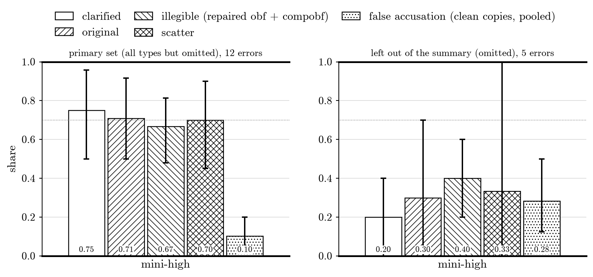

| reader | clarified | original | illegible (repaired obf + compobf) | scatter | clarified − illegible | clarified − scatter | false accusations (pooled; worst copy) | verdict |
|---|---|---|---|---|---|---|---|---|
| mini-high, B | 0.75 [0.50, 0.96] | 0.71 [0.50, 0.92] | 0.67 [0.48, 0.81] | 0.70 [0.45, 0.90] | 0.08 [−0.10, 0.25] | 0.00 [−0.20, 0.25] | 0.10; 0.12 | no / no |
| *mini-high, A (from above)* | *0.75* | *0.67* | *0.58* | *0.70* | *0.17 [0.04, 0.29]* | *0.00* | *0.11; 0.21* | *no / no* |

Same key, intervals and grader as variant A. `omitted` set (5 errors): clarified 0.20, illegible 0.40, gap −0.20 [−0.45, 0.05]. All 17: gap 0.00 [−0.16, 0.16]. 0 of 2,456 steps failed; notes were over the 150-word cap and cut 63 times in 192 passes. gpt-6.1-sol agreed with the grader on 19 of 20 regraded reviews. Cost $30.5. Tables: reproduce with `python scripts/v4/exp8_limited.py --figure --variant B`.

- **Measured:** variant B's verdict is "no" on both tests. Halving the notes did not widen the gap, as the design expected. Clarified stays at 0.75 and the illegible rate rises from 0.58 to 0.67, so the gap falls from 0.17 to 0.08 and its interval includes 0. False accusations on `compobf` fall from 0.21 to 0.12. Length per pass is the same as in A (same chunks), and findings per pass are similar (5.0 on clarified, 5.5 to 7.5 elsewhere).
- **Measured (A against B, same reader, errors and copies):** per error and copy, the two variants give the same catch count in 10 of 12 clarified cells but only 6 of 12 `obf` and 7 of 12 `compobf` cells. Nearly all differences are flips of one sample in two, spread over 9 errors. So **A's 0.17 is not robust**: a design change that should, if anything, hurt the illegible copies more gives half the gap, and the difference is the size of sampling noise (Weird results 20).
- **Inference:** with these 12 errors and 2 samples per copy, a gap of 0.1 to 0.2 for this reader cannot be told from noise, and neither memory setting so far puts the illegible rate anywhere near 0.35.

**Variant C (paragraph chunks ≤ 250 words, notes ≤ 300), primary set, mini-high only**

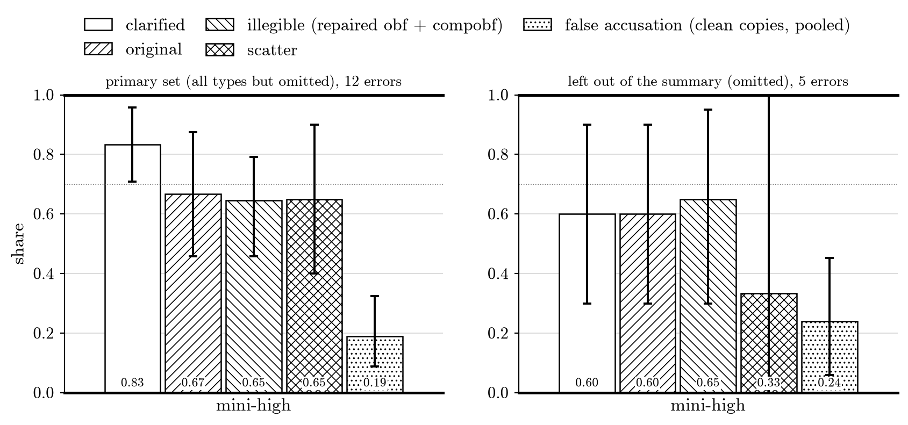

| reader | clarified | original | illegible (repaired obf + compobf) | scatter | clarified − illegible | clarified − scatter | false accusations (pooled; worst copy) | verdict |
|---|---|---|---|---|---|---|---|---|
| mini-high, C | 0.83 [0.71, 0.96] | 0.67 [0.46, 0.88] | 0.65 [0.46, 0.79] | 0.65 [0.40, 0.90] | 0.19 [0.06, 0.31] | 0.20 [0.00, 0.40] | 0.19; 0.25 (`orig`, `compobf`) | no / no |
| *mini-high, A (from above)* | *0.75* | *0.67* | *0.58* | *0.70* | *0.17 [0.04, 0.29]* | *0.00* | *0.11; 0.21* | *no / no* |

Same key, intervals and grader as variant A. `omitted` set (5 errors): clarified 0.60, illegible 0.65, gap −0.05 [−0.35, 0.25]. All 17: gap 0.12 [−0.03, 0.25]. Caught per copy (primary, of 24; `scatter` of 20): clarified 20, original 16, `obf` 17, `compobf` 14, `scatter` 13. 0 of 4,058 steps failed. The run used the parser from before the pass 15 fix, but the fix would have recovered none of C's 2,499 read outputs (one fails both parsers and was retried), so no re-run was needed ([`run-log.md`](run-log.md)). Notes were cut 63 times in 192 passes. gpt-6.1-sol agreed with the grader on 17 of 20 regraded reviews. Cost $47.2. Reproduce with `python scripts/v4/exp8_limited.py --figure --variant C`.

- **Measured:** variant C's verdict is "no" on both tests. On the illegible test the gap (0.19) is just under the 0.20 "close" bar, and pooled false accusations (0.19) are over the 0.15 bar, so it fails "close" on two counts. On the `scatter` test the gap is 0.20, but its interval reaches 0.00 and false accusations are the same. The illegible rate (0.65) is far above the 0.35 "meets" bar.
- **Length and the reader (a finding, not tuned):** paragraph chunks make the reader pay for length. Per pass, clarified has 25.4 chunks (24.4 notes rewrites), the original 22.9, `obf` 21.6, `scatter` 22.6 and `compobf` 13.3. So the clarified copy costs about twice the notes rewrites of `compobf`, and it still gives the highest catch rate (0.83). Smaller chunks also mean more findings per pass (7.8 to 10.4, against 4.0 to 8.1 in A), and with them more false accusations (0.12 on clarified, 0.25 on the original and `compobf`).
- **Measured (A against C, same reader, errors and copies):** the same catch count in 8 of 12 clarified cells, 7 of 12 original, 9 of 12 `obf`, 9 of 12 `compobf` and 5 of 10 `scatter`. As with B, most differences are one-of-two sample flips.

**Experiment 8 verdict (preregistered selection rule over A with luna-low, mini-high and mini-med, B and C).** No variant and reader meets the bars or comes close, on the illegible test or the `scatter` test. By the preregistration, experiment 8 is reported as **negative for this reader design**, and the held-out `imp2` copies are not used. Jason's experiment 9 note (2026-11-13) folds `imp2`'s kind of illegibility into a new `obf-max` copy and replaces `imp2` as a held-out test with 9 held-out papers.

- **Inference:** with a limited view, a reader at the clarified bar shows gaps of 0.17 and 0.19 (A and C), with intervals that exclude 0, where the same reader with the whole paper gave 0.04. B's 0.08 shows that the size of the gap is not stable at this sample size. The direction is consistent, the size is not established, and the illegible rate is nowhere near the bar. Experiment 9 changes the copies (a stronger `obf-max`, clarifications written from the copy the audit receives), the errors (about 50 designed per paper) and the score. These address the two limits seen here: weak illegible copies and too few errors.

### Experiment 9 (in progress): clean versions and errors

**Error stage: errors built and gated on the 4 calibration papers (pass 28); no weak-reader data yet.** Preregistered in pass 27 ([`plan-v4.md`](plan-v4.md), "Experiment 9 error stage preregistration"); code [`scripts/v4/err9.py`](../scripts/v4/err9.py), rows [`data/v4/err9/errors.jsonl`](../data/v4/err9/errors.jsonl), raw calls `data/v4/err9/calls.jsonl`. gpt-6.1-sol (high) designed 49 errors per paper (7 categories × 2 easy, 3 medium, 2 hard) as edits to `orig`. Each was planted alone into `obf-max` and both `explainer` clarifications, and kept only if the strong reader (Sol medium, whole paper) caught it in both clarified copies and the pair check found it planted equally in all 4 versions. Cost $26.33 (estimate about $55).

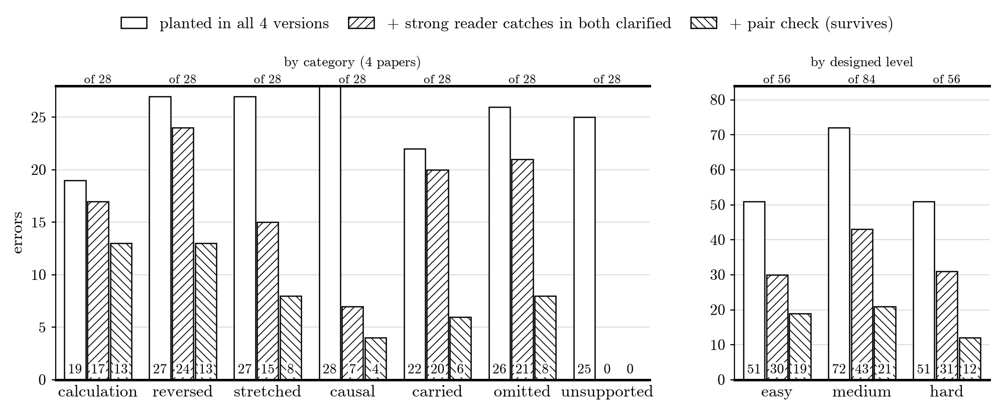

**Figure 9b.** Errors left after each construction stage, pooled over the 4 papers (28 designed per category, 56 / 84 / 56 per level). Code: `python3 scripts/v4/err9.py --table`.

- **Measured: 52 of 196 errors survive** (2609.30094v2 9, 2608.13754v1 14, 2609.02893v1 18, Dropout 11), **44 in the primary set** (excluding `omitted` and `unsupported`). 22 failed planting (no counterpart in a version, or an overlap with the avoid list), 70 more were missed by the strong reader in at least one clarified copy, and 52 more failed the pair check.
- **`unsupported`: 0 of 25 planted survive.** The strong reader flagged none of them in any version, `orig` included. Experiment 0's review prompt asks only for contradictions, so a claim with no support is not something it reports. This category cannot be tested with the preregistered review prompt (weird result 24).
- **`causal`: 4 of 28 survive**, all from 2609.02893v1 (7 of 28 passed the strong-reader gate). The strong reader rarely reports a correlation restated as a cause as an internal error.
- **`calculation`: most errors failed planting** (9 of 28 had no counterpart). `obf-max` keeps every number in its tables but states most derived comparisons in its prose qualitatively, so a wrong number in the prose of `orig` has nowhere to go in `obf-max` (weird result 25).
- **The pair check removed 52 errors**, mostly because the designer's own edit to `orig` also dropped a nearby clause or qualifier, which the check flags in every version, not because the versions were planted unequally.
- **Designed difficulty matches distance:** the median distance from edit to evidence in `orig` is 16 words for easy, 347 for medium and 2,442 for hard (survivors: 16, 220, 2,730). The strong reader caught 48 of the 52 survivors in planted `orig` too, so for it, designed level does not predict a miss.
- **Next:** readers, below.

**Reader 1, gpt-5-mini high with variant A (limited view): preregistered verdict "no" for both scores (pass 30, all 4 papers).** Code: `err9.py read`, `regrade`, `--scores` and `--distance` ([`err9.py`](../scripts/v4/err9.py)); rows [`data/v4/err9/reader-mini-high-A.jsonl`](../data/v4/err9/reader-mini-high-A.jsonl); raw calls `data/v4/err9/reader-calls.jsonl`. Cost $24.5 including the slice (ledger $130.91 → $155.46; estimate $31). 0 failed or unparsed steps, 0 ungraded rows. gpt-6.1-sol regraded 20 random planted reviews and agreed with the grader on all 20.

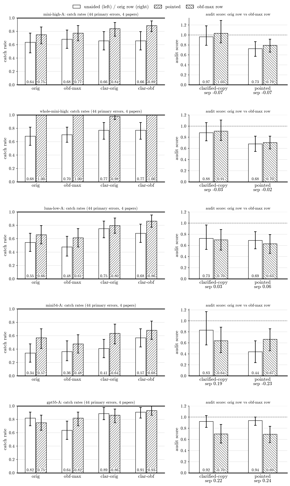

**Figure 9c (44 primary errors, 4 papers).** Left: unaided and pointed catch rates per version. Right: the two audit scores' `orig` and `obf-max` rows, with 95% intervals from a bootstrap over errors stratified by paper (2000 resamples, seed 0). Code: `python3 scripts/v4/err9.py --scores mini-high-A`.

| primary set, 44 errors | `orig` | `obf-max` | `clar-orig` | `clar-obf` |
|---|---|---|---|---|
| unaided catch | 0.64 [0.48, 0.77] | 0.68 [0.55, 0.82] | 0.66 [0.52, 0.80] | 0.66 [0.52, 0.80] |
| pointed catch | 0.75 [0.61, 0.86] | 0.77 [0.66, 0.89] | 0.84 [0.73, 0.93] | 0.89 [0.80, 0.95] |
| false accusations (per error × clean pass; bar ≤ 0.10) | 0.10 | 0.14 | 0.11 | 0.15 |

| audit score | `orig` row (bar ≥ 0.85) | `obf-max` row (bar ≤ 0.60) | separation (bar ≥ 0.25) | verdict |
|---|---|---|---|---|
| clarified-copy | 0.97 [0.79, 1.18] | 1.03 [0.84, 1.29] | −0.07 [−0.32, 0.17] | no |
| pointed | 0.73 [0.57, 0.87] | 0.79 [0.66, 0.92] | −0.07 [−0.22, 0.08] | no |

- **Measured:** the limited-view reader catches the same share of errors in all four versions (0.64 to 0.68 unaided). Maximal illegibility (`obf-max`) did not lower its catch rate, and clarifying did not raise it. So both audit scores give `obf-max` about the same value as `orig`, and both separations are slightly negative with intervals around 0. False accusations exceed the 0.10 bar in 3 of 4 versions. Pointing at the passage raises catch rates most in the clarified versions (+0.18 and +0.23, against +0.11 and +0.09), so the gain from pointing is larger where the text is clearer. The control (unplanted passage) is wrongly accused in 0.11 of cases.
- **Secondary sets (not barred):** `omitted` (8 errors) and all 52 give the same picture: separations 0.20 [−0.83, 1.73] and 0.00 for `omitted`, −0.03 and −0.06 for all.
- **Against experiment 8 (inference):** experiment 8's variant A, with the same reader, found a clarified-minus-illegible gap of 0.17 [0.04, 0.29] on V1's `obf`/`compobf` copies. With the new `obf-max`, new errors and a fourth paper, the gap is gone (clarified 0.66 against `obf-max` 0.68). Either experiment 8's gap was partly noise (its variant B gave 0.08), or `obf-max`, which is shorter than V1's copies, helps a chunked reader as much as its jargon hurts (see weird result 26).
- **Weird result 26, explained as noise plus length (exploratory, no API):** unaided, `obf-max` 30 of 44 against `orig` 28 of 44. Error by error that is 5 errors caught only in `obf-max` against 3 caught only in `orig` (sign test p = 0.73). `obf-max` is shorter (51 chunks against 58 over the 4 papers), so edit and evidence sit closer (1.4 chunks apart on average, against 2.0), and a catch is much likelier when they share a chunk (pooled 0.80 against 0.25 to 0.56 when they do not). All 3 of `obf-max`'s net extra catches come from the 15 errors whose evidence is closer in `obf-max` (3 to 0); on the 25 at equal distance, `orig` leads 3 to 2. Reproduce with `python3 scripts/v4/err9.py --distance mini-high-A`.
**Reader 2, gpt-5-mini high with the whole paper (the reference): preregistered verdict "no" for both scores (pass 31, all 4 papers).** Same code and figure (bottom row of Figure 9c; `python3 scripts/v4/err9.py --scores mini-high-A whole-mini-high`); rows [`data/v4/err9/reader-whole-mini-high.jsonl`](../data/v4/err9/reader-whole-mini-high.jsonl). Cost $12.1 including a first slice lost to a token-allowance defect ($1.3; weird result 27). 2 of 1,000 rows unparsed (malformed JSON from the reader: 1 planted read, 1 pointed check), excluded as preregistered; 0 failed reads. gpt-6.1-sol regraded 20 random planted reviews and agreed on 18; both disagreements are lenient gpt-5-mini grades on 2609.02893v1 (one in `obf-max`, one in `clar-obf`), so they touch both terms of the `obf-max` row and cannot move the verdict.

| primary set, 44 errors | `orig` | `obf-max` | `clar-orig` | `clar-obf` |
|---|---|---|---|---|
| unaided catch | 0.68 [0.55, 0.82] | 0.70 [0.59, 0.82] | 0.77 [0.64, 0.89] | 0.77 [0.64, 0.89] |
| pointed catch | 1.00 | 1.00 | 0.98 [0.93, 1.00] | 1.00 |
| false accusations (bar ≤ 0.10) | 0.06 | 0.07 | 0.02 | 0.02 |

| audit score | `orig` row (bar ≥ 0.85) | `obf-max` row (bar ≤ 0.60) | separation (bar ≥ 0.25) | verdict |
|---|---|---|---|---|
| clarified-copy | 0.88 [0.74, 1.06] | 0.91 [0.74, 1.11] | −0.03 [−0.31, 0.21] | no |
| pointed | 0.68 [0.55, 0.82] | 0.70 [0.59, 0.82] | −0.02 [−0.18, 0.14] | no |

- **Measured:** with the whole paper, clarifying raises the unaided catch rate by about 0.08 over both `orig` and `obf-max`, but `obf-max` is no harder than `orig` (0.70 against 0.68). Pointed at the passage, it catches every error in every version, so the pointed score is just the unaided rate. False accusations are low (0.02 to 0.07, under the bar), and the control passage is wrongly accused in 0.05 of cases. Secondary sets: `omitted` 8 errors, separations 0.40 [−0.33, 1.33] and 0.12 [−0.25, 0.38]; all 52, 0.02 and 0.00.
- **Against reader 1 and earlier experiments (inference):** both readers give `obf-max` the same score as `orig`. This repeats experiments 3 to 5 for the whole-paper reader (illegibility costs a strong reader nothing, and pointing removes all misses), and it now holds for the limited-view reader too. The one difference is that the whole-paper reader gains from clarification (+0.08) and the limited-view reader does not, which is the opposite of what experiment 8 suggested.
**Reader 3, gpt-5.6-luna low with the limited view (variant A): preregistered verdict "no" for both scores (pass 32, all 4 papers).** Same code and figure (bottom row of Figure 9c; `python3 scripts/v4/err9.py --scores mini-high-A whole-mini-high luna-low-A`); rows [`data/v4/err9/reader-luna-low-A.jsonl`](../data/v4/err9/reader-luna-low-A.jsonl). Cost $3.33 including the slice and regrade. 0 failed or unparsed read steps. 10 pointed replies were first left ungraded by a parser defect (weird result 28), fixed and replayed from cache; the verdict was "no" before and after. gpt-6.1-sol regraded 20 random planted reviews and agreed on all 20.

| primary set, 44 errors | `orig` | `obf-max` | `clar-orig` | `clar-obf` |
|---|---|---|---|---|
| unaided catch | 0.55 [0.41, 0.68] | 0.48 [0.34, 0.64] | 0.75 [0.61, 0.86] | 0.68 [0.55, 0.82] |
| pointed catch | 0.66 [0.52, 0.80] | 0.61 [0.48, 0.75] | 0.80 [0.68, 0.91] | 0.86 [0.77, 0.95] |
| false accusations (bar ≤ 0.10) | 0.08 | 0.05 | 0.10 | 0.09 |

| audit score | `orig` row (bar ≥ 0.85) | `obf-max` row (bar ≤ 0.60) | separation (bar ≥ 0.25) | verdict |
|---|---|---|---|---|
| clarified-copy | 0.73 [0.53, 0.97] | 0.70 [0.52, 0.88] | 0.03 [−0.20, 0.28] | no |
| pointed | 0.69 [0.54, 0.85] | 0.63 [0.45, 0.79] | 0.06 [−0.15, 0.28] | no |

- **Measured:** luna low gains most from clarification of the three readers: +0.20 on both `orig` and `obf-max` (0.55 → 0.75, 0.48 → 0.68). `obf-max` costs it a little (0.48 against 0.55; the difference was not tested). Because clarifying helps both by the same amount, the clarified-copy score, which divides each version's rate by its clarified copy's, comes out about the same for both rows. Unlike readers 1 and 2, pointing does not bring luna near 1.00: it catches 0.61 to 0.86, lowest in `orig` and `obf-max`. So luna's misses include judging failures, and clarified text helps it judge as well as find. False accusations sit at or under the 0.10 bar (0.05 to 0.10); the control passage is wrongly accused in 0.03 of graded cases (0.11 say "inconsistent"). Secondary sets: `omitted` separations −0.08 and 0.05; all 52, 0.03 and 0.06.
- **Inference:** three readers of different strength and view all give `obf-max` about the score of `orig`. For luna the reason is not that illegibility costs nothing (it costs a little), but that the clarified copies help both versions equally, so the score's normalisation cancels the effect. The `obf-max` row would only fall if clarifying `obf-max` helped more than clarifying `orig`, and for no reader so far does it.
**Reader 4, gpt-5.4-mini medium with the limited view (variant A): preregistered verdict "no" for both scores (pass 32, all 4 papers).** First use of this model (returned revision `gpt-5.4-mini-2026-03-17`). Same code and figure (Figure 9c; `python3 scripts/v4/err9.py --scores mini-high-A whole-mini-high luna-low-A mini54-A`); rows [`data/v4/err9/reader-mini54-A.jsonl`](../data/v4/err9/reader-mini54-A.jsonl). Cost $15.85 including the slice and regrade. 0 failed or unparsed read steps, 0 ungraded rows. gpt-6.1-sol regraded 20 random planted reviews and agreed on 18.

| primary set, 44 errors | `orig` | `obf-max` | `clar-orig` | `clar-obf` |
|---|---|---|---|---|
| unaided catch | 0.34 [0.20, 0.48] | 0.36 [0.23, 0.52] | 0.41 [0.27, 0.55] | 0.57 [0.43, 0.70] |
| pointed catch | 0.57 [0.41, 0.70] | 0.48 [0.34, 0.61] | 0.64 [0.48, 0.77] | 0.68 [0.55, 0.82] |
| false accusations (bar ≤ 0.10) | 0.02 | 0.02 | 0.05 | 0.09 |

| audit score | `orig` row (bar ≥ 0.85) | `obf-max` row (bar ≤ 0.60) | separation (bar ≥ 0.25) | verdict |
|---|---|---|---|---|
| clarified-copy | 0.83 [0.56, 1.17] | 0.64 [0.42, 0.88] | 0.19 [−0.09, 0.54] | no |
| pointed | 0.44 [0.24, 0.64] | 0.67 [0.46, 0.86] | −0.23 [−0.43, −0.03] | no |

- **Measured:** gpt-5.4-mini medium is the weakest of the four readers here, though it costs about 3 times as much per token as gpt-5-mini. It reports few findings (2.1 per read, against 7.4 for gpt-5-mini high and 2.9 for luna low), so it rarely accuses falsely (0.02 to 0.09) but also rarely catches (0.34 to 0.57 unaided), and even when pointed at the passage it says "inconsistent" in only 0.64 of cases. Its clarified-copy separation, 0.19, is the largest of the four readers, and it comes from `clar-obf` (0.57) beating `clar-orig` (0.41), not from `obf-max` being hard (0.36 against 0.34 in `orig`). It fails the bars on every count: clarified catch under the 0.60 base, `orig` row 0.83 against 0.85, interval including 0. The pointed score is reversed, with an interval excluding 0 (weird result 29). Secondary sets: `omitted` −0.30 and 0.10; all 52, 0.08 and −0.16.
- **Inference:** a separation that comes from one clarified version beating the other, on a reader catching under half the errors, is not the effect the audit is meant to measure. It is most likely noise in the denominator. The 4 readers so far agree that `obf-max` is no harder than `orig` unaided (differences −0.07 to +0.04).

**Reader 5, gpt-5.5 low with the limited view (variant A): preregistered verdict "close" for both scores (pass 33, all 4 papers).** Returned revision `gpt-5.5-2026-04-23`. Same code and figure (bottom row of Figure 9c; `python3 scripts/v4/err9.py --scores mini-high-A whole-mini-high luna-low-A mini54-A gpt55-A`); rows [`data/v4/err9/reader-gpt55-A.jsonl`](../data/v4/err9/reader-gpt55-A.jsonl). Cost $79.7 including the slice ($11.41) and regrade; the slice projected $81 to $85, under Jason's $200 limit for gpt-5.5. 0 failed or unparsed read steps, 0 ungraded rows. gpt-6.1-sol regraded 20 random planted reviews and agreed on all 20.

| primary set, 44 errors | `orig` | `obf-max` | `clar-orig` | `clar-obf` |
|---|---|---|---|---|
| unaided catch | 0.82 [0.70, 0.91] | 0.64 [0.50, 0.77] | 0.89 [0.80, 0.98] | 0.91 [0.82, 0.98] |
| pointed catch | 0.75 [0.64, 0.86] | 0.82 [0.70, 0.91] | 0.86 [0.75, 0.95] | 0.93 [0.86, 1.00] |
| false accusations (bar ≤ 0.10) | 0.14 | 0.07 | 0.12 | 0.07 |

| audit score | `orig` row (bar ≥ 0.85) | `obf-max` row (bar ≤ 0.60) | separation (bar ≥ 0.25) | verdict |
|---|---|---|---|---|
| clarified-copy | 0.92 [0.82, 1.03] | 0.70 [0.53, 0.87] | 0.22 [0.04, 0.40] | close |
| pointed | 0.94 [0.85, 1.00] | 0.69 [0.54, 0.83] | 0.24 [0.09, 0.41] | close |

- **Measured:** gpt-5.5 is the strongest reader so far (0.82 to 0.91 unaided outside `obf-max`), and the only one that `obf-max` costs something: 0.64 against 0.82 in `orig`. The drop is spread over 3 of 4 papers (all-errors counts `orig` → `obf-max`: Dropout 10 → 7 of 11, 2608.13754v1 9 → 7 of 14, 2609.30094v2 9 → 8 of 9, 2609.02893v1 12 → 12 of 18). Clarifying `obf-max` restores it (0.91), so the clarified-copy score's `obf-max` row falls to 0.70. Both scores clear the "close" bars (`orig` row ≥ 0.75, separation ≥ 0.15 with interval excluding 0, pooled false accusations 0.10 ≤ 0.15). They miss "meets" on the `obf-max` row (≤ 0.60), the separation (≥ 0.25) and false accusations in `orig` and `clar-orig`. The two separations hardly differ (clarified minus pointed −0.02 [−0.17, 0.14]). Secondary sets: `omitted` (8 errors) reversed, −0.40 and −0.36; all 52 errors, 0.15 [−0.04, 0.35] and 0.13 [−0.03, 0.30].
- **Where the separation comes from (exploratory, no API; positions of edit and evidence in variant A chunks):** among errors whose evidence comes at or before the planted chunk, gpt-5.5 judges almost all correctly when pointed in both versions (29 of 32 in `orig`, 31 of 35 in `obf-max`) but finds fewer unaided in `obf-max` (22 of 35 against 29 of 32). So, as experiment 5 found for whole-paper readers, illegibility acts on finding, not judging, and here the limited view makes finding cost something.
- **Selection, applied mechanically as preregistered:** both scores are "close"; the largest separation is the pointed score's (0.24), and the clarified-copy score (0.22) is within 0.05 of it with the same reader, so the near-tie goes to the pointed score. Frozen: **gpt55-A, pointed score, all five primary categories** (pooled pointed `orig` row per category: calculation 1.00, carried 1.00, causal 1.00, reversed 0.89, stretched 0.88; none under 0.60). `omitted` and `unsupported` stay reported separately.
- **Inference:** the earlier conclusion still holds for whole-paper readers and cheaper limited-view ones. What is new is that a strong reader without search shows an illegibility cost at about the size the "close" bar asks for. One reader out of five reaching the bar, with lower bounds of 0.04 and 0.09, could still be chance, and the held-out papers are the preregistered test of that. The pointed score needs no clarified copy, which removes the clarifier from the audit (Jason's concern).
- **Next, by the preregistered rule:** the anchor addendum (now preregistered, pass 34: `plan-v4.md`, "Experiment 9 anchor addendum"; every reviewed anchor must score ≥ 0.75 on the pointed `orig` row, and long anchors may not score more than 0.15 below short ones, else the reader's notes budget is raised to 600 and then 1,200 words), then the frozen audit once on the 9 held-out papers. Both run gpt-5.5 beyond the 4 calibration papers; Jason approved that at 16:15 UTC on 2026-11-13 (updated pass 38: the addendum is running, and the held-out run is preregistered in `plan-v4.md` with an estimate of $135 to $225 for the 9 papers).

#### Anchor addendum: length control (pass 35 to 39; done at variant A, fails on one long anchor)

Preregistered in pass 34 ([`plan-v4.md`](plan-v4.md), "Experiment 9 anchor addendum") before any anchor data. Frozen reader gpt55-A (gpt-5.5 low, variant A: section chunks ≤ 800 words, notes ≤ 300) on `orig` and `obf-max`, primary-category survivors only, reads in their own file `data/v4/err9/reader-gpt55-A-anchors.jsonl` (calibration numbers cannot move). Anchors drawn by rule v2 ([`paper-selection.md`](paper-selection.md), `data/selection/anchors/selection.json`), 2 per length band; versions and errors built exactly as for the calibration papers (`scripts/v4/anchors_build.sh`, `anchors_read.sh`). Code for every number below: `python3 scripts/v4/err9.py --anchors` (no API calls).

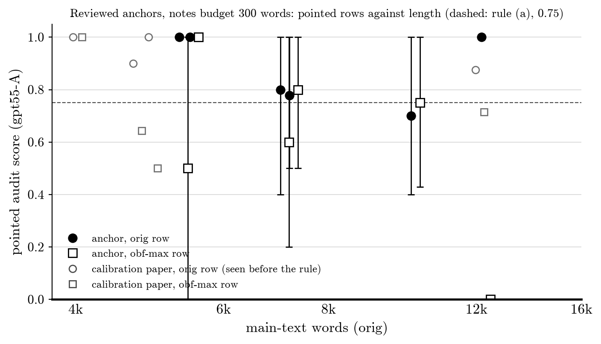

| anchor (band) | words | chunks orig / obf-max | primary errors | pointed `orig` row | pointed `obf-max` row | separation | FA orig / obf-max | control | rule (a) |
|---|---|---|---|---|---|---|---|---|---|
| 2601.02896v4 (short) | 5,374 | 11 / 8 | 4 | 1.00 (n=2) | 0.50 [0.00, 1.00] (n=2) | 0.50 [0.00, 1.00] | 0.00 / 0.00 | 0.00 | pass |
| 2603.01214v2 (short) | 5,535 | 13 / 10 | 5 | 1.00 (n=4) | 1.00 (n=3) | 0.00 | 0.10 / 0.20 | 0.00 | pass |
| 2509.22621v3 (medium) | 7,094 | 15 / 12 | 5 | 0.80 [0.40, 1.00] | 0.60 [0.20, 1.00] | 0.20 [0.00, 0.60] | 0.00 / 0.00 | 0.10 | pass |
| 2509.11379v3 (medium) | 7,270 | 12 / 10 | 12 | 0.78 [0.50, 1.00] (n=9) | 0.80 [0.50, 1.00] (n=10) | −0.02 [−0.33, 0.27] | 0.04 / 0.25 | 0.00 | pass |
| 2510.17247v2 (long) | 10,151 | 21 / 13 | 10 | **0.70** [0.40, 1.00] | 0.75 [0.43, 1.00] (n=8) | −0.05 [−0.40, 0.32] | 0.10 / 0.10 | 0.05 | **fail** |
| 2506.22982v1 (long) | 12,311 | 20 / 13 | 2 | 1.00 (n=1) | 0.00 (n=1) | 1.00 | 0.50 / 0.00 | 0.25 | pass |
| **pooled** | | | **38** | **0.81** [0.67, 0.93] | **0.72** [0.57, 0.86] | **0.08** [−0.08, 0.25] | 0.11 | | |

n is the number of errors in the row (errors found unaided in that version); bootstrap intervals over errors, 2,000 resamples, seed 0 (pooled: stratified by anchor).

- **Measured, rule:** (a) fails on one anchor, 2510.17247v2 (long, `orig` row 0.70 against the 0.75 bar). (b) holds, narrowly: long minus short `orig` row −0.27 [−0.55, 0.00]; the point estimate is below −0.15 but the interval reaches 0, which the rule accepts. Since only a long anchor fails, it is a length failure, and the rule raises the notes budget: 600 words (`gpt55-A600`), then 1,200, re-checked on the 4 calibration papers and the 6 anchors. Slopes per log word (reported, not tested): `orig` −0.12, `obf-max` −0.64, separation +0.52.
- **Measured, signal:** pooled separation 0.08 [−0.08, 0.25], against 0.24 [0.09, 0.41] on the 4 calibration papers with the same frozen setting. Positive on 3 anchors, near 0 on 3.
- **Inference:** the calibration papers' separation did not carry over to new, reviewed papers at this budget. With 1 to 12 errors per anchor, single anchors are noisy, and 2 of the 6 (2601.02896v4, 2506.22982v1) carry most of the positive separation on 2 and 1 errors per row. A ladder step changes both the length behaviour and the separation, and the plan's rule for choosing the step looks at the length rule (and the 4-paper "close" condition) only.
- **Construction:** survivors per anchor 2 to 12 primary errors of 49 designed, fewer than on the calibration papers (9 to 18 of all categories). Sol grader agreement on a 20-review sample of anchor grades: 17/20.
- **Clarified original on the anchors (exploratory, calibration only; Jason, INBOX 16 Nov ~19:30 UTC; pass 61).** The same frozen reader read the anchors' `clar-explainer-orig` planted copies (38 primary errors) and 2 clean copies per anchor, as on the calibration papers, as reader `gpt55-A-anchors-clar` (own file; the `orig`/`obf-max` rows above are untouched). Pooled, 95% bootstrap over errors within anchors: unaided `orig` 0.66 [0.50, 0.82], `obf-max` 0.68 [0.55, 0.82], clarified **0.74 [0.61, 0.87]**; pointed caught 0.82 [0.71, 0.92], 0.76 [0.63, 0.87], **0.95 [0.87, 1.00]**; pointed row 0.81, 0.72, 0.78 [0.66, 0.89]. False accusations in clean reads 6/76, 10/76, 7/76; pointed controls 2/38, 1/38, 4/38. Per anchor (unaided, pointed): 2506.22982v1 2/2, 2/2; 2601.02896v4 3/4, 3/4; 2603.01214v2 4/5, 5/5; 2509.22621v3 2/5, 4/5; 2509.11379v3 7/12, 12/12; 2510.17247v2 10/10, 10/10. 0 failed or unparsed steps, 0 grades None; Sol grader check 20/20 agree; $21.84. **Reading:** as on the 4 calibration papers (same reader, 44 primary errors: unaided `orig` 0.82, clarified 0.89; pointed row 0.94 and 0.95), the clarified original is found unaided a little more often than the original (0.74 against 0.66) and judged correctly when pointed at more often (0.95 against 0.82). Its pointed row (0.78) is close to the original's (0.81), as on the calibration papers. So the calibration standard behaves the same way on reviewed papers; what fails to carry over is the `obf-max` drop, not the clarified copy. Intervals overlap throughout. The 4 control accusations (pointed at an unplanted passage, the reader still says it conflicts) are 2 on 2509.11379v3, the theory paper of weird result 31, and 1 each on 2509.22621v3 and 2510.17247v2; not read by hand. Code: `python3 scripts/v4/err9.py --anchors-clar`; data `data/v4/err9/reader-gpt55-A-anchors-clar.jsonl`.
- **Defects found and fixed by re-reads** (`run-log.md`, pass 39; neither changes a calibration number): gpt-5.5 sometimes opened JSON strings with curly quotes, so 18 steps of 2509.11379v3 failed to parse (third fallback in `exp8.parse_json`, re-read from cache); and a title containing "Preferences" matched the references cut in `exp8.sections`, cutting 2510.17247v2 to 0 chunks so that planted copies equalled the clean one (word boundary added, re-read).
- **Ladder step A600 (pass 40; does not pass).** Notes ≤ 600 words, all else unchanged; rows `data/v4/err9/reader-gpt55-A600.jsonl`, figure [`v4-exp9-anchors-gpt55-A600.png`](figures/v4-exp9-anchors-gpt55-A600.png), code `python3 scripts/v4/err9.py --anchors gpt55-A600`. Per anchor, pointed `orig` / `obf-max` rows: 2601.02896v4 0.67 / 0.50, 2603.01214v2 1.00 / 1.00, 2509.22621v3 0.80 / 0.60, 2509.11379v3 0.50 / 0.70, 2510.17247v2 0.80 / 0.70, 2506.22982v1 1.00 / 1.00. Pooled: 0.73 [0.58, 0.87] / 0.72 [0.57, 0.86], separation 0.01 [−0.15, 0.17], fa 0.10; long minus short +0.04 [−0.36, 0.29]. (a) fails on 2601.02896v4 and 2509.11379v3, so this is not a length failure; 4 original papers: `orig` 0.94, `obf-max` 0.81, separation 0.14 (lower bound 0.01), not "close". Sol grader check 19/20; 0 failed steps; 3 of 860 rows ungraded (2 control replies, 1 clean grade; outside the rule's rows). Cost about $87.

**`obf-max` exists for the 4 original calibration papers** (pass 24; [`scripts/v4/obf_max.py`](../scripts/v4/obf_max.py), texts in `data/v4/versions/<paper>/`, rows in [`manifest.jsonl`](../data/v4/versions/manifest.jsonl), defects and patches in [`obf-max-log.jsonl`](../data/v4/versions/obf-max-log.jsonl)). gpt-6.1-sol (high) rewrote each original once with every illegibility at once, and the consistency check (gpt-6.1-sol medium, missing facts counted as defects) came clean within 4 rounds on the first generation for all 4, so no `obf-max-r2` was needed. Total cost $1.03 at list prices.

| paper | words, orig → obf-max | ratio | codes | repair rounds / patches | FK grade, orig → obf-max | Coleman-Liau, orig → obf-max |
|---|---|---|---|---|---|---|
| 2609.30094v2 | 4,019 → 2,632 | 0.66 | 24 | 3 / 3 | 15.8 → 17.8 | 16.4 → 16.8 |
| 2608.13754v1 | 4,943 → 3,582 | 0.72 | 24 | 1 / 0 | 11.7 → 14.6 | 11.9 → 15.6 |
| 2609.02893v1 | 4,736 → 2,750 | 0.58 | 22 | 3 / 5 | 13.6 → 15.1 | 13.3 → 16.1 |
| Dropout | 12,105 → 7,028 | 0.58 | 24 | 2 / 3 | 11.1 → 15.3 | 10.5 → 14.1 |

- **Measured:** every number of each original is in its `obf-max`, in the same or another format (for example "26.40" in a table for "26.40%"), with **one exception the checker missed**: 2608.13754v1's `obf-max` drops the size of the edge population (32,491). It is recorded in `run-log.md` (pass 24) and the error stage must not plant errors that depend on it. Dropout's other misses are axis tick labels that the PDF extraction left in the text.
- **Not yet measured:** whether `obf-max` is harder for a reader. Reading grades rise by 0.4 to 4.2 points, but they measure only sentence and word length, not codes, scattered evidence or missing steps, so they understate the change. Readers come in the error stage.

**Clarifications: 5 prompts × 2 sources × 4 papers = 40 versions** (pass 26; [`scripts/v4/clarify.py`](../scripts/v4/clarify.py), prompt design in [`clarification-approaches.md`](clarification-approaches.md), texts `data/v4/versions/<paper>/clar-<prompt>-<orig|obf>.md`, rows in [`manifest.jsonl`](../data/v4/versions/manifest.jsonl), every check round, issue and patch in [`clarify-log.jsonl`](../data/v4/versions/clarify-log.jsonl)). The prompt texts were committed before any generation. gpt-6.1-sol (high) wrote each version from its source only; `clar-*-obf` never saw `orig`. Fidelity against `orig` used experiment 1's check unchanged. Cost $10.76 at list prices (estimate was about $20).

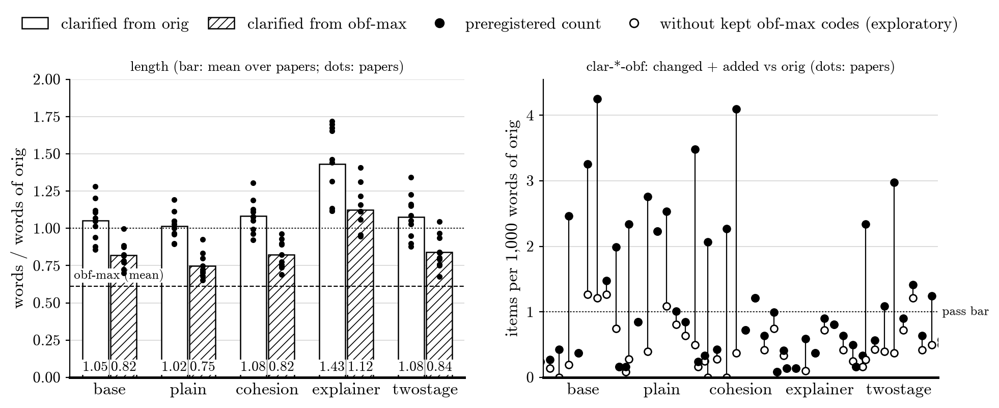

**Figure 9a.** Left: words relative to `orig` (bars: mean over the 4 papers; dots: papers; dashed: `obf-max`). Right: changed + added items (fidelity check against `orig`) per 1,000 words of `orig`, for the copies clarified from `obf-max`. Filled: the preregistered count, judged against the pass bar of 1. Open: the same count without items that only flag one of `obf-max`'s placeholder codes, which the clarifier kept (exploratory, decided after seeing results; weird result 21). Table: `python scripts/v4/clarify.py --table`.

- **Measured, from `orig`:** all 20 `clar-*-orig` copies are faithful by experiment 1's check (no issue at all, minor ones included) within 2 rounds; 10 needed 1 to 7 patches. Length is 1.06 to 1.16× `orig` on average, and 1.55× for `explainer` (summary, glossary and claim-to-evidence lists). Reading grades fall a little (on the 3 arXiv papers, FK grade falls by 0.1 to 3.1; `cohesion` is the highest of the 5 on every paper).
- **Measured, from `obf-max`:** the clarifier recovers most of the length (0.80 to 1.18× `orig`, from 0.64× for `obf-max`) and decodes the codes inline, but usually keeps them ("V4N, or persuasion intensity"). Nothing is reported lost. 12 of the 20 copies keep 1 or 2 major issues; on 2609.30094v2 these are hedges turned into flat claims ("turns a tentative interpretation into a categorical claim").
- **Preregistered prompt rule** (`clar-
-orig` clean on every paper, and `clar-
-obf` at most 1 changed or added item per 1,000 words of `orig` on every paper): **only `explainer` passes** (0.33 to 0.81). `cohesion` misses on one paper (1.21), `twostage` on two (1.24, 1.42), `plain` on two (1.01, 3.48) and `base` on three (up to 4.25). So by the plan, only `explainer` is carried into the error stage.
- **Exploratory:** without the kept-code items, `plain` also passes (at most 0.80), and `base`, `cohesion` and `twostage` fail narrowly (1.21 to 1.27, each on one or two papers). The preregistered count partly measures how the checker groups kept codes (one item for all codes, or one per code), which is noise relative to the bar.
- **Excerpts:** the same two passages of 2609.30094v2 in all 12 versions, picked by position: [`exp9-excerpts.md`](exp9-excerpts.md). In those passages, the `clar-*-orig` copies stay close to `orig` word for word, and the `clar-*-obf` copies are readable prose that keeps the codes.

### Experiment 11: whole paper in context, four readers (core test, done pass 44)

Preregistration and amendment: [`plan-v4.md`](plan-v4.md) ("Experiment 11 preregistration"). Reader: whole paper in context, experiment 9's review prompt and grader unchanged. 44 primary errors on the 4 calibration papers and 38 on the 6 reviewed anchors; 2 unaided samples per error and version, 1 pointed check plus control, 2 clean reads per version. Versions: `obf-max` (garbled), `orig`, and the clarified original `clar-explainer-orig` (calibration standard only, never part of the test). Intervals: 95%, 2,000 bootstrap resamples of errors within papers (seed 0). No pass/fail bars (Jason's). Code: `uv run --with matplotlib python scripts/v4/exp11_whole.py` ([script](../scripts/v4/exp11_whole.py)); rows `data/v4/err9/reader-w11-<reader>.jsonl`, calls `reader-calls-w11-<reader>.jsonl`; log of the run `logs/exp11-salvage-w11-*.log`.

**Unaided catch rate (measured):**

| reader | papers | garbled | original | clarified original | original − garbled |
|---|---|---|---|---|---|
| gpt-5-mini high | 4 calibration | 0.67 [0.57, 0.77] | 0.69 [0.59, 0.80] | 0.76 [0.64, 0.88] | +0.02 [−0.08, +0.12] |
| | 6 anchors | 0.62 [0.50, 0.74] | 0.57 [0.43, 0.70] | 0.59 [0.47, 0.71] | −0.05 [−0.18, +0.07] |
| gpt-5.6-luna low | 4 calibration | 0.59 [0.49, 0.70] | 0.62 [0.50, 0.75] | 0.69 [0.57, 0.81] | +0.03 [−0.08, +0.14] |
| | 6 anchors | 0.46 [0.34, 0.61] | 0.43 [0.32, 0.55] | 0.53 [0.41, 0.64] | −0.03 [−0.16, +0.09] |
| gpt-5.4-mini medium | 4 calibration | 0.47 [0.33, 0.59] | 0.52 [0.39, 0.66] | 0.59 [0.48, 0.70] | +0.06 [−0.05, +0.17] |
| | 6 anchors | 0.50 [0.38, 0.63] | 0.49 [0.37, 0.62] | 0.49 [0.36, 0.62] | −0.01 [−0.14, +0.12] |
| **gpt-5.5 low** | 4 calibration | 0.72 [0.59, 0.83] | 0.92 [0.85, 0.98] | 0.91 [0.84, 0.97] | **+0.20 [+0.07, +0.34]** |
| | 6 anchors | 0.62 [0.49, 0.75] | 0.75 [0.63, 0.87] | 0.80 [0.68, 0.91] | **+0.13 [+0.04, +0.22]** |

**Pointed catch rate (measured):** 0.82 to 1.00 in every version for every reader. Original − garbled: gpt-5-mini high +0.00 / +0.03, luna −0.02 / +0.13 [+0.05, +0.24], gpt-5.4-mini +0.09 / +0.08 (intervals include 0), gpt-5.5 +0.02 / −0.03 (calibration / anchors). Control accusations (the same passage's original text, nothing planted) 0.00 to 0.08.

**False accusations (clean reads with at least one item graded as a catch of some primary survivor):** calibration 1 to 4 of 8 reads per version, anchors 0 to 5 of 12. gpt-5.5: `orig` 2/8 and 0/12, `obf-max` 2/8 and 4/12, clarified 1/8 and 0/12.

**Checks:** after the salvage rerun (below), 0 unparsed or failed reads in 2,208 reads; 4 grades without a value (gpt-5-mini high 2, gpt-5.4-mini 1, gpt-5.5 1), left out of their rates. Sol low regrade of 20 random planted reviews per reader: agree 20/20 for all four. Cost of experiment 11 about $97 at list prices (reads and pointed $97.1 by the script, against the $150 estimate).

**What this shows (inference):**

- **gpt-5.5 low, reading the whole paper, is the only reader that separates the original from its garbled version, and it does so on the reviewed anchors too** (+0.13, lower bound +0.04). The three weaker readers show no separation on either paper set. This is the first setting in the pilot whose separation holds on papers outside the calibration set.
- **The separation is in finding, not judging.** Pointed at the passage, gpt-5.5 judges 0.95 to 1.00 of errors correctly in every version. Experiments 5 and 9 found the same.
- **This differs from experiments 3 to 7,** where whole-paper readers showed no gap. Two things changed: the garbled text (`obf-max` is much harsher than V1's copies) and the reader (gpt-5.5 was not in experiments 3 to 7). Which of the two matters was not tested.
- **The clarified original adds little for gpt-5.5** (0.91 against 0.92 on calibration, 0.80 against 0.75 on anchors): the originals are already near its ceiling. For the weaker readers it is 0.05 to 0.10 above the original on calibration, intervals overlapping.
- **The held-out choice is not applied yet.** By the preregistered rule it waits for experiment 12. On experiment 11 alone gpt-5.5 low is the only reader with a positive anchor difference, so it would be chosen.

**Salvage rerun (pass 44, preregistered as a parser fix in run-log pass 43):** the chains started before a salvage parser was added. After they finished, each reader was rerun from its call cache (`err9.py read <rd> <10 papers>` then `regrade <rd>`), with new calls only for grades of salvaged items. Unparsed or failed reads fell from 7 (gpt-5-mini high) and 16 (luna) to 0. The numbers above are after the rerun; the pre-rerun per-paper lines are in `logs/exp11-w11-*.log`.

### Experiment 12: every paragraph in turn, whole paper in context (gpt-5-mini high done on all 10 papers, pass 59)

**Final, all 10 papers (pass 59).** gpt-5-mini high, 22,516 questions (11,028 calibration, 11,488 reviewed), 0 unparsed or failed, $175.36 ($80.26 + $95.10; estimate was $85 to $170). Output of `uv run --with matplotlib python scripts/v4/exp12_paragraphs.py --scores p12-mini-high`; rows [`p12-mini-high.jsonl`](../data/v4/exp12/p12-mini-high.jsonl), calls [`calls-p12-mini-high.jsonl`](../data/v4/exp12/calls-p12-mini-high.jsonl.gz), figure `docs/figures/v4-exp12-paragraphs.png`. Caught intervals: bootstrap over errors within papers (preregistered). False-alarm intervals: bootstrap over paragraphs within papers (exploratory, pass 58).

| set | version | caught | false alarms / paragraph | / 1,000 words | clean copies (/ 1,000 words) | planted copies: new (exploratory) | inherited |
|---|---|---|---|---|---|---|---|
| 4 calibration (44 errors) | garbled `obf-max` | 0.93 [0.86, 0.98] | 0.278 [0.234, 0.327] (698/2,510) | 3.90 [3.25, 4.62] | 64/228 (4.00) | 176/2,282 | 458 |
| | original | 0.95 [0.89, 1.00] | 0.212 [0.176, 0.249] (697/3,285) | 2.39 [1.96, 2.85] | 49/279 (1.90) | 223/3,006 | 425 |
| | clarified original | 1.00 [1.00, 1.00] | 0.165 [0.139, 0.194] (837/5,083) | 1.94 [1.53, 2.44] | 67/448 (1.82) | 303/4,635 | 467 |
| 6 reviewed (38 errors) | garbled `obf-max` | 0.95 [0.87, 1.00] | 0.354 [0.313, 0.396] (925/2,610) | 4.65 [4.07, 5.24] | 131/368 (4.68) | 229/2,242 | 565 |
| | original | 0.95 [0.87, 1.00] | 0.289 [0.258, 0.323] (1,040/3,594) | 3.06 [2.71, 3.43] | 169/527 (3.54) | 274/3,067 | 597 |
| | clarified original | 0.97 [0.92, 1.00] | 0.269 [0.240, 0.299] (1,385/5,143) | 3.09 [2.50, 3.71] | 191/704 (3.08) | 329/4,439 | 865 |

Original − garbled caught: calibration +0.02 [−0.07, +0.11], reviewed +0.00 [−0.08, +0.08]. Garbled − original false alarms (exploratory interval `fa_diff_boot`, defined in `plan-v4.md` in pass 60 after these rates were seen; paragraph clusters resampled within papers, versions independently, 2000, seed 0): per paragraph calibration +0.066 [+0.006, +0.124], reviewed +0.065 [+0.011, +0.118]; per 1,000 words +1.50 [+0.72, +2.29], +1.59 [+0.88, +2.32]. Between papers, garbled is above original on 9 of 10 papers in both units (exception 2608.13754v1); the intervals do not cover variation between papers. Per paper, false alarms garbled / original / clarified: 2609.30094v2 63/377, 32/477, 38/756; 2608.13754v1 128/560, 223/804, 238/1,035; 2609.02893v1 177/592, 258/1,163, 225/1,421; Dropout 330/981, 184/841, 336/1,871; 2601.02896v4 107/230, 136/341, 155/431; 2603.01214v2 70/283, 69/313, 100/547; 2509.22621v3 82/252, 77/397, 112/528; 2509.11379v3 226/817, 217/1,179, 412/1,765; 2510.17247v2 303/736, 331/868, 418/1,349; 2506.22982v1 137/292, 210/496, 188/523. Per paragraph, garbled exceeds original on 9 of 10 papers (not on 2608.13754v1; counted after seeing the data, exploratory). On the reviewed papers the clarified original is no lower than the original per 1,000 words, unlike the calibration papers (measured; not explained yet, and it is a calibration standard rather than part of the test). The exploratory checks below (found elsewhere, stable paragraphs, heading split, regrouping) are from 7 papers or fewer; their rerun on all 10 papers was started by the follow-up chain at 08:41 UTC (`logs/exp12-followup.log`).

Interim record (passes 46 to 58) follows.

Preregistration: `plan-v4.md`, "Experiment 12 preregistration", with the per-1,000-words measure (Jason, INBOX 01:00 UTC) and the exploratory inherited/new split (defined pass 47 after 2 papers). gpt-5-mini high, all 4 calibration papers (2609.30094v2, 2608.13754v1, 2609.02893v1, jmlr-2014-dropout; 44 errors), 11,028 questions, 0 unparsed, $80.26. Output of `uv run --with matplotlib python scripts/v4/exp12_paragraphs.py --scores p12-mini-high` (pass 50):

| version | caught (44 errors) | false alarms / paragraph | / 1,000 words | clean copies | planted copies: new (exploratory) | inherited |
|---|---|---|---|---|---|---|
| garbled `obf-max` | 0.93 [0.86, 0.98] | 0.278 (698/2,510) | 3.90 | 64/228 | 176/2,282 (0.077; 1.08 per 1,000 words) | 458 |
| original | 0.95 [0.89, 1.00] | 0.212 (697/3,285) | 2.39 | 49/279 | 223/3,006 (0.074; 0.84) | 425 |
| clarified original | 1.00 [1.00, 1.00] | 0.165 (837/5,083) | 1.94 | 67/448 | 303/4,635 (0.065; 0.77) | 467 |

Original − garbled caught: +0.02 [−0.07, +0.11]. Misses: `orig` 2608.13754v1 calculation-easy-1 and 2609.02893v1 causal-hard-1; `obf-max` Dropout calculation-medium-1, reversed-easy-2 and reversed-hard-1 (weird result 35). Planted paragraphs flagged for another reason: 3 `orig`, 2 `obf-max`, 0 clarified. Per paper, false alarms: 2609.30094v2 `orig` 32/477, `obf-max` 63/377, clarified 38/756; 2608.13754v1 223/804, 128/560, 238/1,035; 2609.02893v1 258/1,163, 177/592, 225/1,421; Dropout 184/841, 330/981, 336/1,871.

First reviewed paper (2601.02896v4, 4 errors, 1,015 questions, $7.61): all 4 caught in every version; false alarms per paragraph 0.47 (garbled), 0.40 (original), 0.36 (clarified), per 1,000 words 6.16, 5.12, 3.52. Why this is about twice the calibration rate is weird result 36 (explained, pass 51): about 70% of its false alarms fall on 16 to 24 paragraphs flagged in nearly every copy, and nearly all of these name real inconsistencies or overclaims in the original paper.

3-paper interim (pass 49), kept for the record: caught 1.00 / 0.94 / 1.00 (35 errors), original − garbled −0.06 [−0.14, 0.00]; false alarms per paragraph 0.241 / 0.210 / 0.156.

Notes (measured): the preregistration expected `obf-max` to have "fewer, longer paragraphs". On the first 2 papers it has fewer paragraphs because it is shorter overall (3,582 vs 4,943 and 2,632 vs 4,019 words), but its paragraphs are not longer (mean 69 vs 67 and 61 vs 74 words). So per paragraph and per 1,000 words tell similar stories for garbled vs original, while the clarified original's longer text gives it the lowest rate per 1,000 words. The inherited/new split rests on 1 clean sample per version, so some "new" flags are just a paragraph flagged on one read and not another (inference; not measured).

**Planted paragraphs from regrouping (pass 49, `--regroup p12-mini-high`, no API).** The preregistration defines planted paragraphs as those of the planted copy not found in the clean copy, "1, or 2 where an error has two edits". In 14 of 105 planted copies there are 2 or more. Most are `carried` errors, edited in two places by design. In 3 copies a single edit moved a block across the 40-word merge, so neighbouring paragraphs were regrouped and counted as planted (2609.02893v1 `orig` carried-easy-1: 6 planted paragraphs, 2 edited). Across the 3 papers, 7 paragraphs are planted only by regrouping, with 4 flags on them. No caught result changes if only edited paragraphs count (an edited paragraph is caught in every such copy), and the 4 flags would add under 0.002 per paragraph to the false-alarm rates. The preregistered definition stands. Pass 50, with Dropout: unchanged (14 copies, 7 regrouped-only paragraphs, 4 flags, no caught result differs). **Pass 60, all 10 papers:** 35 of the planted copies have 2 or more planted paragraphs (mostly `carried` errors, by design), 15 paragraphs are planted only by regrouping, there are 5 flags on them, and no caught result differs. The preregistered definition stands.

**Found elsewhere (exploratory, defined pass 48 in `plan-v4.md` before grading; no effect on caught rates).** **Final, pass 60, all 10 papers** (`--elsewhere p12-mini-high`, 4,911 flags graded, 1 failed (the same Dropout grade), $2.24 in all; output [`elsewhere-p12-mini-high.jsonl`](../data/v4/exp12/elsewhere-p12-mini-high.jsonl)): found elsewhere garbled 117 (70 new, 47 inherited), original 147 (115, 32), clarified 234 (182, 52), which is 0.026, 0.024 and 0.026 per non-planted paragraph of planted copies (117/4,524, 147/6,073, 234/9,074). So there is no version difference. False alarms without them, all copies and both paper sets pooled: per paragraph garbled 0.301, original 0.236, clarified 0.199; per 1,000 words 4.10, 2.57, 2.33 (all flags 0.317, 0.253, 0.217 and 4.29, 2.75, 2.52). The grader agrees with all 30 hand labels. The interim record follows. Pass 50, 4 calibration papers (2,052 flags graded, 1 failed, $0.92 in all): garbled 61 (37 new, 24 inherited), original 87 (72, 15), clarified 136 (117, 19), about 0.03 per paragraph of planted copies in each version (61/2,282, 87/3,006, 136/4,635); false alarms without them per paragraph 0.260, 0.191, 0.142 and per 1,000 words 3.65, 2.15, 1.69. Hand labels still agree 30/30. So there is no version difference. The 3-paper record follows. I hand-labelled a seeded random 30 of the 256 "new" false alarms on the first 2 papers (`--new-sample p12-mini-high 30 12`, labels [`new-fa-labels-p12-mini-high.jsonl`](../data/v4/exp12/new-fa-labels-p12-mini-high.jsonl), each now naming its flag): 11 of 30 name the planted error from another paragraph, often the one holding its evidence (e.g. Table 1 flagged because it contradicts the planted "six alternatives exceed"); most of the other 19 are inherited inconsistencies the single clean read happened not to flag (group sizes 1,512 to 2,520, seven vs eight axes, five seeds). Then experiment 9's grader, unchanged, graded every flag on a non-planted paragraph of a planted copy (`--elsewhere p12-mini-high`: 1,283 flags on 3 papers, $0.89 in all, 0 failed, output [`elsewhere-p12-mini-high.jsonl`](../data/v4/exp12/elsewhere-p12-mini-high.jsonl)). It agrees with all 30 hand labels.

**Update, pass 53, 6 papers (adds the first two anchors, 2601.02896v4 and 2603.01214v2; `--elsewhere` rerun from cache, 2,574 flags graded, the same 1 Dropout grade failed, $1.16 in all):** found elsewhere garbled 85 (53 new, 32 inherited), original 107 (86, 21), clarified 170 (144, 26), about 0.03 per flagged non-planted paragraph of planted copies in every version (85/2,700, 107/3,538, 170/5,434). False alarms without them (clean and planted copies): per paragraph 0.269, 0.207, 0.157; per 1,000 words 3.77, 2.33, 1.82 (all flags: 0.289, 0.229, 0.180 and 4.04, 2.57, 2.08). Grader still agrees with all 30 hand labels. Still no version difference; the remaining 4 anchors are graded when gpt-5-mini high finishes.

**Update, pass 55, 7 papers (adds 2509.22621v3; rerun from cache, 2,800 flags graded, the same 1 Dropout grade failed, $1.27 in all):** found elsewhere garbled 88 (55 new, 33 inherited), original 118 (95, 23), clarified 177 (149, 28), 0.030, 0.031 and 0.030 per non-planted paragraph of planted copies (88/2,909, 118/3,868, 177/5,873). False alarms without them (clean and planted copies): per paragraph 0.273, 0.204, 0.160; per 1,000 words 3.73, 2.26, 1.83 (all flags: 0.292, 0.226, 0.183 and 3.97, 2.50, 2.08). Grader agrees with all 30 hand labels. Still no version difference. Reproduce: `python3 scripts/v4/exp12_paragraphs.py --elsewhere p12-mini-high` (from cache).

| version | found elsewhere (flags) | per paragraph of planted copies | errors with ≥ 1 | false alarms without them, per paragraph | per 1,000 words |
|---|---|---|---|---|---|
| garbled `obf-max` | 38 (24 new, 14 inherited) | 0.027 (38/1,400) | 26 of 35 | 0.221 (330/1,491) | 3.08 |
| original | 71 (58 new, 13 inherited) | 0.032 (71/2,250) | 30 of 35 | 0.186 (442/2,373) | 2.64 |
| clarified original | 103 (90 new, 13 inherited) | 0.035 (103/2,952) | 24 of 35 | 0.128 (398/3,109) | 1.40 |

Per paper, found elsewhere per paragraph, garbled / original / clarified: 2609.30094v2 0.030 / 0.033 / 0.024, 2608.13754v1 0.016 / 0.038 / 0.028, 2609.02893v1 0.036 / 0.026 / 0.045. Measured: after 2 papers the garbled rate was lower than the original's in both (pass 48 lead), but on the third paper it is higher, and overall the gap shrank to 0.027 vs 0.032. **The pass 48 lead did not hold up on the third paper**; read it as no clear difference so far. Removing these flags lowers every version's false-alarm rate by 0.02 to 0.03 per paragraph and leaves the order garbled > original > clarified unchanged.

### Earlier experiments

Summary of experiments 0 to 2:

- All five reader settings return usable, parsable reviews, at a cost low enough for the planned grid (all 135 reviews together came to $3.24 in the ledger, which overestimates).
- **Readers accuse clean papers often, and are mostly wrong.** 25 to 100% of reviews accuse the paper, depending on reader and copy. gpt-6.1-sol judged only 10 of the 121 distinct accusations real (8%).
- **The "clean" copies are not clean.** gpt-6.1-sol found 17 internal contradictions across the 9 copies. Two of the originals have small real defects, and V1's rewrites added more, including one major one in each of two `compobf` copies. The readers caught only 6 of the 17 in any of their 15 reviews per copy. These passages are now listed in [`data/v4/inventory/inventory.jsonl`](../data/v4/inventory/inventory.jsonl), and planted errors will avoid them.
- **Clarified copies exist and pass every check (experiment 1).** gpt-6.1-sol wrote one per paper (1.0 to 1.2 times the original's length). Every number in each original appears in its clarified copy. The fidelity check found no added, lost or changed content, and it did find all 3 of 3 infidelities I planted to test it. The clarified copies keep the originals' known contradictions, as instructed, and gain no new ones. (One of them, 2608.13754v1, later fails the stricter check against the original on one minor point; see the repair section.)
- **19 of 36 planted errors survive the construction checks (experiment 2).** gpt-6.1-sol designed 12 errors per paper, 3 of each grid type, and planted each in all four copies (clarified, original, `obf`, `compobf`). An error survives if it could be planted in every copy away from known contradictions, the strong reader caught it in every copy, and the pair check found it planted equally. Survivors by type: same paragraph 4, other section 5, carried 4, omitted from summary 6, which is enough for a coarse grid. Most losses (10) were unequal planting, where the edit added or removed detail in one copy.
- This is a usable baseline for the planned design: readers make many false accusations, especially on `compobf`, and they miss most real contradictions. So the grader has to match each accusation to a specific planted error, and does not just count accusations.

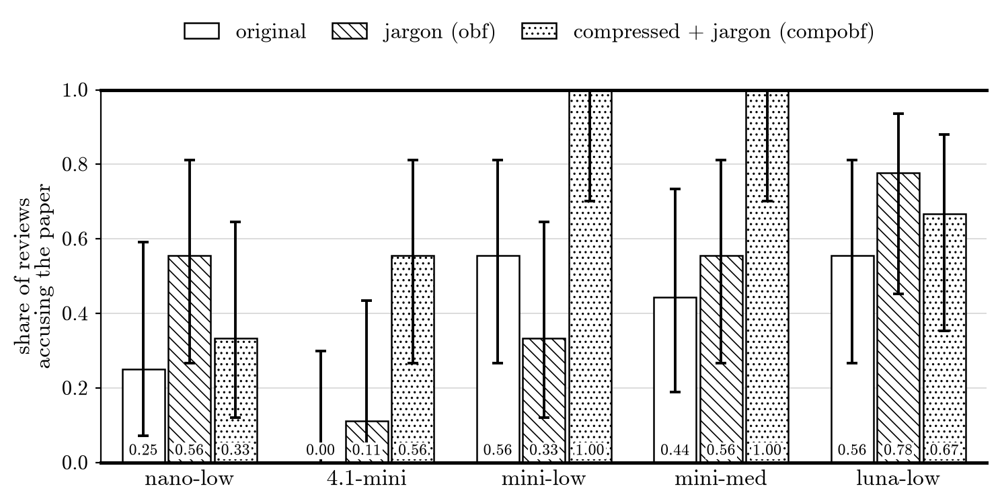

**Figure 1.** Share of reviews that accuse the clean paper of at least one internal error, by reader and copy. Each bar covers 9 reviews (3 papers x 3 samples), with a Wilson 95% interval. No errors were planted, but some accusations are correct (see below), so this is not a false-accusation rate.

Measured:

- **Usable reviews:** 134 of 135 parsed; 0 API failures. gpt-4.1-mini barely reviews. It averages 91 output tokens and returns an empty list on every original.
- **Cost per review (ledger):** gpt-5-nano $0.001, gpt-4.1-mini $0.005, gpt-5-mini low $0.008, gpt-5-mini medium $0.021, gpt-5.6-luna about $0.08 (priced at the fallback rate, so too high).
- **Accusations rise on `compobf` for the gpt-5-mini readers:** 9 of 9 reviews accuse, at 1 to 5 accusations each, against 4 to 5 of 9 on the original.

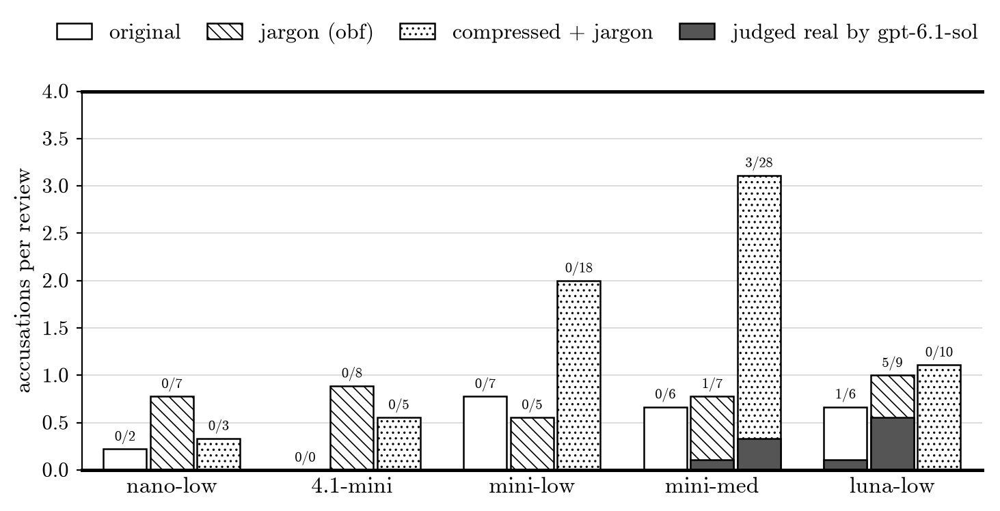

**Figure 2.** Experiment 0 accusations per review, by reader and copy. The dark part is the share gpt-6.1-sol judged real, and the label gives real/total. Exact duplicate accusations are counted once.

Contradiction inventory (measured, by one gpt-6.1-sol sample; its verdicts are not checked against a human except where noted):

| Paper | orig | obf | compobf | Caught by any reader |
|---|---|---|---|---|
| 2609.30094v2 | 0 | 1 (a code given two referents) | 0 | 1 of 1 |
| 2608.13754v1 | 3 minor | 3 minor (same 3) | 5 (1 major: circuits "no better than random" yet "beat" it) | 2 of 11 |
| 2609.02893v1 | 1 minor (14 PCs stated, 15 listed) | 2 minor | 2 (1 major: Z1M code swap) | 3 of 5 |

I checked two items by hand. The 14-vs-15 PC count in 2609.02893v1 is real: the Sandbagging greedy row in Appendix D lists 15 PCs, and Section 4.3 says 14. Sol's two arithmetic reconciliations that I recomputed hold (for example, (0.881 − 0.706)/(0.929 − 0.706) = 78%).

Read by hand during experiment 0 (inference, from about 50 accusations: all those on originals and all gpt-5-mini medium ones on `compobf`):

- **Flaws in the clean texts.** In the original of 2609.02893v1, the appendix table titled "selected for likely transferability" lists PCs that scored 3, while the text says the 19 selected PCs all scored 6. Three readers flagged this. *Corrected after the inventory:* Sol judged it a consistent reading, because the table holds the 5 PCs that the greedy method selected for several targets (Section 4.4). On rereading I agree that the caption is misleading but not contradictory. It goes on the avoid list anyway. In `compobf` of 2609.02893v1, the rewrite gave code Z1M, which the original uses for the source-PCA probe, to the PC-projection method in the abstract. As a result, the abstract says Z1M "nearly matches" the target probe while the results section says it performs like the baseline. All three gpt-5-mini medium samples flagged this. Other `compobf` accusations, such as a pair count attached to the wrong noun and a table caption naming the wrong metric, look like rewrite defects too.
- **False accusations also occur.** Examples: gpt-5-nano read "SSNs are suppressed far more often" as contradicting a table that supports it. gpt-5-mini claimed a pooled kappa cannot lie below every per-size kappa, which is false. Several readers flagged 157 sources against 156 components, which is probably the embedding input counted as a source.

Clarified copies (experiment 1; measured, one gpt-6.1-sol sample per check):

| Paper | Words, original → clarified | Numbers missing | Fidelity issues | Contradictions in clarified copy |
|---|---|---|---|---|
| 2609.30094v2 | 4,019 → 4,824 | 0 | 0 | 0 (original: 0) |
| 2608.13754v1 | 4,943 → 5,927 | 0 | 0 | 3 minor, the same 3 as the original |
| 2609.02893v1 | 4,736 → 4,880 | 0 | 0 | 3 minor: the original's 14-vs-15 PCs, the Table 3 caption, and one false item (below) |

Fidelity-check test: on a copy with 3 planted infidelities it reported exactly those 3 and nothing else.

What I read by hand (inference): the start of 2609.30094v2 through Section 2 in full, and spot checks of the others. The rewrite defines terms inline, moves supporting table pointers next to claims, and splits long sentences. It also rebuilt the original's tables, which the text extraction stored one cell per line, as proper Markdown tables. That is a real legibility gain, but it means part of the gap between the clarified copy and the others is table layout, which the illegible copies do not have. 2609.02893v1 grew only 3%, so its clarified copy differs less from the original than the others do.

Planted errors (experiment 2; measured, one gpt-6.1-sol sample per check):

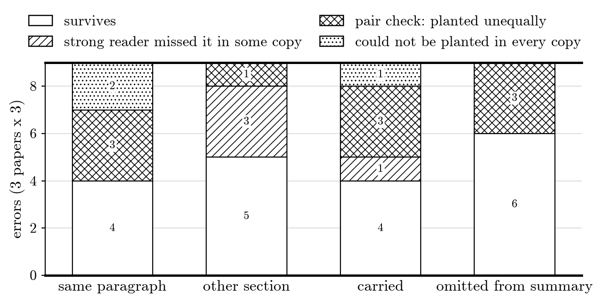

**Figure 3.** The 36 planted errors (3 papers x 3 per type) by the first construction check they failed. Only survivors go into experiment 3.

| Paper | Same paragraph | Other section | Carried | Omitted | Survivors |
|---|---|---|---|---|---|
| 2609.30094v2 | 0 | 2 | 2 | 2 | 6 of 12 |
| 2608.13754v1 | 3 | 1 | 1 | 2 | 7 of 12 |
| 2609.02893v1 | 1 | 2 | 1 | 2 | 6 of 12 |

- The strong reader caught the planted error in 135 of 141 planted copies it reviewed (6 misses, below). It caught every surviving error in all four copies by construction, so these errors are valid and findable, but this says nothing about weak readers.
- Losses: 10 errors planted unequally (for example, planting added a table reference in `obf` or glosses for codes in `compobf`); 3 with no counterpart in some copy; 1 that edits an avoid-list passage in `compobf`; 4 missed by the strong reader in some copy (one of which was also unequal).

What I read by hand (inference): the three slice errors and their plants in `clarified` and `compobf`. They are natural edits. For example, "open-weights LLM judge" becomes "closed-weights" against the paper's own naming of a Llama judge, and "N8W is lowest" becomes "N8W is highest" against Table 4. In the clarified copy, an error often lands next to its evidence, because the clarification put evidence next to claims. So a same-paragraph error in the clarified copy can be a cross-section error in the others. That is the legibility difference under test, but the local-window check should confirm it.

## Weird results

1. **V1's illegible copies contain contradictions the rewrite introduced.** Explained (rewriter errors, example above). Fixed in repaired copies (42 patches, see Results), and experiment 3 rerun on them (3r): catch rates moved by less than 0.1, so the defects did not distort the grid measurably. They break the assumption that the copies of a paper differ only in legibility.
2. **gpt-5-mini accuses `compobf` more than gpt-5.6-luna does** (9 of 9 vs 6 of 9). This is open. One possibility is that luna resolves the codes better and sees through some apparent contradictions, but we have not checked.
3. **gpt-4.1-mini's near-empty reviews.** Probably a weak reader that does not search, and not a bug: its responses are complete JSON. Its single 8-accusation review on `obf` is unexamined.

4. **No reader caught the major rewrite contradiction in `compobf` of 2608.13754v1** ("circuits, being no better than random, at fixed size beat a [random baseline]", abstract), in 15 reviews. gpt-5-mini medium made 28 other accusations on this copy, all judged false. Open. It may be that the sentence is so garbled by the rewrite that it reads as noise rather than as a claim. That is the illegibility effect the audit should measure, but here it comes from a rewrite defect.

5. **The inventory is not ground truth.** On the clarified 2609.02893v1, gpt-6.1-sol listed a new contradiction: the reported Jaccard overlap of 0.182 for Insider Trading Report supposedly disagrees with the appendix PC lists. I recomputed it. With the target ranking cut at k = 13, as Section 4.3 specifies, the overlap is 4/22 = 0.182, which matches the paper. Sol's own description of that case (3/23) is wrong. Explained: a Sol error. The passage stays on the avoid list, which costs nothing. The clarified copy's added definition of Jaccard overlap probably prompted the check, since it was not flagged on the original.

6. **The strong reader missed two errors only in `compobf`** (2608.13754v1: "the discovered circuits are functionally interchangeable", refuted by a near-zero kappa in Section 7.6, and "the surviving specification pool is balanced by metric", refuted by a 52% share), and one only in the original (2609.30094v2). Its evidence quotes were found in those copies. By the rule in `calibration-table.md`, they are removed. Open, and it matters for the design. A miss only in an illegible copy may be the very effect the audit looks for, so removing such errors could push the grid toward the ceiling. With one Sol sample, these could also be chance misses. A second Sol sample on these copies was not run (see Next steps); whether the gate should require catches in the clarified copy only is a decision for Jason.
7. **One designed error was missed by the strong reader in all four copies** (2609.02893v1 carried-1: "source-fitted weights make greedy selection an unbiased OOD estimate"). Probably explained, not verified: the refutation needs an inference about bias from target-label use, not a direct contradiction, so it is a weak error. The gate removed it, as intended.

8. **Stronger readers sometimes catch more in the illegible copies than in the clarified copy** (gpt-5-mini medium on carried and omitted errors, luna on same-paragraph errors). Open. With 4 to 6 errors per cell and 2 samples, these differences are within noise (see the intervals), and pooled rates do not show it.
9. **The clarified copy does not beat the original for the stronger readers.** Open. The originals may already be legible enough for these readers, or the clarified copies' extra length (up to 1.2 times) may cost as much as their explanations help. The preregistered design treats the original as reported, not used for selection, so this does not change the grid's reading, but it matters for using a clarified copy as the reference.
10. **11 of 880 planted-copy reviews were unparsed** (luna 4, nano 3, gpt-4.1-mini 3, gpt-5-mini medium 1) and are excluded from the rates. Not examined individually.
11. **The pair check changes its verdict on identical planted edits.** In experiment 3r, 2 of the 19 preregistered errors (2608.13754v1 carried-1, 2609.02893v1 omitted-3) failed the pair check with the same edits that passed in experiment 2; both times Sol said the `compobf` planting added detail. The surrounding text shown to it differs only where patches are nearby. In the other direction, 2609.30094v2 other_section-2, which the strong reader had missed in one copy in experiment 2, now passes every check. Explained in part: each check is a single gpt-6.1-sol sample, and here 2 of 22 verdicts flipped (about 1 in 10). Following the preregistration, the two are exploratory in 3r. It means the survival rule is noisy; a 2-sample vote would make it steadier.
12. **Catch rates are slightly lower, not higher, on repaired copies** for three of five readers (−0.06 to −0.08). Open. The intervals include 0, so this may be noise. It is not a length effect: the repairs changed each copy's length by at most 8 words. Sampling noise (2 samples per copy, 17 errors) is the simplest explanation.

13. **luna-med catches fewer errors in `obf` (15 of 34) than in `compobf` (22 of 34)**, the reverse of the weaker readers, for whom `compobf` was the harder copy. Open. Most of the difference is in same-paragraph and other-section errors (5 vs 12 catches, of 18 reviews in each copy). With 17 errors and 2 samples it may be noise; not examined.

14. **One control in experiment 5 found a real overclaim in the original paper.** Pointed at the unplanted clarified sentence of 2609.02893v1 carried-3 ("interpretations of greedy-selected PCs describe contrasts at an abstraction level that survives transfer"), luna-low called it too broad, because Table 3 describes greedy-selected PC9 and PC81 as relying on brittle, domain-specific cues. The grader and Sol both counted this as the planted reason. The original paper has the same sentence (line 162 of `orig.md`), and the step 0b inventory did not list it. Explained: a mild real tension in the original that the planted error exaggerates ("uniformly", "exclude"). Unpointed catches of this one error may partly credit the existing tension. It is 1 of 17 errors, so it does not change the pooled rates much. It should go on the avoid list before any new errors are built on this paper.

15. **The number check flagged 9 to 31 "missing" numbers in each raw `scatter` copy, yet the consistency check found no missing fact.** Explained: all are formatting. Section numbers (`scatter` drops them by design), `%` signs that are not repeated in table cells, `38.7` written as `38.70`, and the LaTeX `32{,}491` split by the regex. After normalising, no number is missing in any copy.
16. **mini-high accused clean `scatter` copies of 3 planted errors (0.12), against near 0 elsewhere.** Explained for 2 of 3: on 2609.30094v2, the original paper says leakage "varies strongly by ... persuasion intensity" while its effect-size table says "Negligible" for persuasion. That is a contradiction in the original, on the step 0b inventory, which `scatter` states in prose and so makes easier to see. The grader matched it to two planted errors about persuasion. The third (2609.02893v1 other_section-2) objects that no interpretation-selected AUROC is given for Insider Trading Confirm. The original does not give one either, so it is a reader complaint the grader accepted loosely.

17. **luna-low finds fewer planted errors in the clarified copy than in the illegible copies when several are planted** (experiment 7: 0.34 vs 0.41 and 0.51). Explained in part: it reports fewer errors per review on clarified (2.1 vs 2.3 and 2.8) and often stops after one easy error (above). Why it stops sooner on clarified is an inference: the first find comes faster there. Not tested further.

18. **In the first variant A run, 9 of 4,912 limited-view steps failed to parse, 8 of them on the same chunk** (step 4 of clarified 2609.30094v2, luna-low). Fixed by a re-run. That chunk contains LaTeX (`\(N=1000\)`), which luna copies into its JSON as an invalid escape. A failed step loses its findings and its notes update, so this biased luna's clarified rate down on one paper. The parser now doubles invalid backslash escapes, and luna-low A was re-run from cache, with new calls only after the recovered steps: 0 failures. The primary verdict did not change. luna-low's original-copy rate moved from 0.54 to 0.46, because the recovered passes re-read later chunks with different notes. That gives a sense of luna's sampling noise per copy. The first-run numbers are in [`run-log.md`](run-log.md), and its outputs are kept as `reviews-A-v0.jsonl`.
19. **The limited-view mini-high falsely accuses clean `compobf` copies in 21% of (pass, error) pairs**, against 4 to 12% in the other copies. Partly explained. Of the 5 accusations on the primary set, 1 is the original paper's own persuasion contradiction (item 16). 2 are the same complaint on 2608.13754v1 (`D = 0.960` read as contradicting "nearly complete overlap"), which may be a real ambiguity the compression introduced, and is not checked. The other 2 are open. Reading a dense chunk without the surrounding text plausibly produces more accusations (mini-high reports 6.8 findings per `compobf` pass against 4.0 on clarified).
20. **A smaller notes buffer (variant B) gave a smaller clarified-minus-illegible gap than variant A (0.08 against 0.17), not a larger one.** Probably sampling noise, not proven: the A-to-B differences are mostly one-of-two sample flips spread over 9 errors, mainly on `obf` (14/24 to 17/24 caught), and one error accounts for two (2608.13754v1 other_section-1 on `obf`, 0/2 to 2/2). The "left out of the summary" set reverses in B (clarified 0.20, illegible 0.40), on 5 errors with intervals of about ±0.3. Not examined further. It means A's interval, which excluded 0, should not be read as a stable effect.

21. **Most "added" items in the copies clarified from `obf-max` are `obf-max`'s own placeholder codes,** which the fidelity check (comparing against `orig`) calls invented terminology: 50 of the 58 added items over the 20 copies. Explained: the clarifier sees only `obf-max`, where each code is the term's name, so it keeps the code next to the decoded term. These are not new content, but they count toward the preregistered pass bar, and the checker sometimes lists all codes as one item and sometimes one per code (`plain` on 2609.30094v2: 12 items; `base` on the same paper: 5). The preregistered result stands (only `explainer` passes); the count without code items is reported as exploratory, with a mechanical rule (`code_item` in `clarify.py`).
22. **Every Dropout clarification from `orig` is shorter than `orig`** (0.88 to 0.92×, except `explainer` 1.12×), yet all passed the fidelity check. Explained by inspection, not measured: Dropout's `orig` is raw `pdftotext` output with 27 running-head lines, journal page numbers (1930 to 1955 are among the "missing numbers"), plot axis and tick text and math broken across lines. The clarifiers drop this noise. Dropout's length ratios are therefore not comparable with the other papers'.
23. **One fidelity reply for Dropout failed to parse.** Fixed: Dropout's `orig` contains 30 raw control characters (for example `\x0f` for ε); the checker quoted one, and the strict JSON parser rejected it. `clarify.py` now parses with control characters allowed, and the version was regenerated from the cached generation (run-log, pass 26).
24. **The strong reader flagged none of the 25 planted `unsupported` claims, in any version.** Explained: experiment 0's review prompt (used for the gate, as preregistered) asks only for contradictions, and an unsupported claim contradicts nothing. The category cannot pass this gate; the preregistered gate is kept and the category is reported as untestable with it. Testing it would need a review prompt that also asks for unsupported claims, which would be a new, separately reported design.
25. **9 of 28 `calculation` errors could not be planted in `obf-max` or `clar-explainer-obf`.** Explained: `obf-max` keeps every number in its tables but restates most derived comparisons in its prose qualitatively ("substantial", "closely tracks"), so a wrong derived number in `orig`'s prose has no counterpart, and the planter (correctly) refused to add one. This is a property of `obf-max`, also visible in its shorter length (0.58 to 0.72 × `orig`).
26. **Explained: sampling noise, helped by length (experiment 9 reader 1).** gpt-5-mini high (variant A) caught slightly more errors unaided in `obf-max` (30 of 44) than in `orig` (28 of 44). That is 5 discordant errors against 3 (sign test p = 0.73). `obf-max` is shorter, so evidence sits fewer chunks from the edit, and all 3 net extra catches come from errors whose evidence is closer in `obf-max` (`err9.py --distance`, exploratory). The interim gap on 2 papers (0.67 against 0.56) shrank with all 4.
27. **Fixed by a re-run: 14 of reader 2's first 44 whole-paper reads came back empty (experiment 9).** `err9.py` reused experiment 3's review function, which caps output at 16,000 tokens; gpt-5-mini high spent it all on reasoning. Experiment 4 had already raised this reader's allowance to 32,000 for the same reason. The log hid it by counting unparsed but not failed reads. Both fixed; the slice was re-run at 32,000 with 0 failures, and the failed rows are kept in `data/v4/err9/failed/` (run-log, pass 31).
28. **Fixed by a replay: 10 of reader 3's pointed replies were left ungraded (experiment 9).** gpt-5.6-luna copied LaTeX (`\(F\)`, `\pi`) into its JSON strings, which is invalid JSON. Experiment 8 met the same problem in pass 15 and added an escape-tolerant parser for reads, but `err9.py`'s pointed check still used the strict one. It now falls back to experiment 8's parser. The fix recovers all 10 luna replies and changes no reply of readers 1 or 2. All 4 papers were replayed from cache (3 new grading calls), and the pre-fix rows are kept in `data/v4/err9/failed/reader-luna-low-A-strictparse.jsonl`. The pointed rates moved by at most 0.03, and the verdict was "no" before and after (run-log, pass 32).
29. **Explained: reader 4's pointed score is reversed** (`obf-max` row 0.67 above the `orig` row 0.44, separation −0.23 [−0.43, −0.03]). The pointed score is the unaided catch rate among the errors the reader judges correctly when pointed. gpt-5.4-mini judges fewer errors correctly when pointed in `obf-max` (21 of 44) than in `orig` (25). The ones it still gets are the easier ones, which it also finds unaided (14 of 21, against 11 of 25 in `orig`). So the score conditions on an easier subset exactly where the text is harder: a selection effect of the score's definition for any reader that misjudges when pointed, and visible here because this reader misjudges most. It is not a defect in the code (exploratory count, run-log pass 32).

30. **Explained: gpt-5.5's pointed catch in `orig` (0.75) is below its unaided catch (0.82).** A reader shown the planted passage judges it correctly less often than it finds it unaided. Of the 5 errors gpt-5.5 found unaided but misjudged when pointed in `orig`, 4 have all their evidence in chunks after the planted one. The pointed check gives the reader only its notes from before the planted chunk, while an unaided read continues and can meet the evidence later. With evidence at or before the planted chunk, pointed catch is 29 of 32. This is a property of the preregistered pointed check, not a code defect (exploratory count, run-log pass 33). It lowers the pointed rate but does not create the separation, which comes from unaided finding.

31. **Open: two anchors show no separation at variant A** (anchor addendum). 2603.01214v2: pointed `obf-max` row 3/3 against `orig` 4/4 (5 errors, within noise). 2509.11379v3 (12 primary errors): `obf-max` row 0.80 against `orig` 0.78, and 6 of 24 grades of clean `obf-max` reads credit the reader with accusing an error not planted there (0.25, against ≤ 0.10 on the other anchors except 2603.01214v2's 0.20). Untested guess: it is a theory paper whose argument is carried by formulas, which `obf-max` keeps, so the copy stays readable to gpt-5.5. Also noisy, not explained: 2506.22982v1's false accusations in `orig` (0.50) and control (0.25) rest on 2 errors.

32. **Explained (pass 45, exploratory reading, no API cost): every reader "falsely accuses" clean `obf-max` of 2509.11379v3** (experiment 11): 2 of 2 clean reads for gpt-5.5, luna and gpt-5.4-mini, 1 of 2 for gpt-5-mini high, against 0 to 1 of 2 on its `orig`. I read every clean-read item a grade credited (`kind == "cgrade"`, `caught` true, in `data/v4/err9/reader-w11-*.jsonl`) against `data/v4/versions/2509.11379v3/{orig,obf-max}.md`. **No credited item points at a rewrite defect.** All target features of the original paper that every version shares: (a) Theorem 1 and Corollary 3.3 allow α ∈ [0, 1], while the threshold has exponent 1/(1 − α) (and 1/[2(1 − α)], α/[2(1 − α²)] for ξ_{m,k}), and the text then states a separate α = 1 result (`orig.md` lines 619 to 690); (b) Lemma 3.2's bound writes `R_{φ,A_n}` where the aggregator elsewhere is `A_m` (`orig.md` line 803); (c) Corollary 4.1 claims direction convergence from Theorem 2, which gives risk convergence only (`orig.md` line 945). None is in the paper's inventory (`inventory-2509.11379v3.jsonl` lists only a 0/0 convention), so the rule that accusations of errors already in the original count as neither catch nor false accusation never applied to them. Why `obf-max` more: by a rough text match, the α = 1 point appears in 8 of 8 clean `obf-max` reads (2 per reader) against 3 of 8 `orig` and 4 of 8 `clar-explainer-orig`; and the grader credits it as a catch of `reversed-medium-2` ("as α approaches 1 ... fewer samples") or `stretched-hard-2` mostly in `obf-max`, where the rewrite put the planted sentence and the α = 1 claim in one sentence (`obf-max.md` line 365), and in the clarified copy, where they are adjacent sentences (line 898). In `orig` the planted sentence and the α = 1 claim are further apart; there one α = 1 complaint was credited (gpt-5.4-mini) and gpt-5.5's α = 1 and `A_n` complaints were not. So the excess is readers raising a real inherited quirk more often on the denser copy, plus a location-overlap leniency in the grader. Separate minor defect found on the way: the grader's `index` is sometimes 1-based ("the second reported error" with `index` 2 of 2 items); `caught`, which every measure uses, is unaffected. **Exploratory recount** without this paper (`exp11_whole.false_acc`), anchors, `orig` / `obf-max` / clarified: gpt-5-mini high 0/10, 1/10, 1/10 (preregistered 0/12, 2/12, 2/12); luna 2/10, 2/10, 3/10 (2/12, 4/12, 5/12); gpt-5.4-mini 0/10, 1/10, 0/10 (1/12, 3/12, 0/12); gpt-5.5 0/10, 2/10, 0/10 (0/12, 4/12, 0/12). The preregistered numbers stand; the unaided catch rates do not depend on this. It also bears on weird result 31: the 6 of 24 clean `obf-max` credits at variant A are likely the same mechanism (not rechecked).

33. **Partly explained (pass 46, no API cost): experiment 12 gpt-5-mini high flags about a quarter of non-planted paragraphs on 2608.13754v1** (621 flags in 2,431 questions), against 4 to 17% on the slice paper 2609.30094v2. Non-planted flag rate, clean / planted copies: `orig` 18/74 (0.24) / 205/730 (0.28); `obf-max` 13/52 (0.25) / 115/508 (0.23); `clar-explainer-orig` 20/95 (0.21) / 218/940 (0.23). The same paragraphs are flagged in all 11 copies of a version (e.g. `orig` paragraphs 2, 13, 17, 60 in 11 of 11). The 18 clean `orig` flags (`data/v4/exp12/p12-mini-high.jsonl`, `paper == 2608.13754v1`, `copy == clean`) mostly name real inconsistencies of the original paper: the abstract's 15,840 "pre-registered" specifications vs 18,480 in Section 6; 157 non-terminal sources vs 144 heads + 12 MLPs = 156; pooled kappa 0.0146 below the per-size range minimum 0.016; Table 7's caption ("entirely below 2,000 edges") vs its 2,000-edge row; the ceiling F ≤ 1 − 1/k vs Equation 2; a 924-cell replication vs 1,320 × 3/5 = 792; 0.2746 vs 0.2706. Some are judgement calls ("seven axes" vs an eight-element tuple; "not a proposal" vs the named protocol). The paper's inventory (`data/v4/inventory/inventory.jsonl`, `orig`) lists only 3 of these (2,000 edges, group-size range, ceiling). So the paragraph reader surfaces inherited inconsistencies that the whole-paper readers behind the inventory did not. The preregistered false-alarm measure counts every flag on a non-planted paragraph, so these raise every version's rate alike and dilute version differences. Not yet done: an exploratory recount excluding paragraphs flagged in (nearly) every clean and planted copy of a version, once all papers are in. Open: why this paper has so many more inherited inconsistencies than the slice paper (likely the paper itself; not checked). **Pass 48:** the excess of false alarms in planted over clean copies (run-log pass 43) is partly explained: by the grader (30/30 agreement with hand labels on a random sample), 102 of 659 planted-copy false alarms name the planted error from another paragraph ("found elsewhere", experiment 12 section); most other "new" flags in a hand-read sample are inherited inconsistencies a single clean read missed. Pass 49, with the third paper: 212 of 1,283.

34. **Fixed (pass 49, no API cost): the found-elsewhere check against hand labels fell from 30/30 to 16/30 when the third paper arrived.** Cause: the labels were keyed only by sample index, and the check redrew the random sample from all papers present, so with a third paper it compared labels against different flags (both sides still had 11 "yes"; only 4 overlapped). The grades themselves were unchanged (rerun from cache gives identical counts). Fix: the 2-paper draw was reproduced exactly (256 "new" flags, as in pass 48), each label now names its flag (paper, version, copy, paragraph), and the check matches by that; agreement is 30/30 again. Same pass, separately: planted paragraphs that are planted only by regrouping (experiment 12 section) change no caught result.

35. **Explained (pass 52, exploratory): experiment 12's only garbled misses sit late in merged blocks, but they do not recur on a second sample.** First observed in pass 50: On Dropout, gpt-5-mini high misses calculation-medium-1, reversed-easy-2 and reversed-hard-1 in `obf-max` and catches all three in `orig` and clarified. In each `obf-max` copy, the preregistered 40-word merge put a short table or equation, then a section heading, then the planted sentence into one block (paragraphs 42, 43 and 77). The replies address only the leading part. calculation-medium-1 is flagged, but for Table 7's 20.5% vs 20.7%, and is correctly graded not caught. The other two are judged consistent, with reasoning about the Reuters table and the σ² equation. Counting a copy when its planted edit comes after a `#` heading inside its block, over the 4 calibration papers: `obf-max` 15 of 44 copies, caught 12, against 29 of 29 elsewhere; `orig` 8, caught 7; clarified 1, caught 1. Dropout's `orig` has no markdown headings (PDF text), so its blocks are mixed in a different way. This is not a code defect: the segmentation is preregistered and the grader is right. Untested: whether the garbled text's terse tables and headings really make errors harder for this reader to find, or whether a heading-aware split would remove the effect. The preregistered numbers stand; any re-split would be exploratory. **Pass 52 check (defined in `plan-v4.md` before any call; `--headsplit p12-mini-high`, 78 asks, $0.51 plus grades, output [`headsplit-p12-mini-high.jsonl`](../data/v4/exp12/headsplit-p12-mini-high.jsonl)):** each of the 25 affected blocks (an edit after a heading inside its block; 24 on the calibration papers plus 1 on 2601.02896v4) was asked again unchanged as a second sample, and split at its headings with each part asked on its own. Caught, as preregistered / second sample / split: `orig` 7 / 7 / 8 of 8, `obf-max` 13 / 16 / 15 of 16, clarified 1 / 1 / 1. All 3 Dropout garbled misses are caught on the second sample of the same, unsplit block and when split. The one split `obf-max` failure (Dropout reversed-easy-1) is an unparsed reply on the part holding the edit, not a miss. Only 2609.02893v1 `orig` causal-hard-1 is missed on both samples of the unsplit block and caught when split. Splitting adds flags on the parts without the edit (6 of 28). **Reading (fixed before the run):** the garbled misses are mostly sampling variation of a single ask, not an effect of the heading merge or of garbled text; the merge may matter for one `orig` error, which is at most suggestive. The preregistered numbers stand (garbled 0.93, original 0.95). Inference: single-sample caught rates in experiment 12 carry per-copy noise of a few points, which matters when the version differences are this small. **Pass 54 extension:** 2603.01214v2 adds one affected block (clarified reversed-easy-2, paragraph 52), caught as preregistered, on the second sample and when split, so clarified is 2 / 2 / 2 of 2 and flags on parts without the edit are 6 of 29 (cost $0.02). The other anchors are added when gpt-5-mini high finishes. **Pass 55:** 2509.22621v3 has no affected block (still 26 blocks, 81 asks), so nothing changes. **Pass 60, all 10 papers (chain run of `--headsplit p12-mini-high`, resumed from cache; 108 asks, $0.78 in all plus grades, 1 unparsed):** 35 affected blocks (`orig` 11, `obf-max` 22, clarified 2); the last 3 anchors add 9 (most on 2506.22982v1 and 2509.11379v3). Caught as preregistered / second sample / split: `orig` 10 / 9 / 11 of 11, `obf-max` 19 / 22 / 20 of 22, clarified 2 / 2 / 2. All 10 anchor blocks were caught as preregistered. The new single-ask failures are on 2509.11379v3 reversed-medium-2: missed on the second sample in `orig`, and flagged but graded not caught in the split `obf-max` part. They are the same kind of per-ask noise. Flags on parts without the edit: 8 of 38. The reading stands: the garbled misses are sampling variation (all 3 are caught on the second sample), and only 2609.02893v1 `orig` causal-hard-1 suggests a merge effect.

36. **Explained (pass 51, exploratory, no API cost): the first reviewed paper, 2601.02896v4, gets about twice the calibration papers' false-alarm rate in experiment 12 (0.36 to 0.47 per paragraph against 0.05 to 0.34).** `python3 scripts/v4/exp12_paragraphs.py --stable p12-mini-high` groups every non-planted question by paragraph text within a version, across the clean and planted copies. A paragraph is "stable" if gpt-5-mini high flags it in at least 80% of the 3 or more copies that contain it. On 2601.02896v4, stable paragraphs carry 68% (`orig`), 70% (`obf-max`) and 74% (clarified) of the false alarms, from 20, 16 and 24 paragraphs. Without them the rate is 0.18, 0.21 and 0.13 per question, close to the calibration papers' 0.04 to 0.17 on the same measure. I read the reader's reasons for all 20 stable `orig` paragraphs. Nearly all point at a real feature of the original text. The paper's own inventory (`data/v4/err9/inventory-2601.02896v4.jsonl`) lists 4 contradictions: the fluency term is added in Figure 2's caption but subtracted in Eq. 4; "statistically indistinguishable from 50%" on sycophancy, against Gemma's 62.65% and 70.70%; improvements that are not consistent across baselines; and a prompt length of 8 tokens next to an 11-word optimised prompt. These account for most of paragraphs 1, 12, 17 to 21, 34 to 42 and 66. The rest are overclaims or oddities the inventory missed, which I checked against the text. Table 4's caption calls the perplexity change "negligible" while Qwen goes from 10.88 to 12.48. Section 4.5 says Random Direction "causes performance to collapse" across all tasks and models, while some of its Table 5 cells beat zero-shot. The abstract's 79.24% baseline appears nowhere else. Section 4.2 says "two model families" while Table 1 has three models. Table 5's "Task Loss as Objective" row is identical, cell for cell, to Table 1's GCG row; this may be intended, since GCG optimises the task loss, but the paper does not say so. Paragraph 31 is mixed: some flags are the 8-token issue, others a less clear complaint about context-aware optimisation. So the high rate is mostly the reader finding the paper's own weaknesses again in every copy. By the preregistered definition these still count as false alarms, and the reported numbers do not change. Inference: a paper's per-paragraph false-alarm rate depends heavily on how many real weaknesses it has, so comparisons across papers say little. Comparisons across versions of one paper are less affected, because the stable paragraphs are shared. Measured on all 5 papers so far: without stable paragraphs, the garbled version has the highest rate on 3 papers and ties with the original on 2 (2608.13754v1 at 0.13, 2609.02893v1 at 0.15), so garbling adds some sporadic false alarms on top of the shared ones. **Pass 54 extension to 2603.01214v2:** its rates are ordinary (0.18 to 0.25 per question), stable paragraphs carry 41% to 49% of its false alarms, and without them the garbled version is again highest (0.15, against 0.13 `orig` and 0.12 clarified). So over 6 papers the garbled version is highest without stable paragraphs on 4 and ties with the original on 2. **Pass 55, 2509.22621v3:** ordinary rates (0.19 to 0.33 per question), stable paragraphs carry 47% to 65%, and without them garbled is highest again (0.15 against 0.11 `orig` and 0.11 clarified). Over 7 papers: garbled highest on 5, tied with the original on 2. **Pass 60, all 10 papers (`--stable p12-mini-high`, no API):** without stable paragraphs, the garbled version has the highest rate on 8 of 10 papers and ties with the original on 2 (2608.13754v1 and 2609.02893v1, as before). A second reviewed paper looks like 2601.02896v4: 2506.22982v1 has 0.36 to 0.47 false alarms per question, and stable paragraphs carry 67% to 78% of them (without them 0.11 to 0.20). I did not read its stable paragraphs, so the claim that they name real weaknesses is checked only on 2601.02896v4 and 2608.13754v1. 2510.17247v2 is also high (0.31 to 0.41; stable share 60% to 64%). Measured over 10 papers: high rates go with large stable shares. Inference, as before: false-alarm rates compare across versions of one paper, not across papers.

37. **Explained (pass 55, no API cost): experiment 12 misses causal-hard-2 on 2509.22621v3 in `orig` and `obf-max` but not in the clarified copy, because an inherited overclaim in the same paragraph takes the reader's one answer.** The planted edit turns "We suspect that this is due to imperfect compression ... which should improve with larger ranks" into "The inferior accuracy is caused by ... and increasing rank reliably eliminates this deficit" (refuted by rank fixed at 8 and rank ablations listed as future work). In `orig` (paragraph 38) and `obf-max` (paragraph 23) the planted paragraph is flagged, but for the sentence before it: "Like single-token, our proposed IA2 → SFT method outperforms SFT only training, in all cases", which the reader says Table 1 contradicts (a single-token case where SFT only wins). That sentence is in the unplanted original (`data/v4/versions/2509.22621v3/orig.md` line 228), so the grader correctly says not caught. The question asks for one conflict per paragraph, so an inherited inconsistency can crowd out the planted one. The clarified copy rewrote the single-token result as "almost all cases" and dropped "Like single-token", so its paragraph 51 had only the planted claim, which was flagged and caught. Clean copies: `obf-max` paragraph 23 is flagged for the same overclaim on its clean read; `orig` paragraph 38 is not, on its single clean read. Not a code defect. The preregistered numbers stand: on the 3 reviewed papers so far, garbled 0.93 and original 0.93 (13 of 14 each). Because the same error is missed in both, the orig-minus-garbled bootstrap interval collapses to [+0.00, +0.00]. That shows no error differs between the two versions, not certainty. Inference: the clarified copy's advantage here comes from smoothing an inherited overclaim, which says more about the clarification than about legibility. The single-answer format makes caught rates depend on how many real weaknesses share a paragraph with the plant (compare weird result 36). Data: `data/v4/exp12/p12-mini-high.jsonl`, `paper == 2509.22621v3`, `error == causal-hard-2`.
