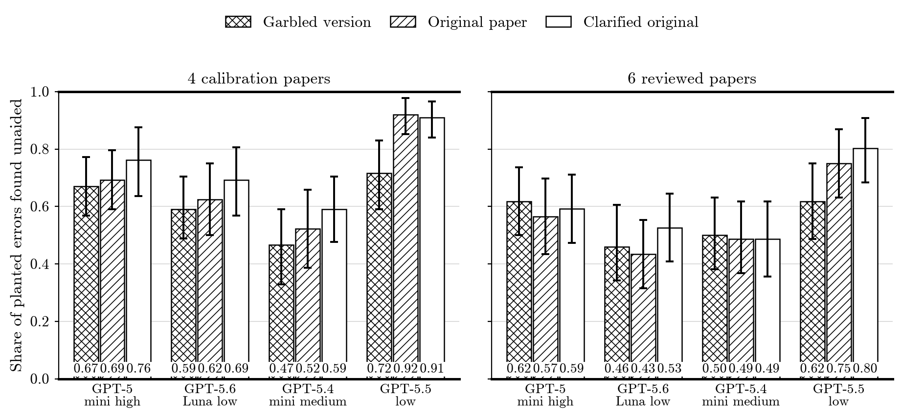
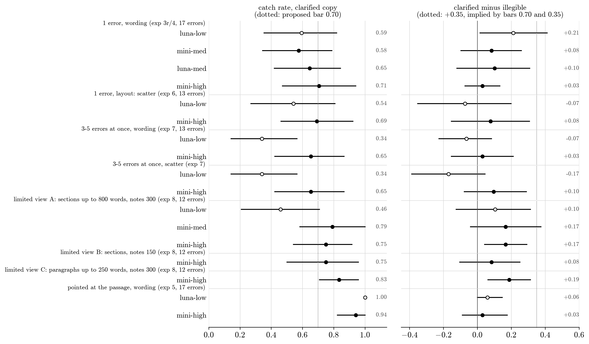
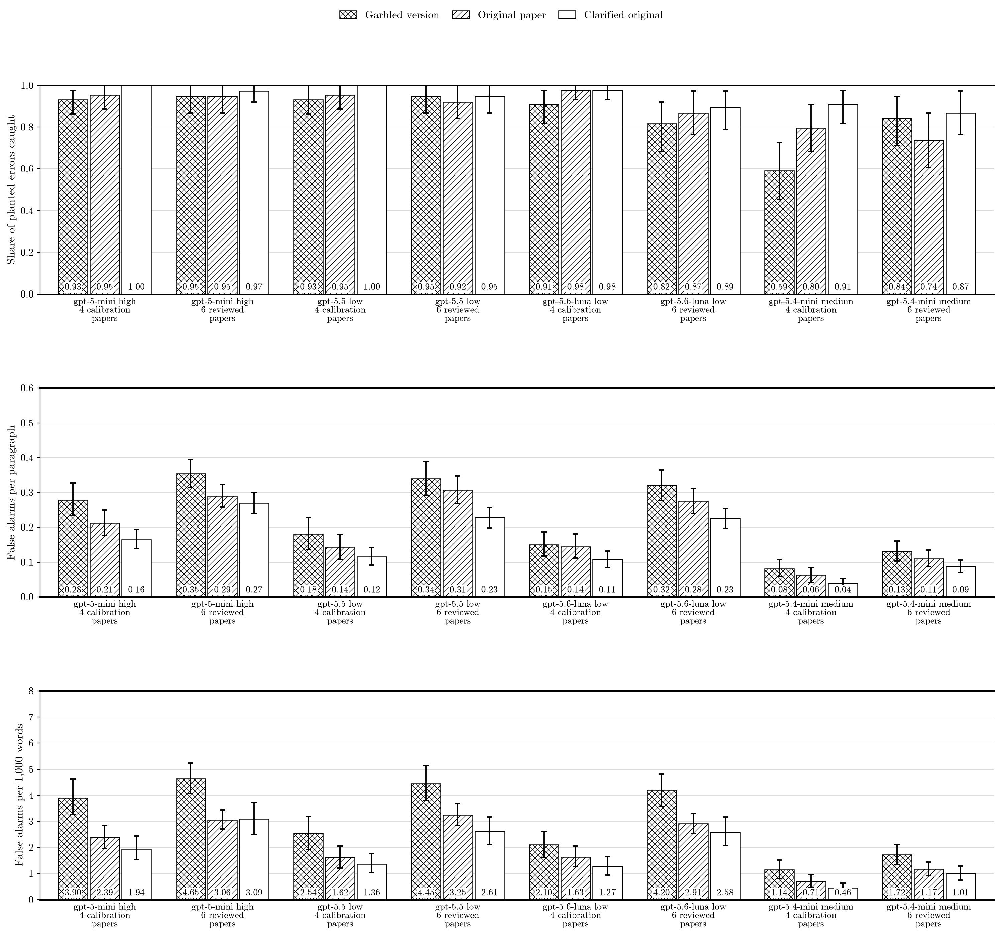
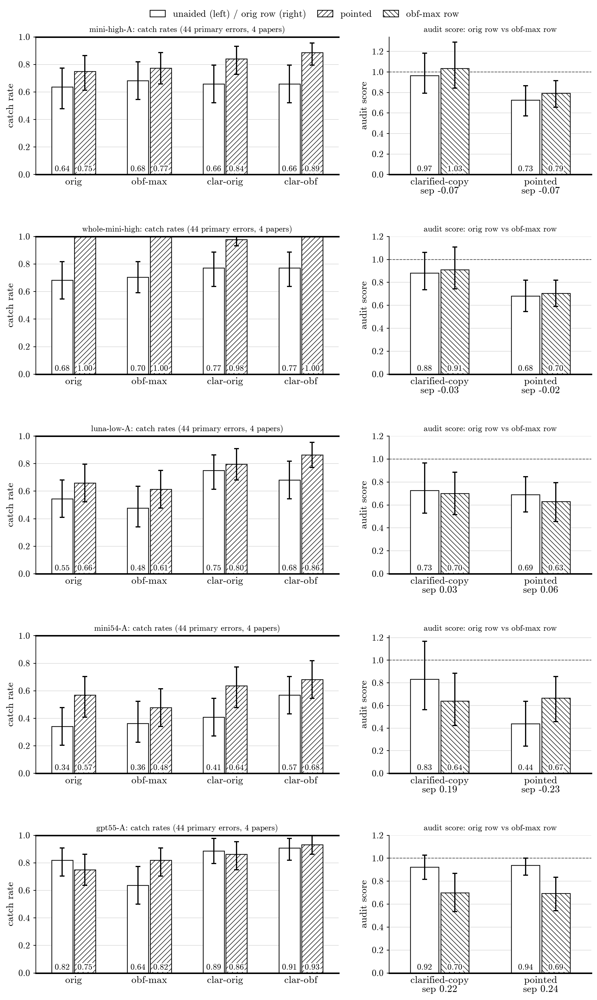
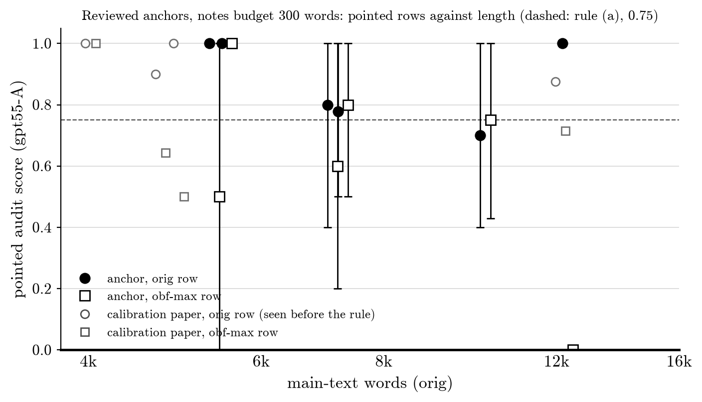

# Report v4: calibrating an error-catching legibility audit

Status (2026-11-17 ~23:50 UTC, pass 71): **final for Jason's 20:00 note.** Experiment 12 (every paragraph asked about in turn) now has all four readers and all three versions on all 10 papers: gpt-5.5 low's clarified original, and gpt-5.6-luna low and gpt-5.4-mini medium (both exploratory additions), run through the Batch API for $259 against the $400 (later $900) limit, 0 unparsed. The rest of this page was final at pass 70: the anchor fill-in is complete (table under experiment 9). The 9 held-out papers stay sealed until Jason decides what they test. Section-by-section reading (experiment 9, its anchor addendum and the ladder Jason stopped) is a side experiment. Full tables, every weird result, and the code and data behind each number are in [`report-v4-details.md`](report-v4-details.md). This page is the short version.

## Bottom line

**First signal that holds outside the calibration set: one strong reader, reading the whole paper, finds planted errors less often in a garbled version than in the original.** The audit plants an internal error in a paper and asks a fixed reader model, with the whole paper in context, to name any error. A legible paper should keep its errors findable, and a garbled one should hide them. **gpt-5.5 (low effort) finds 0.92 of errors in the originals and 0.72 in the garbled versions (`obf-max`) of the 4 calibration papers, a difference of +0.20 [+0.07, +0.34] (44 errors). On 6 reviewed, published papers it never saw during design: 0.75 against 0.62, +0.13 [+0.04, +0.22] (38 errors)** (measured, experiment 11). The three cheaper readers (gpt-5-mini high, gpt-5.6-luna low, gpt-5.4-mini medium) show no difference on either set (−0.05 to +0.06).

**Second measure, every paragraph asked about in turn (experiment 12, all 10 papers):** catch rates show no gap for either reader (gpt-5-mini high: original − garbled +0.02 on calibration, +0.00 on the reviewed papers; gpt-5.5 low: +0.02 and −0.03). False alarms on unedited paragraphs are higher in the garbled version for both readers on both sets when counted per 1,000 words: gpt-5-mini high +1.50 [+0.72, +2.29] (calibration) and +1.59 [+0.88, +2.32] (reviewed); gpt-5.5 low, smaller, +0.92 [+0.17, +1.68] and +1.20 [+0.39, +2.02] (measured; exploratory intervals over paragraphs, not papers). Per paragraph, gpt-5.5 low's difference (+0.04 and +0.03) has intervals that include 0. No bars exist for this measure. **With all four readers (pass 71), pooled over 10 papers:** per 1,000 words every reader raises more false alarms on garbled than on original text (gpt-5-mini high +1.54 [+1.03, +2.08], gpt-5.5 low +1.05 [+0.51, +1.59], luna low +0.89 [+0.41, +1.37], gpt-5.4-mini medium +0.49 [+0.19, +0.80]; exploratory intervals over paragraphs), and every reader raises the fewest on the clarified original. Only gpt-5.4-mini medium, the weakest catcher, shows a caught-rate gap, and it does not replicate: +0.20 [+0.07, +0.34] on calibration but −0.11 [−0.21, +0.00] on the reviewed papers.

**Why this is still weak (inference):** it is 1 of 4 readers, picked after the fact. The lower bound on the reviewed papers is close to 0, and 6 papers is few. The garbled text is a deliberate, extreme rewrite, not real bad writing. No pass/fail bars are set (they are Jason's), and the 9 sealed held-out papers, which are the preregistered test, have not been read. Pointed at the planted passage, gpt-5.5 judges 0.95 to 1.00 of errors correctly in every version, so the difference comes from finding the error, not judging it. That is the mechanism the audit wants, but it also means a reader that searches harder could close the gap.

**Earlier results, kept:** whole-paper readers on V1's milder illegible copies showed no gap (experiments 3 to 7). The section-by-section reader with capped notes gave gpt-5.5 a pointed separation of 0.24 on the calibration papers but only 0.08 [−0.08, 0.25] on the reviewed papers (experiment 9), so it is now a side result.

**There is no human baseline.** Even a held-out pass would show only that the audit separates papers from deliberately garbled versions of themselves, not that it tracks human understanding.

**Figure 1.** Experiment 11, whole paper in context. Share of planted errors found unaided, per reader, in the garbled version, the original, and the clarified original (a calibration standard, not part of the test), with 95% intervals (bootstrap over errors within papers). Left: 4 calibration papers (44 errors). Right: 6 reviewed papers (38 errors). Code: `uv run --with matplotlib python scripts/v4/exp11_whole.py` ([`exp11_whole.py`](../scripts/v4/exp11_whole.py)); data `data/v4/err9/reader-w11-*.jsonl`.

## What was run

- **Papers:** 3 development papers (2609.30094v2, 2608.13754v1, 2609.02893v1) for experiments 0 to 8; these plus Dropout (JMLR 2014) as the 4 calibration papers of experiment 9; 6 reviewed, published anchor papers (TMLR and ICLR 2026, 5,374 to 12,311 words) to check that length does not drive the score; 9 more papers sealed for the held-out run. Selection: [`paper-selection.md`](paper-selection.md).
- **Texts:** the original (`orig`), V1's illegible rewrites (experiments 0 to 8, repaired in experiment 3r), a new maximally illegible rewrite `obf-max` (experiment 9), and clarified copies (5 prompts tried; only `explainer` passed the preregistered fidelity rule).
- **Errors:** designed and planted by gpt-6.1-sol in every version of a paper, kept only if a strong reader catches them in the clear copies and a pair check finds them planted equally. Experiment 9: 49 designed per paper, 52 of 196 survive (44 in the primary categories).
- **Readers:** gpt-5-nano, gpt-4.1-mini, gpt-5-mini, gpt-5.4-mini, gpt-5.6-luna and gpt-5.5 at various efforts, whole paper or limited view. gpt-5-mini grades; gpt-6.1-sol regrades samples (agreement 18 to 20 of 20 per reader). All calls go through [`scripts/v4/llm.py`](../scripts/v4/llm.py).
- **Spend: $1,506.78 of the $2,500 cap (Jason raised it from $2,000 on 17 Nov), final at 23:35 UTC 17 Nov:** the anchor fill-in $48, gpt-5.5's clarified slice $17.81, and pass 71's batch runs $258.78 (luna $37.8, gpt-5.5 clarified $135.6, gpt-5.4-mini $85.5). Earlier: $1,182 at OpenAI list prices, at 06:10 UTC 17 Nov ([`data/v4/spend.jsonl`](../data/v4/spend.jsonl.gz)): about $92 for experiments 0 to 8, about $520 for experiment 9 with its anchors, ladder and anchor clarified original ($22), about $97 for experiment 11, $175 for experiment 12 with gpt-5-mini high on all 10 papers (22,516 questions) and $274 for experiment 12 with gpt-5.5 low on all 10 papers, two versions (12,195 questions; projected $245 to $285), plus a few dollars of checks.

Each experiment was preregistered in [`plan-v4.md`](plan-v4.md) before its data; anything decided afterwards is labelled exploratory.

## Results

| experiment | design | result | verdict |
|---|---|---|---|
| 3, 3r | whole paper, 5 readers, V1 illegible copies (original and repaired) | best clarified catch 0.60 (bar 0.70); gap clarified minus illegible about 0.15, intervals mostly include 0 | no |
| 4 | stronger readers, whole paper | gpt-5-mini high: clarified 0.71, illegible 0.68, gap 0.03 [−0.07, 0.13] | no |
| 5 | pointed at the planted passage | catch 0.91 to 1.00 in every copy; gap 0.03 to 0.06: misses are search failures | (diagnostic) |
| 6 | `scatter`: evidence moved away from claims, plain wording | no gap (luna −0.07) | no |
| 7 | 3 to 5 errors per copy | gap reverses for luna (−0.07, −0.17) | no |
| 8 | limited view (one chunk at a time, capped notes) | gap 0.17 [0.04, 0.29] (A) and 0.19 [0.06, 0.31] (C), illegible rate 0.58 to 0.67 (bar 0.35) | no |
| 9, readers 1 to 4 | `obf-max`, 4 papers, 44 errors; gpt-5-mini high (limited and whole), luna low, gpt-5.4-mini medium | `obf-max` no harder than `orig` unaided (differences −0.07 to +0.04) | no |
| 9, reader 5 | gpt-5.5 low, limited view | pointed separation 0.24 [0.09, 0.41]; clarified-copy separation 0.22 [0.04, 0.40] | **close** |
| **11 (core)** | whole paper, `obf-max` vs original, 4 readers, 4 calibration + 6 reviewed papers | gpt-5.5 low: original − garbled +0.20 [+0.07, +0.34] (calibration), **+0.13 [+0.04, +0.22] (reviewed)**; other readers −0.05 to +0.06; pointed 0.82 to 1.00 everywhere | no bars set |
| 12 | every paragraph asked about, whole paper in context, gpt-5-mini high and gpt-5.5 low, 10 papers | caught: original − garbled +0.02 / +0.00 (mini high, calibration / reviewed), +0.02 / −0.03 (gpt-5.5 low), all intervals include 0: no gap. False alarms per 1,000 words garbled − original: mini high +1.50 [+0.72, +2.29] / +1.59 [+0.88, +2.32]; gpt-5.5 low +0.92 [+0.17, +1.68] / +1.20 [+0.39, +2.02], exploratory intervals | no bars set |

**Figure 2.** Experiments 3 to 8: share of planted errors found in the clarified copy (left) and clarified minus illegible (right), with 95% intervals over errors. Code: [`summary_figure.py`](../scripts/v4/summary_figure.py).

**Experiment 12: every paragraph asked about in turn, whole paper in context (gpt-5-mini high, all 10 papers, 22,516 questions, 0 unparsed).** Measured:

- **No caught-rate gap.** The reader flags the planted paragraph for the planted reason in nearly every version: 4 calibration papers (44 errors) garbled 0.93 [0.86, 0.98], original 0.95 [0.89, 1.00], clarified 1.00, original − garbled +0.02 [−0.07, +0.11]; 6 reviewed papers (38 errors) 0.95 [0.87, 1.00], 0.95 [0.87, 1.00], 0.97 [0.92, 1.00], difference +0.00 [−0.08, +0.08]. Asking about every paragraph removes the search step, and search was where gpt-5.5's whole-paper gap came from (experiment 11's pointed check). The few misses are explained: the 3 garbled misses on Dropout were sampling variation (each was caught when asked again, weird result 35), and one reviewed-paper miss happened because a real overclaim in the same paragraph took the reader's one answer (37).
- **False alarms are higher in the garbled version, on both paper sets.** Per non-planted paragraph, garbled 0.28 [0.23, 0.33], original 0.21 [0.18, 0.25], clarified 0.16 [0.14, 0.19] on the calibration papers (per 1,000 words 3.90 [3.25, 4.62], 2.39 [1.96, 2.85], 1.94 [1.53, 2.44]); on the 6 reviewed papers 0.35 [0.31, 0.40], 0.29 [0.26, 0.32], 0.27 [0.24, 0.30] (per 1,000 words 4.65 [4.07, 5.24], 3.06 [2.71, 3.43], 3.09 [2.50, 3.71]). Per paragraph, garbled is above original on 9 of 10 papers (the exception is 2608.13754v1). Intervals are exploratory 95% bootstraps over paragraphs within papers (pass 58). Per 1,000 words the garbled and original intervals do not overlap on either set; per paragraph they overlap. The difference garbled − original, with an exploratory interval defined in pass 60 after these rates were seen (same within-paper bootstrap, versions resampled independently): per paragraph +0.066 [+0.006, +0.124] (calibration) and +0.065 [+0.011, +0.118] (reviewed); per 1,000 words +1.50 [+0.72, +2.29] and +1.59 [+0.88, +2.32]. These intervals cover paragraph sampling only, not variation between papers; with 4 and 6 papers, the between-paper check is the count of papers where garbled is above original (per paragraph 9 of 10).
- **The clarified original lowers false alarms only on the calibration papers.** On the reviewed papers it matches the original per 1,000 words (3.09 vs 3.06). It was a calibration standard, not part of the test, so this does not change the garbled-vs-original reading, but it does mean "fewer false alarms" is not simply "more legible" (inference).
- **Most false alarms are not noise (inference from hand reading, weird results 33 and 36).** Many name real inconsistencies of the original paper, flagged again in nearly every copy, so rates compare fairly across versions of one paper but poorly across papers. About 0.03 per paragraph in every version name the planted error from another paragraph, usually the one holding its evidence (exploratory grading on all 10 papers: garbled 0.026, original 0.024, clarified 0.026 per non-planted paragraph of planted copies, so no version difference). Removing them leaves the order unchanged: per 1,000 words garbled 4.10, original 2.57, clarified 2.33, all 10 papers pooled.

So this design does not separate versions by catching errors. Its false-alarm rate does separate garbled from original, on the reviewed papers as well as the calibration papers (measured). Whether that counts as a legibility signal is open: Jason made false alarms by version a primary reading (INBOX, 01:00 UTC 14 Nov), but no bars are set for them, the garbled text is an extreme rewrite, and a reader that flags garbled text more is not shown to be tracking human confusion. Code and data: `uv run --with matplotlib python scripts/v4/exp12_paragraphs.py --scores p12-mini-high`, [`data/v4/exp12/p12-mini-high.jsonl`](../data/v4/exp12/p12-mini-high.jsonl); full section in [the details](report-v4-details.md).

**gpt-5.5 low, all 10 papers (pass 67; 12,195 questions, 0 unparsed, $274).** Original and garbled only; the clarified original was skipped for cost (INBOX, 16 Nov). Measured:

- **No caught-rate gap, as for gpt-5-mini high.** Calibration (44 errors): garbled 0.93 [0.86, 1.00], original 0.95 [0.89, 1.00], original − garbled +0.02 [−0.05, +0.09]. Reviewed (38 errors): garbled 0.95 [0.87, 1.00], original 0.92 [0.84, 1.00], −0.03 [−0.13, +0.08]. So gpt-5.5's whole-paper gap in experiment 11 (+0.20, +0.13) disappears once every paragraph is asked about, which fits the earlier reading that it came from search.
- **False alarms: same direction, smaller difference.** Calibration per paragraph garbled 0.18 [0.14, 0.23], original 0.14 [0.11, 0.18]; per 1,000 words 2.54 [1.93, 3.19] and 1.62 [1.21, 2.05]. Reviewed per paragraph 0.34 [0.29, 0.39] and 0.31 [0.27, 0.35]; per 1,000 words 4.45 [3.80, 5.15] and 3.25 [2.83, 3.69]. Exploratory garbled − original per 1,000 words +0.92 [+0.17, +1.68] (calibration) and +1.20 [+0.39, +2.02] (reviewed); per paragraph +0.037 [−0.021, +0.094] and +0.032 [−0.034, +0.095], intervals including 0. Garbled is above original per 1,000 words on 9 of 10 papers (all 6 reviewed), per paragraph on 8 of 10. Because `obf-max` merges text into fewer, longer paragraphs, the per-1,000-words reading is the one less confounded by paragraph length, but neither normalisation is clean (inference).
- **gpt-5.5 low raises fewer false alarms than gpt-5-mini high on the calibration papers (about two thirds) but not on the reviewed papers** (original 3.25 against 3.06 per 1,000 words). Most of the excess is one paper, 2509.11379v3, the theory paper of weird result 31 (original 337 of 1,179 paragraphs flagged, against 217 for gpt-5-mini high). Not read by hand; see weird results.
- **Clarified original, all 10 papers (pass 71, Batch API).** Caught 1.00 [1.00, 1.00] (calibration) and 0.95 [0.87, 1.00] (reviewed), like the other versions. False alarms per paragraph 0.115 [0.092, 0.142] and 0.228 [0.199, 0.257]; per 1,000 words 1.36 [1.03, 1.76] and 2.61 [2.10, 3.17]: the lowest of the three versions on both sets. The pass 70 slice paper (direct calls, $17.81) is included; the other 9 papers cost $135.6 at batch price, against $396 projected for direct calls.

Data: [`p12-gpt55-low.jsonl`](../data/v4/exp12/p12-gpt55-low.jsonl); code `uv run --with matplotlib python scripts/v4/exp12_paragraphs.py --scores p12-mini-high p12-gpt55-low`.

**All four readers, three versions (pass 71; luna low and gpt-5.4-mini medium are exploratory additions, Jason, INBOX 17 Nov 20:00; every reader 22,516 questions, 0 unparsed).** Pooled over all 10 papers (82 errors; caught: bootstrap over errors within papers; false alarms: exploratory bootstrap over paragraphs within papers). Per paper set: `--scores` output and Figure 2a.

| Reader | Caught: garbled / original / clarified | Original − garbled | False alarms per paragraph: garbled / original / clarified | Per 1,000 words: garbled / original / clarified | Garbled − original per 1,000 words |
|---|---|---|---|---|---|
| gpt-5-mini high | 0.94 / 0.95 / 0.99 | +0.01 [−0.05, +0.07] | 0.317 / 0.253 / 0.217 | 4.29 / 2.75 / 2.52 | +1.54 [+1.03, +2.08] |
| gpt-5.5 low | 0.94 / 0.94 / 0.98 | +0.00 [−0.06, +0.06] | 0.262 / 0.229 / 0.172 | 3.54 / 2.50 / 2.00 | +1.05 [+0.51, +1.59] |
| gpt-5.6-luna low | 0.87 / 0.93 / 0.94 | +0.06 [+0.00, +0.12] | 0.237 / 0.213 / 0.167 | 3.21 / 2.32 / 1.94 | +0.89 [+0.41, +1.37] |
| gpt-5.4-mini medium | 0.71 / 0.77 / 0.89 | +0.06 [−0.04, +0.16] | 0.107 / 0.088 / 0.063 | 1.45 / 0.96 / 0.74 | +0.49 [+0.19, +0.80] |

Per set (measured): luna low caught original − garbled +0.07 [+0.00, +0.16] calibration, +0.05 [−0.03, +0.16] reviewed; false alarms per 1,000 words garbled − original +0.47 [−0.17, +1.07] and +1.30 [+0.59, +2.01]. gpt-5.4-mini medium caught +0.20 [+0.07, +0.34] calibration (garbled 0.59, original 0.80, clarified 0.91) but −0.11 [−0.21, +0.00] reviewed (0.84, 0.74, 0.87); false alarms per 1,000 words +0.44 [+0.00, +0.85] and +0.55 [+0.11, +1.01]. Reading (inference): the false-alarm ordering garbled > original > clarified holds for every reader, and its size scales with how often the reader flags at all; the caught rate separates versions only for the weakest reader and only on one paper set. Cost at batch price (reader calls plus grading): luna $37.8, gpt-5.4-mini $85.5, gpt-5.5 clarified $135.6 for 9 papers. Data: [`p12-luna-low.jsonl`](../data/v4/exp12/p12-luna-low.jsonl), [`p12-mini54-med.jsonl`](../data/v4/exp12/p12-mini54-med.jsonl), batches in [`batches.jsonl`](../data/v4/exp12/batches.jsonl); code `python3 scripts/v4/exp12_paragraphs.py batch` (driver `logs/exp12-batch.sh`), then `uv run --with matplotlib python scripts/v4/exp12_paragraphs.py --scores p12-mini-high p12-gpt55-low p12-luna-low p12-mini54-med`.

**Figure 2a.** Experiment 12, all four readers, three versions (4 calibration papers, 6 reviewed papers; luna low and gpt-5.4-mini medium exploratory). Left: share of planted errors caught (95% intervals, bootstrap over errors within papers). Middle and right: false alarms on non-planted paragraphs, per paragraph and per 1,000 words, planted and clean copies together (95% intervals, exploratory: bootstrap over paragraphs within papers, defined in pass 58).

**Figure 3.** Experiment 9 (side experiment, section by section), 44 primary errors on 4 calibration papers. Left: share of planted errors found per version, unaided and pointed. Right: the audit scores' `orig` and `obf-max` rows with 95% intervals (bootstrap over errors, stratified by paper). Only gpt-5.5 (bottom row) separates the two versions. Code: `python3 scripts/v4/err9.py --scores mini-high-A whole-mini-high luna-low-A mini54-A gpt55-A` ([`err9.py`](../scripts/v4/err9.py)); data [`data/v4/err9/`](../data/v4/err9/).

**gpt-5.5 section by section in detail (measured, 44 primary errors).** Unaided, it finds 0.82 of errors in `orig`, 0.64 in `obf-max` and 0.89 to 0.91 in the clarified versions. The drop shows on 3 of 4 papers. Pointed at the passage, it judges most errors correctly in both `orig` and `obf-max`, so here too illegibility acts on finding, not judging (exploratory count). By the preregistered selection rule its pointed score was frozen for the held-out run. Jason has since paused that run: what the held-out papers test is re-chosen after experiment 12, by the rule in `plan-v4.md`.

**Anchor addendum (side experiment; fails at the 300-word notes budget).** The preregistered rule: every reviewed anchor must score ≥ 0.75 on the pointed `orig` row (a), and long anchors may not score more than 0.15 below short ones (b); a failure on long anchors only counts as a length failure and raises the reader's notes budget to 600, then 1,200 words, before the held-out run. On all 6 anchors (2 per length band, 38 primary errors): `orig` row 0.81 [0.67, 0.93], `obf-max` row 0.72 [0.57, 0.86], **separation 0.08 [−0.08, 0.25]**, false accusations 0.11. (a) fails on one long anchor (2510.17247v2, `orig` 0.70); (b) holds (long minus short −0.27 [−0.55, 0.00]). So the ladder ran (below). **What this means:** on reviewed, published papers the audit barely separates the paper from its garbled version (0.08, interval includes 0), against 0.24 on the 4 calibration papers. Per-anchor counts are small (1 to 12 errors; 2506.22982v1 has 1 per row), so single anchors are noisy. Two anchors were re-read after defects (gpt-5.5 opened JSON strings with curly quotes; a title containing "Preferences" cut a paper to 0 chunks); both fixed, no calibration number changes ([`run-log.md`](run-log.md), pass 39). Sol grader check on anchor reviews: 17/20 agree. Code: `python3 scripts/v4/err9.py --anchors`; figure below.

**Clarified original on the anchors (exploratory, calibration only, pass 61).** Jason asked for it on 16 Nov. The same frozen reader read the anchors' clarified-original planted copies (38 primary errors, $22). Unaided caught: `orig` 0.66 [0.50, 0.82], `obf-max` 0.68 [0.55, 0.82], **clarified 0.74 [0.61, 0.87]**. Pointed caught: 0.82, 0.76, **0.95 [0.87, 1.00]**. Pointed row: 0.81, 0.72, 0.78 [0.66, 0.89]. False accusations in clean reads: 6/76, 10/76, 7/76. This is the same shape as on the 4 calibration papers (unaided 0.82 against 0.89 for clarified, pointed row 0.94 against 0.95), so the clarified standard carries over to reviewed papers. What does not carry over is the drop in the garbled version. Intervals overlap. Sol grader check: 20/20 agree. Code: `python3 scripts/v4/err9.py --anchors-clar`; details in [`report-v4-details.md`](report-v4-details.md).

**Fill-in: more readers on the 6 anchors (exploratory, pass 68; Jason, INBOX 17 Nov).** Same frozen section-by-section reader (variant A) and the same 38 primary errors, so every Part 2 figure can use all 10 papers. Not calibration and no tuning. Unaided share caught, 95% bootstrap over errors within anchors, and false accusations in clean reads:

| Reader (notes budget) | `orig` | `obf-max` | clarified original | garbled − original | false accusations (orig / obf-max / clar) |
|---|---|---|---|---|---|
| gpt-5.5 low (300), reference, passes 30 and 61 | 0.66 [0.50, 0.82] | 0.68 [0.55, 0.82] | 0.74 [0.61, 0.87] | +0.03 [−0.13, +0.18] | 6/76, 10/76, 7/76 |
| gpt-5.5 low (1,200), now on all 6 | 0.76 [0.63, 0.89] | 0.66 [0.53, 0.79] | not read | −0.11 [−0.24, +0.03] | 5/75, 3/76 |
| gpt-5.6-luna low (300) | 0.50 [0.34, 0.66] | 0.45 [0.32, 0.58] | 0.66 [0.53, 0.79] | −0.05 [−0.21, +0.08] | 7/76, 8/76, 3/76 |
| gpt-5.4-mini medium (300) | 0.53 [0.37, 0.68] | 0.34 [0.18, 0.50] | 0.58 [0.42, 0.71] | **−0.18 [−0.34, −0.05]** | 4/76, 8/75, 5/75 |
| gpt-5-mini high (300) | 0.66 [0.53, 0.79] | 0.55 [0.39, 0.71] | 0.71 [0.58, 0.84] | −0.11 [−0.26, +0.05] | 10/76, 13/75, 11/76 |

Measured: only gpt-5.4-mini medium shows a garbled − original drop whose interval excludes zero on the anchors (−0.18). Its pointed drop is small (−0.05 [−0.21, +0.13]), so here garbling acts on finding errors more than on judging them. On the 4 calibration papers the same reader showed no unaided drop (experiment 9: −0.07 to +0.04 across readers). The direction therefore does not even agree across paper sets for this reader. It is one exploratory reader among several, with no correction for multiple comparisons: a lead, not a result (open, unexplained). The clarified original is caught most often by every reader that read it. A1200's pointed rows on all 6 anchors are `orig` 0.85 [0.72, 0.97] and `obf-max` 0.71 [0.56, 0.84] (separation 0.14 [0.00, 0.29]), and rule (a) still fails on 2601.02896v4. So the stopped ladder step would not have passed, now that it is complete. gpt-5-mini high (pass 70) fits the same pattern: garbled − original −0.11 with an interval that includes zero, and the clarified original caught most often (0.71). Two of its ~600 steps returned nothing usable (one pointed reply on 2509.11379v3, clarified; one clean-read grade on 2510.17247v2, `obf-max`) and are left out of the denominators, as for the other readers. Sol grader check: luna 18/20, gpt-5.4-mini 20/20, gpt-5-mini high 18/20 agree. Fill-in complete: $48 of the $80 approved; the guard never fired. Code: `python3 scripts/v4/err9.py --anchors-clar <reader>` and `--anchors gpt55-A1200`; data `data/v4/err9/reader-<reader>.jsonl`; driver [`fill_anchors.sh`](../scripts/v4/fill_anchors.sh).

**Ladder step A600 (600-word notes; does not pass).** Same reader, chunks and errors, new reads on the 4 calibration papers and 6 anchors ($87). Anchors: `orig` row 0.73 [0.58, 0.87], `obf-max` row 0.72 [0.57, 0.86], **separation 0.01 [−0.15, 0.17]**; long minus short +0.04 [−0.36, 0.29], so length no longer matters, but (a) now fails on a short anchor (2601.02896v4, 0.67 on 3 errors) and a medium one (2509.11379v3, 0.50 on 10). The 4 calibration papers fall to separation 0.14 (lower bound 0.01), below the "close" bar of 0.15. **Inference:** a larger memory lets the reader of the garbled copy keep what it needs, which is the plan's stated risk; the audit's signal came from limited memory, and limited memory is also what penalized length. The 1,200-word step was stopped by Jason at about 22:10 UTC 13 Nov with 8 of 10 papers read; it has no verdict and is not restarted ([`run-log.md`](run-log.md)). Code: `python3 scripts/v4/err9.py --anchors gpt55-A600`; [figure](figures/v4-exp9-anchors-gpt55-A600.png).

**Also found:** V1's illegible rewrites contained 42 meaning changes against their originals. These were repaired, with no measurable effect on catch rates. Two of the three development papers contain small real inconsistencies of their own. Details: [`report-v4-details.md`](report-v4-details.md).

## Weird results

All 37 are listed, with their evidence, in [the details](report-v4-details.md#weird-results). Most were explained or fixed by a re-run, for example parser failures on LaTeX in JSON (18, 28), a token cap that emptied reads (27), and a selection effect in the pointed score's definition (29). Still open, plus the newest explained ones:

- **gpt-5.4-mini medium's experiment 12 caught-rate gap reverses between paper sets (open, pass 71, exploratory reader).** Original − garbled +0.20 [+0.07, +0.34] on the calibration papers, −0.11 [−0.21, +0.00] on the reviewed papers; every other reader is within ±0.07 on both. It is the only reader that misses many planted paragraphs (caught 0.59 to 0.91), so it is the only one where the version can move the caught rate at all. Not read by hand; likely per-paper variation with few errors per paper (inference). No re-run: the result stands as measured.
- **A planted error hidden behind a real overclaim (37, explained, pass 55).** On 2509.22621v3, gpt-5-mini high misses a planted causal claim in `orig` and `obf-max` and catches it in the clarified copy. In both misses it flags the right paragraph, but for the sentence before the plant, "in all cases", an overclaim the original paper really makes. The question asks for one conflict per paragraph, so the real flaw took the answer. The clarified copy had softened that sentence, so only the plant was left. The grader is right and the numbers stand.

- **Experiment 12 false alarms run at about 25% of paragraphs on 2608.13754v1, against 4 to 17% on the slice paper (33, explained, passes 46 to 50).** The same paragraphs are flagged in every version, clean copies included, and most name inconsistencies the original paper really has (for example 15,840 vs 18,480 "pre-registered" specifications); only 3 of them were in the paper's inventory. The extra false alarms in planted copies are partly flags of the planted error from another paragraph (exploratory grading, about 0.03 per paragraph in every version). Shared flaws raise every version's rate and dilute version differences, but they do not favour one version. The preregistered numbers stand.
- **One reviewed paper draws twice the false alarms of the calibration papers (36, explained, pass 51).** On 2601.02896v4, about 70% of experiment 12's false alarms fall on 16 to 24 paragraphs that gpt-5-mini high flags in nearly every copy. Nearly all of them name real inconsistencies or overclaims in that paper, such as a sign flip between Figure 2 and Eq. 4, and a "negligible" perplexity change that is 10.88 to 12.48 on Qwen. Without them its rate (0.13 to 0.21) is like the others'. So false-alarm rates compare poorly across papers, but fairly across versions of one paper.
- **Experiment 12's only garbled misses sit late in merged blocks (35, explained, exploratory).** On Dropout, gpt-5-mini high misses 3 errors in `obf-max` and none in `orig`. Each time, the planted sentence comes after a table or equation and a heading in one merged block. A check defined before running (pass 52, $0.5) asked every such block again, both unchanged and split at its headings. The unchanged blocks were caught 16 of 16 times in `obf-max`, 7 of 8 in `orig` and 1 of 1 in the clarified copy. The split blocks were caught 15 of 16 (the one failure is an unparsed reply), 8 of 8 and 1 of 1. So the garbled misses are sampling variation of a single ask. Only one `orig` error needed the split. Data: [`headsplit-p12-mini-high.jsonl`](../data/v4/exp12/headsplit-p12-mini-high.jsonl). The preregistered numbers stand.
- **Every reader flags clean `obf-max` of one reviewed paper (32, explained, pass 45).** On 2509.11379v3, clean garbled reads draw accusations graded as catches of planted errors for all four whole-paper readers. Every credited accusation targets something the original paper itself contains, not a rewrite defect: mostly that Theorem 1 allows α = 1 while its threshold has exponent 1/(1 − α), plus an `A_n` subscript where `A_m` is meant and a corollary stated under weaker assumptions than its theorem. Readers raise the α = 1 point in 8 of 8 clean `obf-max` reads against 3 of 8 `orig` and 4 of 8 clarified, and the grader credits it as a catch mostly in `obf-max`, where the rewrite merged the planted sentence and the α = 1 claim into one sentence. These features are missing from the paper's inventory, so they were not excluded. Exploratory recount without this paper: `obf-max` false accusations on the reviewed papers fall from 2 to 4 of 12 per reader to 1 to 2 of 10 (gpt-5.5 low 4/12 → 2/10, `orig` 0/10). The preregistered numbers stand. No API cost.
- **Strong-reader gate may remove the very errors the audit looks for (6).** Errors the strong reader missed only in an illegible copy were dropped by the preregistered gate. One Sol sample each, so these could be chance misses. Jason has settled the gate for experiment 9 (clarified copies only).
- **Noise-sized reversals with no tested cause (2, 8, 12, 13, 20):** stronger readers sometimes catch more in illegible copies, and catch rates on repaired copies are slightly lower. All are within the intervals.
- **The clarified copy does not beat the original for strong whole-paper readers (9).** The originals may already be legible enough for them.
- **Two anchors show no separation so far** (open). 2603.01214v2: pointed `obf-max` row 3/3 against `orig` 4/4, and `obf-max` unaided 5/5 against 4/5; with 5 errors this is within noise. 2509.11379v3 (12 primary errors): `obf-max` row 0.80 against `orig` 0.78, and in 6 of 24 grades of clean `obf-max` reads against its errors (2 reads × 12 errors) the reader was credited with accusing an error that is not planted there (0.25, against ≤ 0.10 on the other anchors). Not yet explained: this anchor is a theory paper (surrogate-loss bounds) whose `obf-max` copy may stay readable to gpt-5.5 because the argument is carried by formulas, which `obf-max` keeps; untested. Reported as is (weird result 31). At 600 words 2509.11379v3 reverses further (`orig` 0.50, `obf-max` 0.70).
- **gpt-5.5 low flags more paragraphs than gpt-5-mini high on one reviewed paper (open, pass 67).** On 2509.11379v3 (theory paper, weird result 31) gpt-5.5 low flags 337 of 1,179 original non-planted paragraphs against 217 for gpt-5-mini high, and 256 against 226 in the garbled version, while on the calibration papers it flags about two thirds as many. Not read by hand. It raises both versions, so it dilutes rather than creates the garbled − original difference. Left open because the run is at its approved end.

## Limits

- **No human baseline.** Nothing here can show that scores track human understanding.
- **Small samples.** 4 calibration papers and 44 primary errors give intervals of about ±0.15 on each separation. The experiment 11 signal is 1 of 4 readers on 4 + 6 papers (reviewed-paper lower bound +0.04), and the experiment 9 "close" result is 1 of 5 readers and 10 reader × score tests; either may be chance until the held-out run.
- **One sample per construction check.** The strong-reader and pair checks use one gpt-6.1-sol sample each, and the pair check flipped on about 1 in 10 identical edits (weird result 11).
- **Constructed errors and texts.** The errors are planted by a model, and `obf-max` is deliberately garbled. Real illegibility in real papers may act differently.
- **Narrow error types.** `unsupported` claims cannot pass the preregistered review prompt (0 of 25), and `omitted` errors show no separation and are reported separately.
- **OpenAI models only,** and spend is computed from token counts at list prices, not checked against a bill.

## Next steps

1. **Experiment 12's exploratory checks are done** on all 10 papers (pass 60) and change no conclusion. The garbled − original false-alarm difference has an exploratory interval that excludes 0 on both paper sets. It covers paragraph sampling only, not variation between papers. Nothing more is planned for gpt-5-mini high.
2. **Apply the preregistered held-out choice:** the setting with the largest calibration original − garbled difference among those with a positive difference on the reviewed papers. With experiment 12 complete this is gpt-5.5 low, whole paper (experiment 11, +0.20 calibration, +0.13 reviewed); experiment 12's caught-rate difference is +0.02 on calibration and +0.00 on the reviewed papers, so it is not positive there. The rule covers caught rates only; experiment 12's false-alarm difference is not part of it. Running the 9 sealed papers waits on Jason.
3. The ladder, experiment 10 and the `unsupported` prompt are stopped by Jason. A human baseline remains the real next question once a setting passes the held-out run; recruiting readers needs Jason.

**Decisions for Jason:** (1) Experiment 12 is complete for all four readers and three versions; nothing more is queued. (2) Whether to run the held-out papers once the choice rule has picked a setting. (3) Final pass/fail bars remain yours; none are set.
