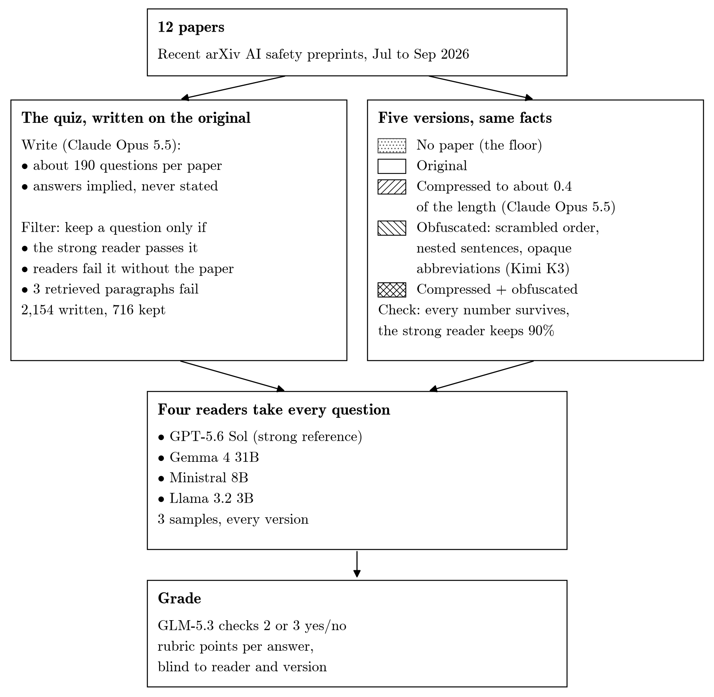
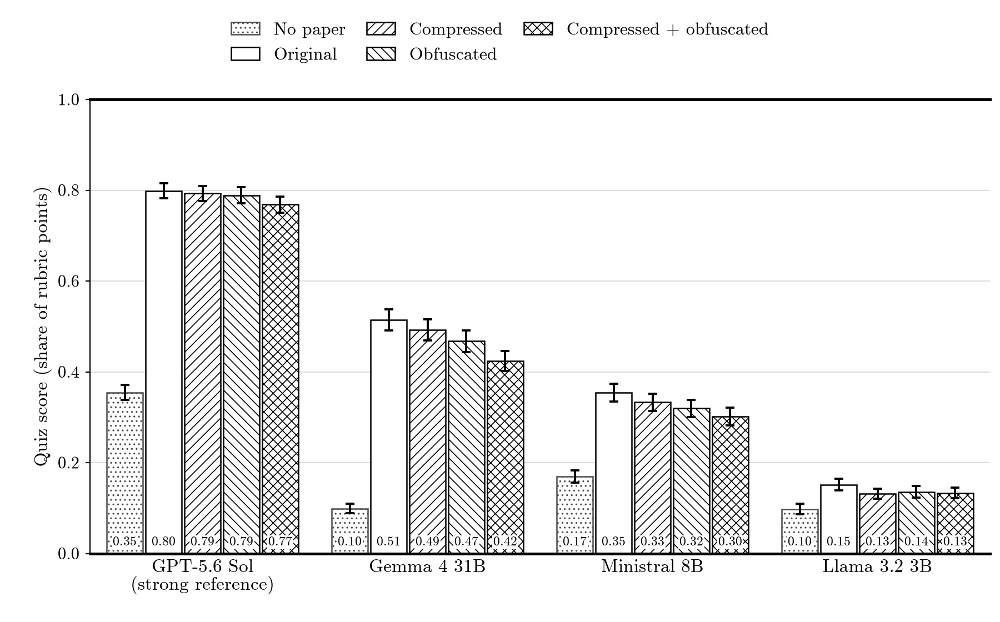
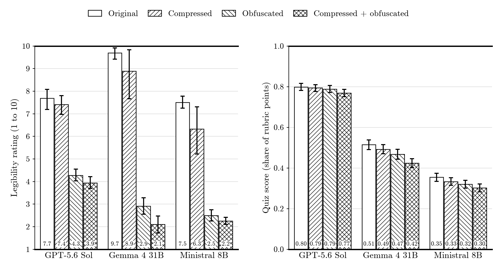
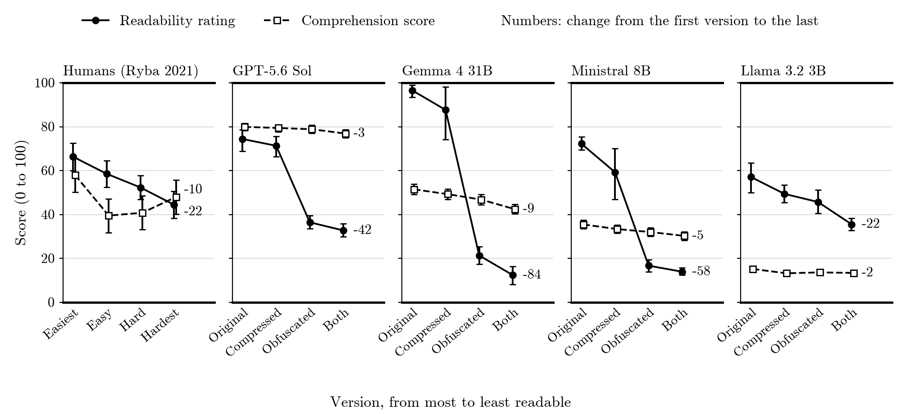
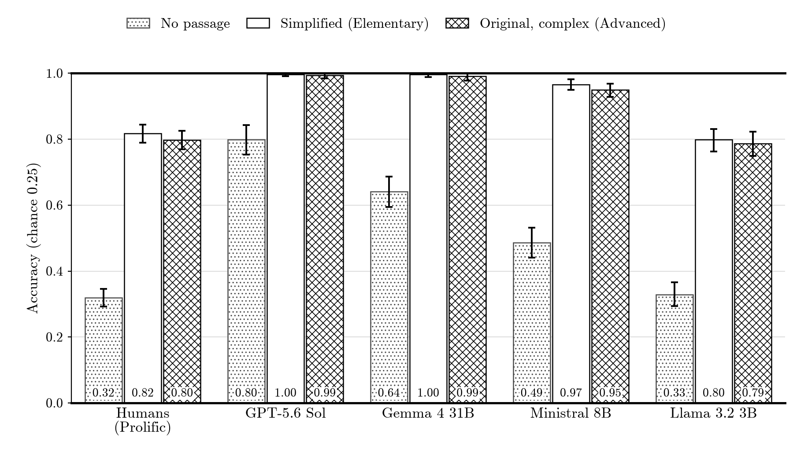

# Can a Quiz Test Whether a Paper Is Legible to Humans?

Jason Fantl, Averroes Labs · November 4, 2026

*Preliminary internal results, produced in three days. Please read them as initial signals, not definitive findings.*

**TL;DR.** We tried to build an automated test of whether a research paper is legible to humans. A strong model writes an open-book quiz on the paper, and weaker models take it. Rewriting papers to be hard to follow lowered the weaker models' quiz scores only slightly, much less than the gap between one model and another. Asked to rate legibility directly, the same models rated the rewrites as far harder to read, yet their ratings had little to do with how well they understood the text. A fluent paper with its key results quietly removed fooled most of the ratings, and a quiz written on that paper as well. In two published human studies, harder writing also hurt people's sense of readability more than their understanding, though less sharply than in our models. So the quiz's small effect may be partly realistic, and human data on our own papers is the next step.

## Why we want this

AI systems are starting to write a large share of AI safety research, and people can only oversee work they can follow. AI reasoning already drifts away from readable English, and optimizing outputs for correctness can make them harder for people to check. One fix is to have an LLM translate a hard paper into a readable one. Readers would then trust a translation nobody has audited, and each reader might get a different one. We would rather require the paper itself to be legible, and check this automatically at the scale at which AI will produce papers.

The idea is to turn a reading-comprehension quiz around. A normal quiz holds the text fixed and tests the reader. We hold the reader fixed and test the text. A paper counts as legible to a given reader if that reader, with the paper open, can answer questions that require understanding its methods, key results and conclusions.

**Premise and hypothesis.** We assume that rewriting a paper into scrambled, convoluted prose, with every fact kept, would slow a human reader down a lot, so a legibility test should detect it. If weaker LLM readers behave even roughly like people, their quiz scores should fall on the rewritten versions while the strong reader's score stays steady, which shows the information is still there. Comparing versions of the same paper separates how a paper is written from what it says.

## How we tested it

**Figure 1.** The experiment, read top to bottom. Each paper's quiz is written and filtered on the original. Every reader then takes it with no paper and with each version. The pattern next to each version is the one it has in the later figures.

**Papers.** 12 AI safety preprints from arXiv, posted July to September 2026 and drawn at random from interpretability, attacks, and alignment and oversight. They should postdate the readers' training data, and a no-paper condition measures how much the readers know anyway.

**Versions.** Each paper exists in four versions with the same facts. *Obfuscated* (written by Kimi K3) keeps the content and length but scrambles the order of ideas, uses long nested sentences and replaces named terms with opaque abbreviations. *Compressed* (written by Claude Opus 5.5) cuts the paper to about 0.4 of its length in terse shorthand, dropping background, motivation and repetition. *Compressed + obfuscated* does both. An *information check* guards against lost content. A script confirms that every number survives, and the strong reader must keep at least 90% of its original score on each version. A few versions fail the check. We flag them, and the pooled results barely change without them. A fifth condition, *no paper*, gives each reader's floor.

**The quiz.** The quiz is open book, with the whole paper in the reader's context, because the audit asks whether a reader can follow a paper. That makes looking things up the main way to pass without understanding, and in our first pilot most questions could be answered without the paper or from a few retrieved paragraphs. So the core rule, taken from reading-comprehension research, is that **answers must be implied by the paper but stated nowhere in it**. Claude Opus 5.5 first maps the paper's claims to the methods and results behind them. It then writes about 190 free-response questions per paper, covering failure modes and edge cases, why a result follows, counterfactual pairs, transfer to a new case, connections between distant parts of the paper, and whether a generalization is supported. Each question has a rubric of 2 or 3 yes/no points, first the conclusion and then the reason.

**Filtering.** Questions are filtered on the original paper only. A question is kept if the strong reader passes it with the paper, the readers fail it without the paper, and a mid-sized reader given only three keyword-retrieved paragraphs fails it, so lookup alone is not enough. The weaker readers' scores with the paper are never used to filter, because they are the measurement. Of 2,154 questions written, 716 (33%) were kept, between 11 and 95 per paper. One paper got only 11 because the writer's content filter refused it partway through.

**Readers and grading.** GPT-5.6 Sol is the strong reference, and Gemma 4 31B, Ministral 8B and Llama 3.2 3B are the weaker readers. All run through OpenRouter and answer every kept question in every condition, 3 samples each. GLM-5.3 grades each rubric point as met or not, without knowing the reader or the version, and quotes the words that earn each point. In our pilot a second grader model gave the identical score on 90% of answers. We have not yet checked the grading against humans. The 12-paper run cost about $250 in API calls.

## Result 1: the quiz detects the rewrite, but only slightly

**Figure 2.** Quiz score for each reader (groups of bars) in each condition (bar patterns, see the legend). The scale runs from 0 to 1, marked by the bold lines. Bars are means over 716 questions and 3 samples, and whiskers are 95% intervals. Compare bars within a group to see the effect of a rewrite, and across groups to see the effect of the reader.

Making a paper harder to read did lower the weaker readers' scores, and the harsher the rewrite, the larger the drop, while the strong reader held steady (Figure 2). That is the direction we hoped for, and the weaker readers lost more than the strong reader on most papers. But the drops are small.

They are small next to everything else that moves a score. Having the paper at all, and which model reads it, each matter far more than how the paper is written, so a quiz score mostly measures the reader. Papers also differ from each other more than versions of one paper do, which is why every comparison is between versions of the same paper. Llama barely beats its no-paper floor, so it has nothing to lose, and we leave it out of what follows.

For a tool that judges one paper at a time, this is the problem. Paper by paper, the versions sit within a few points of each other. Before seeing the results, we committed to counting a paper's drop only if it was at least 10 points and clearly above zero. Obfuscation never reached that on any paper, and the combined rewrite reached it on only a few. A rough estimate is that a single paper would need about one and a half times as many good questions as our best paper had to detect effects this small.

## Result 2: model ratings measure something else

A much simpler alternative to the quiz is to ask a model how legible a paper is. Each reader rated every version from 1 to 10 on how easy it would be for an ML researcher outside the subfield to understand. We name a human reader in the prompt, because asking about "a reader at your level" made each model rate by its own comfort. If the rating and the quiz measured the same thing, they would move together, and they do not.

**Figure 3.** Left: each model's rating, from 1 to 10, of how easy each version would be for a human ML researcher to understand (mean over 12 papers, 95% interval over papers). Right: the same model's quiz score on the same versions (95% interval over questions). If the ratings tracked understanding, the two panels would show the same pattern. Llama 3.2 3B is left out because its quiz scores sit near its no-paper floor.

The ratings and the quiz disagree (Figure 3). Every model rates the obfuscated versions as much harder to read, yet its quiz score barely changes, and compression alone hardly moves either. Models that understand very different amounts give similar ratings. Even within one model, the papers it rates hardest are not the ones it does worst on. Judging how readable a text looks and understanding it seem to be separate abilities. The ratings respond to the surface of the text, and the quiz to what the reader can work out.

Our best guess, which we have not tested, is that convoluted prose is hard for people because they must hold half-resolved references in memory, while a model has the whole paper in context at once. If so, the property we wanted to measure barely registers in these readers.

The ratings did spot our obfuscation more reliably than the quiz, and so did a standard readability formula, but only because this obfuscation is easy to see. A harder case is a paper that reads fluently but leaves out what the reader needs, which we test next.

### A fluent paper with a hidden gap

Claude Opus 5.5 recorded each paper's crucial insight and the results that depend on it, then wrote two fluent versions.

- **Key insight implicit:** every fact and number stays, but the insight is never stated, results come without the reasoning behind them, and intuition, examples and summaries are cut, as a terse expert might write for other experts.
- **Key results removed:** the insight and the results that depend on it are cut, and the text is smoothed over so nothing looks missing. This tests completeness, and it is where a rating and a quiz should disagree most clearly.

**Figure 4.** The original and two fluent versions, one with the key insight left implicit (sparse lines) and one with the key results removed (dense lines). Left: legibility ratings, as in Figure 3. Middle: quiz scores, each on a quiz written for that text. The original and the implicit version, which keeps every fact, use the original quiz, and the results-removed version uses a new quiz written and filtered on it. Right: how many questions survived filtering per paper. Bars are means over papers with 95% intervals. One paper is left out on the right because the writer model's content filter cut its original quiz short.

Leaving the key insight implicit lowered the ratings a little and barely moved quiz scores. This was meant to be the real legibility test, but the writer kept most definitions, so the quiz has not yet faced a paper that is complete but genuinely hard to follow.

Removing the key results fooled most raters, who found the hollow paper as readable as the original. Only GPT-5.6 Sol noticed that the results sections no longer reported numbers. A quiz written on the hollow paper missed the gap too, because it can only ask about what that paper says, and readers can follow that. A quiz written on the full paper does catch the gap, but only by asking about results that are gone.

The hollow paper did leave one trace: fewer questions survive the filtering (Figure 4, right), because more of what is left to ask about is background a model already knows. Intact papers also vary widely in how many questions survive, so this is a weak signal. Catching an incomplete or wrong paper is closer to peer review than to testing whether a paper can be followed.

## Result 3: comparison with human readers

The quiz barely moved while the ratings fell sharply. To see whether people behave the same way, we compared our models with two existing human studies that rewrote texts with the content held fixed. We have no human data on our own papers.

**Science abstracts at four writing levels.** [Ryba et al. (2021)](https://www.frontiersin.org/articles/10.3389/fpsyg.2021.714321/full) had 170 students read three science abstracts, each rewritten at four writing levels, rate how easy each was to read, and answer two multiple-choice questions on it. The raw data is not public, so Figure 5 shows their published means next to our models.

**Figure 5.** One panel per reader, from people to the weakest model. Each panel shows the readability rating (solid line) and the comprehension score (dashed line), both on 0 to 100, across four versions from most to least readable. A falling line means that measure got worse as the text got harder, and the number at its end is the total change. For the models, "Both" is compressed + obfuscated. Humans: Ryba et al. (2021), published means with approximate 95% intervals. Models: our 12 papers, with the rating rescaled from 1 to 10 and the quiz score multiplied by 100.

People show the same pattern as our models, in a milder form (Figure 5). As the writing got harder, people's sense of how readable an abstract was fell faster than their understanding of it. For our models the gap is extreme, with ratings collapsing while understanding stays nearly flat. Part of that difference may come from our rewrite, which is far harsher than the one in the human study.

**News paragraphs, with the same questions for people and models.** [OneStopQA](https://github.com/berzak/onestop-qa) ([Berzak, Malmaud and Levy, 2020](https://aclanthology.org/2020.acl-main.507/)) has 324 multiple-choice questions on Guardian news paragraphs, each in its original and a teacher-simplified version, answered by Prolific participants (3 per question). We gave our four readers the same questions on both versions and with no passage. We added this check after the main study, and it cost about $2.

**Figure 6.** OneStopQA accuracy for people and our four readers with no passage, with the teacher-simplified version, and with the complex original of each news paragraph. 324 multiple-choice questions, where chance is 0.25; humans are 3 Prolific participants per question. Bars are means with 95% intervals over questions. Equal bars for the simplified and complex text mean the rewrite did not change accuracy.

On the news paragraphs, simplifying the text barely changed accuracy for anyone, people included (Figure 6). People did take longer on the complex paragraphs, so for them the harder text cost time more than correct answers. Two differences remain. Models and people struggle with different questions, and the strong models know many answers without the passage, probably because these older news articles are in their training data.

In both studies, and in [Ozuru et al. (2005)](https://escholarship.org/uc/item/0tw744hb), where making biology texts more cohesive improved accuracy only slightly, writing quality moved people's comprehension much less than their sense of how readable a text was. So part of the quiz's small effect may be realistic, and not only a sign that models read differently from people. The models' ratings, though, react far more strongly than people's, these studies used milder rewrites than ours, and none used research papers. Only human data on our own versions can settle how close the match is.

## Related work

We found no automated legibility test for papers that has been checked against human understanding, but several pieces come close.

**Legibility to a weaker model.** In [prover-verifier games](https://arxiv.org/abs/2407.13692) (Kirchner et al., 2024), a model learned to write grade-school math solutions that a much smaller model could check, and time-limited human checkers became more accurate on them too. It is the one result we know of where legibility to a model carried over to people. [Weak-to-strong legibility](https://arxiv.org/abs/2603.20508) (Roytburg et al., 2026) scores reasoning by how much it helps a weak model, but found no signal on knowledge-heavy questions once length was controlled, and did not test humans.

**Quizzes on papers.** [greCAPTCHA](https://arxiv.org/abs/2609.20481) (Payan et al., 2026) is closest to our design: GPT-5.6 Sol writes a quiz on a manuscript and a model grades the answers. It told authors from non-authors well (AUC 0.90), but it scores the reader, and we want to score the paper. [Comprehension Audits](https://arxiv.org/abs/2610.10064) (Bodkin et al., 2026) propose human oral audits of whether lab staff understand AI-written work.

**Simulated readers.** [KnowledgeGain](https://arxiv.org/abs/2605.31099) (Soós et al., 2026) built an LLM reader whose quiz answers matched humans on average. It got there by answering from a short summary instead of the full text and by tuning to human answers, and still correlated only 0.26 with humans topic by topic. Of 10 automatic metrics in [Guo et al. (2025)](https://arxiv.org/abs/2505.10409), only the quiz-based one tracked human comprehension, and weakly. Simulated students recover which math questions humans find hard ([Acquaye et al., 2026](https://arxiv.org/abs/2601.09953), r ≈ 0.8), with weaker models doing better than stronger ones, but prompting a strong model to act like a weaker student does not work ([Li et al., 2025](https://arxiv.org/abs/2512.18880)). Reading-comprehension models keep 95% of their accuracy with sentences shuffled ([Sugawara et al., 2020](https://arxiv.org/abs/1911.09241)), which fits how little obfuscation affected our readers.

**Model ratings.** LLM readability ratings agree reasonably with human readability ratings ([Cachola et al., 2025](https://arxiv.org/abs/2508.19221); [Trott and Rivière, 2024](https://arxiv.org/abs/2410.14028)). But in KnowledgeGain, a judge's clarity score correlated only 0.09 with what readers actually learned, and rewriting only a paper's framing raised AI-reviewer scores in 75% of attempts ([Yang et al., 2026](https://arxiv.org/abs/2606.13044)).

## What we take away

- **Writing the quiz works.** Requiring answers to be implied and never stated, and filtering out questions that can be answered without the paper or from a few retrieved paragraphs, gave enough usable questions for most papers. The filtering is wasteful, since most questions written get dropped, and the same pipeline works with any reader.
- **The reader is the weak link.** An LLM reader with the whole paper in context is barely affected by prose that every model rates as hard for a human, so its quiz score mostly measures its own ability. An off-the-shelf model cannot stand in for a human reader without evidence that it does.
- **Asking a model to rate legibility measures something else.** It catches visibly awkward text, but most models rated fluent text that had lost its key results as readable as the original, and the ratings depend heavily on how the question is framed.
- **A quiz can only test what the paper says.** Written on a paper with its key results missing, it asks about what is left, and readers pass. Catching missing or wrong content needs a different kind of check.
- **People show a milder version of the same gap.** In two human studies, harder writing hurt people's sense of readability more than their understanding, so a small quiz effect does not by itself show that the quiz fails. Human data on our own papers is the next step.

*Caveats: 12 papers, all AI safety preprints. One quiz writer, which also wrote the compressed versions. One obfuscation style. The strong reader both filters the questions and anchors the information check, so its stability is partly by construction. Reader models served through OpenRouter, not pinned weights. Only two rating prompts; another might capture prose and conceptual difficulty better. No human data on our own papers: the human comparisons use other texts, other questions and milder rewrites, so nothing here shows that any score tracks human understanding of research papers.*

---

Next: [Part 2: Can a reader that catches planted errors tell whether a paper is legible?](part-2-planted-errors.md)
