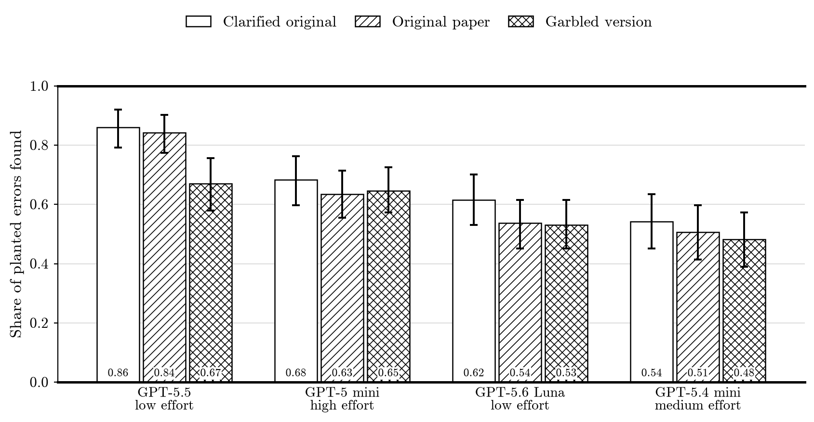
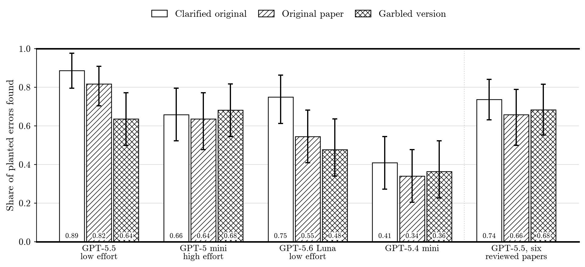

# Can a Reader That Catches Planted Errors Tell Whether a Paper Is Legible?

Jason Fantl, Averroes Labs · November 2026 · Part 2

*Preliminary internal results. This follows [Part 1](part-1-quiz.md).*

**TL;DR.** In Part 1, rewriting papers to be hard to follow barely lowered a model's quiz score. Here we tried a more direct test of legibility, following a suggestion from Jan Kirchner. We planted an error in a paper, asked a model to find it, and planted the same error in a garbled version of the same paper. If writing quality matters to the reader, it should find fewer errors in the garbled one. With the whole paper in view, three of our four readers found about as many errors in garbled text as in the originals. The strongest, GPT-5.5, found clearly fewer, both on the four papers we designed the test with and on six peer-reviewed papers that played no part in the design. Asked about every paragraph in turn, the readers caught most errors in every version, but all four flagged more correct paragraphs in the garbled versions. So bad writing rarely stops a model from judging an error, but it can cost a strong reader in search and make any reader more suspicious of correct text. Of the changes we tried, only the choice of reader moved a setting toward a calibrated test, so that is the lever to work with next.

## Why we tried catching errors

Part 1 asked whether a weak model with the paper open could answer questions that need understanding. Scrambled, convoluted rewrites lowered its scores by only about five points. A model holds the whole paper in context, so it can dig an answer out of bad prose that a person would give up on.

Jan Kirchner, whose [prover-verifier work](https://arxiv.org/abs/2407.13692) made model outputs easier for time-limited people to check, pointed out what a quiz misses. A reader that gives the right answer has not shown that it would notice a wrong one. On his view, a text is legible when the reader's answers are robustly correct, so a text written just as clearly but containing a mistake would not fool it.

His games trained a "sneaky" model to write such mistakes, which is tricky and possibly risky. We used his lighter alternative instead, planting errors from a small fixed set of templates. The hope was that catching an error needs the reader to hold a claim and its contradicting evidence together, which is exactly what hard writing gets in the way of.

## How we tested it

The test is as simple as we could make it. Plant one error in a paper and ask a weak model to review the paper for internal inconsistencies. Then plant the same error in a garbled version of the same paper and ask again, and repeat over many errors. If the reader finds fewer errors in the garbled version, its success depends on how the paper is written, which is what a legibility test needs. Nothing else is required, no quiz and no rewritten reference copy, only the paper, the errors and the reader.

**Papers.** Ten in all. The first four are the papers we started with, three of Part 1's arXiv preprints and the 2014 JMLR Dropout paper. We later added six papers accepted at peer-reviewed venues, drawn at random across lengths of about 4,000 to 15,000 words before anyone read them.

**Garbled versions.** Each stacks every kind of difficulty we had. It compresses the paper to about two thirds of its length, swaps terms for opaque codes, moves evidence away from the claims it supports, and leaves connecting steps unstated. GPT-6.1 Sol checked it against the original until no fact or number was lost.

**Clarified versions.** As a known more-legible standard, Sol also rewrote each original as a structured explainer, with a summary first, a glossary, and each claim listed with its evidence. A separate check against the original confirmed nothing was lost or added. The clarified version only calibrates the test. The test itself runs on the submitted paper alone.

**Errors.** GPT-6.1 Sol planted errors from seven templates, such as a wrong number, a reversed comparison or a claim stretched beyond what was tested, one error per copy, and kept only the ones it could find itself in the clarified versions, so every error is findable when the writing is clear. It did not have to find them in the garbled versions, since errors that garbling hides are what the test looks for. That left 82 errors across the ten papers.

**Readers.** We used OpenAI models only, the API we had. From strongest to weakest by how many errors they found, they were GPT-5.5 at low effort, GPT-5 mini at high effort, GPT-5.6 Luna at low effort and GPT-5.4 mini at medium effort, and every figure orders them that way. In the main test, each reader gets the whole paper and lists any internal inconsistencies, or none. Results 2 and 3 vary how the reader is asked and how much of the paper it can see. A cheap model graded whether each review named the planted error.

Everything here cost about $1,500 in API calls at OpenAI's list prices.

## Result 1: with the whole paper, only the strongest reader finds fewer errors in garbled text

**Figure 1.** Share of planted errors found by four readers (groups) reviewing the whole paper, pooled over all ten papers (82 errors), the four we designed the test with and six peer-reviewed papers that played no part in it. Plain bars are the clarified original, diagonal hatching the original, and crosshatching the garbled version. Whiskers are 95% intervals.

Each reader reviewed the whole paper and listed any internal inconsistencies. GPT-5 mini, GPT-5.6 Luna and GPT-5.4 mini found about as many errors in the garbled versions as in the originals. GPT-5.5 was the exception. It found 0.67 of the errors in the garbled versions against 0.84 in the originals, and the gap held on both sets of papers. Readers rarely accused clean papers of the planted errors.

For three readers that made almost no difference, which is Part 1's result again from a different direction. GPT-5.5's gap is the first sign that a reader with the whole paper in view can pay for bad writing, and the first result in this project to hold on papers outside the set we designed with. It is still one reader of four on ten papers, and its catch rates on the two versions remain close enough that it cannot yet sort a single paper as legible or not.

## Result 2: asked about every paragraph, readers catch most errors but flag more correct text when it is garbled

**Figure 2.** The reader has the whole paper and is asked about each paragraph in turn whether it is consistent with the rest. Top, the share of planted errors caught. Bottom, other paragraphs flagged per 1,000 words, including real inconsistencies already in the original papers. Hatching as in Figure 1. Whiskers are 95% intervals.

Result 2 removes the search step. The reader still has the whole paper, but we ask about every paragraph in turn, so it cannot miss an error by never looking at it. Because most paragraphs hold no error, this also measures how often the reader flags correct text.

The three stronger readers caught nearly every planted error this way in every version, so without the search, garbling no longer hid errors from them. GPT-5.4 mini, the weakest, caught somewhat fewer. Every reader flagged more correct paragraphs in the garbled versions than in the originals, about half again as many, and the fewest in the clarified ones. Some flags land on real contradictions in the original papers, such as a count given as one number in the abstract and another later, and these raise every version alike. The extra flags on garbled text are a second place a legibility signal could show up, next to missed errors.

We also told all four readers which passage holds the error and asked only about that passage. Each then judged the error about as well in garbled text as in the original. So what bad writing costs these readers lies in finding errors and in flagging correct text, not in judging them.

## Result 3: reading one section at a time, every reader found slightly fewer errors in garbled text

**Figure 3.** Share of planted errors found by readers that read each paper once, one section at a time, with notes of at most 300 words, pooled over all ten papers. Hatching and whiskers as in Figure 1.

Result 3 makes the reader read more like a person. It goes through the paper once, one section at a time, rewrites notes of at most 300 words after each section, and cannot look back. A code defined pages earlier, or evidence far from its claim, should then cost it something.

Every reader found slightly fewer errors in the garbled versions, but no gap was clearly larger than chance, and the two sets of papers disagreed about which readers showed one. Every reader found the most errors in the clarified versions, so reading section by section made the readers sensitive to clearer writing, but not reliably to worse writing.

## Toward a calibrated test

The line between legible and illegible is drawn by people. A paper they can follow should pass, and one they cannot should fail. We cannot move that line, but we can tune the test to match it. Two things are tunable: the weak reader (which model, how much effort, how much of the paper it sees and remembers) and the planted errors (what kind of mistake, and how far each sits from the evidence that contradicts it).

To calibrate, we would run a setting on text whose legibility to people we already know, such as published papers, which people can follow, and garbled versions, which they cannot. A calibrated setting catches most errors in the first and few in the second. We have not done this tuning yet. Every setting in this post was fixed before we ran it, so Figure 4 only maps where those settings landed.

**Figure 4.** Each point is one reader setting, pooled over all ten papers. Its position shows the share of planted errors caught in the original papers (horizontal) and in their garbled versions (vertical). Black points read the whole paper, blue points were asked about every paragraph, and ochre points read one section at a time. The shape shows which reader. On the dashed diagonal a setting cannot tell the two apart, and the green corner is the target.

Most settings sit near the diagonal. To calibrate, we need to know which changes move a setting off it and in which direction, so Figure 5 traces every change we have measured on the same map.

**Figure 5.** Each panel is the map of Figure 4, with the same axes, for one kind of change, pooled over all ten papers. Arrows run from the starting setting (open circle) to the changed one (filled circle). The last two panels split GPT-5.5's errors into three groups each, by the difficulty each was built at and by how far its contradicting evidence sits.

Only one change moved a setting off the diagonal, the choice of reader. GPT-5.5 is the one reader whose catch rate falls clearly on garbled text, and it stays below the diagonal whether it reads the whole paper or one section at a time. Its memory did not matter. Cutting its notes from 1,200 words to 300 cost it errors in both versions alike, so the setting slid along the diagonal with its gap unchanged. Everything else also slid settings along the diagonal or up to the top corner. Reading one section at a time made the weaker readers miss more errors in both versions, and telling readers where the error is moved them all to the ceiling.

The errors themselves gave little to work with. Splitting GPT-5.5's errors by difficulty or by distance to the evidence moved it around a small region below the diagonal, and no subset came near the target. These subsets are small, so we read nothing more into them.

None of this is specific to planted errors. Part 1's quiz can be calibrated the same way. Its score is also a weak reader's success on text, measured on originals and on hard-to-read rewrites, so each quiz setting is a point on the same map. There the tunable parts are the reader and the questions, such as how much of the paper an answer needs and how far apart the facts it combines sit. Part 1's readers lost about five points on the rewrites, which puts them near the diagonal, where most settings here sit too. Any test that scores a reader on text people can follow and text they cannot can be placed on this map and tuned toward the target in the same way.

## What this means

A direct test of legibility needs a reader that pays something for bad writing. With the whole paper in view, three of our four readers pay almost nothing. GPT-5.5 pays in finding errors, on new papers as well as the ones we designed with, though the cost is still too small to sort a single paper. Asked about every paragraph, all four readers pay in another way, by flagging more correct text when it is garbled.

Several parts of the test work, and all of them need nothing but the paper itself. Errors can be planted and checked automatically, readers rarely accuse clean papers of them, a cheap grader scores reviews reliably, and pointed questions separate finding an error from judging it.

The method may still work. Every reader found the most errors and raised the fewest false alarms in the clarified versions, so readers do respond to how text is written. A stronger reader was the one change that made a reader pay for bad writing in finding errors, and stronger readers keep arriving.

## Related work

Prover-verifier games ([Kirchner et al. 2024](https://arxiv.org/abs/2407.13692)) trained a helpful and a sneaky prover against a small verifier. Outputs trained this way became easier for time-limited people to check. We keep the small checker, but replace the trained sneaky prover with errors planted from fixed templates, as Jan Kirchner suggested.

Benchmarks of error detection in scientific papers ask whether a model can find real mistakes. They hold the paper fixed and test the reviewer, while we hold the reviewer fixed and vary the writing.

Other work has also found that writing which slows people barely touches models. OneStopQA rewrote the same articles at three reading levels with the same questions. People did worse on the hardest level, while a RoBERTa reader scored the same on all three ([Berzak et al. 2020](https://arxiv.org/abs/2004.14797)). Simplifying text helps people but lowered the accuracy of GPT-4o-mini and Llama-3.1-70B by up to 20 points ([Anschütz et al. 2025](https://aclanthology.org/2025.gem-1.70)). GPT-4 kept 88% of its question-answering accuracy when every word's inner letters were scrambled ([Cao et al. 2023](https://arxiv.org/abs/2311.18805)), and RoBERTa kept its answers on sentence pairs with words shuffled so badly that human experts did little better than chance ([Sinha et al. 2021](https://aclanthology.org/2021.acl-long.569)). What does hurt models is different from what hurts people. Shuffling the premises of a proof, adding one plausible but irrelevant clause, or making the reader link facts that share no words all cost strong models many points ([Chen et al. 2024](https://arxiv.org/abs/2402.08939); [Mirzadeh et al. 2024](https://arxiv.org/abs/2410.05229); [Modarressi et al. 2025](https://arxiv.org/abs/2502.05167)). Weaker models are far more fragile to scrambling, and GPT-3.5 lost half its accuracy where GPT-4 lost a tenth (Cao et al. 2023). Part 1's quiz result and this post's Result 1 fit that pattern.

People have been tested in pieces of this design, never as a whole. Peer reviewers given manuscripts with planted flaws report about a quarter to a third of them ([Godlee et al. 1998](https://europepmc.org/article/MED/9676667); [Schroter et al. 2008](https://pmc.ncbi.nlm.nih.gov/articles/PMC2586872)), and a checklist naming what to look for raises detection at the cost of more false alarms ([Chauvin et al. 2019](https://pmc.ncbi.nlm.nih.gov/articles/PMC6864983)). Students miss contradictions planted in short texts more often when the two statements sit far apart or need an inference to connect ([Baker 1985](https://files.eric.ed.gov/fulltext/ED237577.pdf); [Epstein et al. 1984](https://link.springer.com/article/10.3758/BF03198295)), which is what our garbling does. We found no study that plants the same error in clear and garbled versions of a text and asks people to find it.

## Limitations

- **Small samples.** Ten papers and 82 errors give intervals of about ±0.1 on each rate, so only large differences show up clearly.
- **Many tries.** We tried several readers and ways of asking, and in that many tries some result is likely to look good by chance. Section-by-section gaps appeared for one reader on one set of papers and not on the other. GPT-5.5's whole-paper gap held on both sets, but it is still one reader on ten papers. The false-alarm difference in Result 2 was not planned as a test before we saw it, and its intervals cover paragraphs, not differences between papers.
- **The garbled versions were not checked with people.** We assume they are hard for a person to follow, and Result 1 suggests they are not hard for most models. If they are easy for people too, the test was never really challenged.
- **Legibility to people is assumed, not measured.** We treat the original and peer-reviewed papers as legible because they were written and reviewed for people. We have not measured how people read them.
- **One provider.** Every reader, writer and grader was an OpenAI model, so their blind spots may be shared.
- **Our errors.** We chose the error templates. Two kinds, a result left out of a summary and a claim with no support, could not yet be tested properly, and naturally occurring errors may behave differently.
- **A strong model is the referee.** GPT-6.1 Sol built and checked the errors, the garbled versions and the clarified versions. Its own mistakes would pass into the results unnoticed.

The next step is to calibrate for real. We would try these levers on the first four papers, pick a setting by a rule fixed in advance, check it on the six reviewed papers, and only then run it once on nine papers held out from everything so far. The repository that accompanies this post holds the code, prompts, raw model outputs and every experiment's preregistered predictions, so each result here can be rerun. A detailed reference report written for AI agents, docs/part2-agent-report.md, gathers every number behind this post with its source, so an agent can answer questions about it without searching the repository.

---

Previous: [Part 1: Can a quiz test whether a paper is legible to humans?](part-1-quiz.md)
